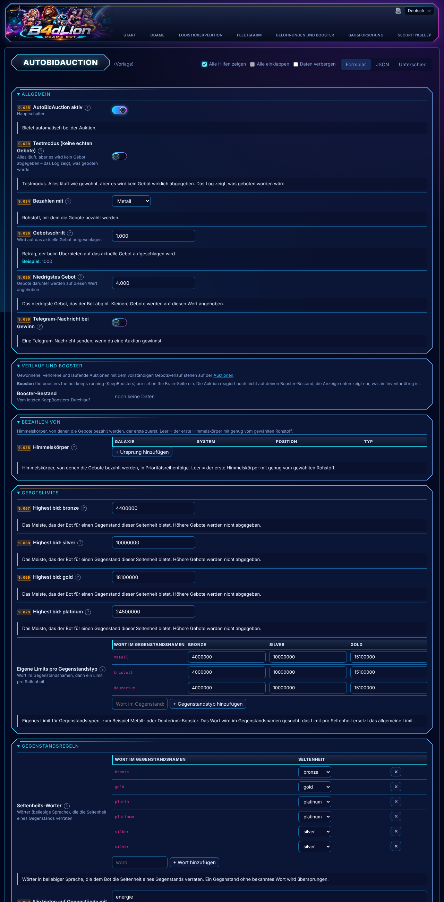

Pages: [Overview](README.md) · [Start](seite-start.md) · [Ogame](seite-ogame.md) · [Logistic & Expedition](seite-logistik.md) · [Fleet & Farm](seite-farm.md) · [Rewards and boosters](seite-belohnungen.md) · [Build & Research](seite-bauforschung.md) · [Security & Sleep](seite-sicherheit.md) · [Logging](seite-logging.md) · [Auctions](seite-auktionen.md) · [Experimental](seite-experimental.md) · [Bar and controls](seite-bedienung.md)

Fields: [General](felder-allgemein.md) · [Logistic & Expedition](felder-logistik.md) · [Fleet & Farm](felder-farm.md) · [Rewards and boosters](felder-belohnungen.md) · [Build & Research (Brain)](felder-bauforschung.md) · [Security & Sleep](felder-sicherheit.md) · **Auctions** · [Experimental](felder-experimental.md)

---

# Fields: Auctions

Automatic bidding in the auction house.

41 fields, as the B4dLion interface shows them (number = field number before the field name).

_Interface with template values, no real data._

## General

#### 9.025 AutoBidAuction active

`AutoBidAuction.Active` · Default: **no** · Switch · Master switch

Bids on the auction automatically.

#### 9.029 Test mode (no real bids)

`AutoBidAuction.DryRun` · Default: **no** · Switch · Everything runs, but no bid is placed - the log shows what would be bid

Test mode. Everything runs as usual, but no bid is really placed. The log shows what would have been bid.

#### 9.034 Pay with

`AutoBidAuction.BidResource` · Default: **“Metal”** · Text

Resource the bids are paid with.

#### 9.035 Lowest bid

`AutoBidAuction.MinBidFloor` · Default: **4000** · Number · Bids below this are raised to it

The lowest bid the bot places. Smaller bids are raised to this value.

#### 9.036 Bid step

`AutoBidAuction.BidIncrement` · Default: **1000** · Number · Added to the current bid

Amount added to the current bid when the bot raises.

**Example:** 1000

#### 9.039 Telegram message when won

`AutoBidAuction.NotifyTelegramOnWin` · Default: **no** · Switch

Send a Telegram message when you win an auction.

## Timing

#### 9.026 Longest pause, min (minutes)

`AutoBidAuction.CheckIntervalMin` · Default: **5** · Number · Waits longer than the max are shortened to a value in this range

Longest pause between two checks, lower value in minutes. A wait longer than the upper value (e.g. until the end of an auction the bot does not bid on) is shortened to a random value between the two. Shorter waits, e.g. in the last 5 minutes, stay as they are.

**Example:** 5

#### 9.027 Longest pause, max (minutes)

`AutoBidAuction.CheckIntervalMax` · Default: **10** · Number · 0 = no limit

Longest pause between two checks, upper value in minutes. 0 = no limit (the bot then sleeps until the end of the auction).

**Example:** 10

#### 9.030 Human Reaction Delay Min.

`AutoBidAuction.HumanReactionDelayMinMs` · Default: **0** · Number

Shortest delay in milliseconds before the bot answers a bid in the final phase. Makes it look human.

#### 9.031 Human Reaction Delay Max.

`AutoBidAuction.HumanReactionDelayMaxMs` · Default: **0** · Number

Longest such delay in milliseconds.

#### 9.032 Normal Bid Reaction Delay Min.

`AutoBidAuction.NormalBidReactionDelayMinMs` · Default: **0** · Number

Shortest delay in milliseconds before a normal bid (not the final phase).

#### 9.033 Normal Bid Reaction Delay Max.

`AutoBidAuction.NormalBidReactionDelayMaxMs` · Default: **0** · Number

Longest such delay in milliseconds.

## Pay from

#### 9.028 Celestial

`AutoBidAuction.Origin` · Default: **[]** · List

Celestials the bids are paid from, in priority order. Empty = the first celestial with enough of the chosen resource.

## More settings (4)

#### 9.037 BidEveryNthAuction

`AutoBidAuction.BidEveryNthAuction` · Default: **1** · Number

Only bid on every n-th auction (the bot counts the auctions it would otherwise bid on: not blocked by a forbidden word, with a cap). 1 = bid on every auction. The count starts again after a restart.

**Example:** 3 = bid on the 1st, 4th, 7th ... auction

#### 9.038 MaxBidsPerAuction

`AutoBidAuction.MaxBidsPerAuction` · Default: **0** · Number

Most own bids per auction. When reached, the bot stops bidding on that auction (it still wins if nobody outbids it). 0 = no limit. Keeps it out of bidding wars with 100 or more bids.

**Example:** 10

## Whitelist

#### 9.040 Whole alliance never outbid

`AutoBidAuction.AllianceWhitelist.Active` · Default: **no** · Switch · Member list is read from the public game API

Treat all members of your alliance like the whitelist. The member list comes from the public game API.

#### 9.041 Server host

`AutoBidAuction.AllianceWhitelist.ServerHost` · Default: **“sXXX-xx.ogame.gameforge.com”** · Text · Host of your universe

Host name of your universe.

**Example:** sNNN-xx.ogame.gameforge.com

#### 9.085 Player IDs never outbid

`AutoBidAuction.Whitelist` · Default: **[0]** · List · Comma separated

Player IDs that are never outbid: as soon as one of them is the highest bidder, the bot skips that item.

## Bid limits

#### 9.067 Highest bid: bronze

`AutoBidAuction.HighestBids.bronze` · Default: **4400000** · Number

The most the bot bids for an item of this rarity. Higher bids are not placed.

#### 9.068 Highest bid: silver

`AutoBidAuction.HighestBids.silver` · Default: **10000000** · Number

The most the bot bids for an item of this rarity. Higher bids are not placed.

#### 9.069 Highest bid: gold

`AutoBidAuction.HighestBids.gold` · Default: **18100000** · Number

The most the bot bids for an item of this rarity. Higher bids are not placed.

#### 9.070 Highest bid: platinum

`AutoBidAuction.HighestBids.platinum` · Default: **24500000** · Number

The most the bot bids for an item of this rarity. Higher bids are not placed.

## Item rules

#### 9.083 Never bid on items containing

`AutoBidAuction.ForbiddenWords` · Default: **["energie", "bronze"]** · List · One word per line

The bot never bids on items whose name contains one of these words.

#### 9.084 Ignore these bronze items

`AutoBidAuction.IgnoredBronzeItemNames` · Default: **[]** · List · One word per line

Bronze items with one of these words in the name are skipped.

## Bid war brake

#### 9.086 Bid war brake active

`AutoBidAuction.BidWar.Active` · Default: **yes** · Switch

Bid war brake. Stops bidding when someone keeps raising on purpose, so you do not pay far too much.

#### 9.087 Extra log lines

`AutoBidAuction.BidWar.Debug` · Default: **no** · Switch

Write extra lines about the brake into the log.

#### 9.088 Telegram message when braking

`AutoBidAuction.BidWar.NotifyTelegram` · Default: **no** · Switch

Send a Telegram message when the brake stops a bid.

#### 9.089 Watch window

`AutoBidAuction.BidWar.WindowSecs` · Default: **120** · Number

Length in seconds of the time window in which raises are counted.

#### 9.090 Raises in a row that start a war

`AutoBidAuction.BidWar.MinLadderSteps` · Default: **3** · Number

Number of raises in a row that count as a war.

#### 9.091 Growth that starts a war

`AutoBidAuction.BidWar.GrowthPct` · Default: **150** · Number

The bid counts as a war when it grows to this percentage of the start value.

#### 9.092 Reaction time

`AutoBidAuction.BidWar.ReactSecs` · Default: **10** · Number

Seconds the bot waits before it reacts to a suspected war.

#### 9.093 Same bidder counts as a war

`AutoBidAuction.BidWar.SameBidder` · Default: **yes** · Switch

Count it as a war when the same player raises again and again.

#### 9.094 Pause after braking

`AutoBidAuction.BidWar.CooldownSecs` · Default: **180** · Number

Seconds the bot stays quiet after the brake has triggered.

#### 9.095 Snipe window before the end (no effect, the game shows only whole minutes)

`AutoBidAuction.BidWar.SnipeSecs` · Default: **20** · Number

Last seconds of an auction in which the brake is relaxed so a final bid can still be placed. Practically without effect: the game shows the end only in whole minutes (the last bracket is 5 minutes), so a window of seconds is never reached. Leave it as it is.

#### 9.096 Check interval while paused

`AutoBidAuction.BidWar.PausePollSecs` · Default: **10** · Number

Seconds between checks while the brake is paused.

#### 9.097 Growth inside the window

`AutoBidAuction.BidWar.WindowGrowthPct` · Default: **300** · Number

Growth in percent inside the time window that counts as a war.

#### 9.098 Bids needed inside the window

`AutoBidAuction.BidWar.WindowMinBids` · Default: **3** · Number

Number of bids needed inside the window before it is judged.

#### 9.099 Jump factor

`AutoBidAuction.BidWar.JumpFactor` · Default: **3** · Number

A single raise this many times bigger than the usual step counts as a jump.

#### 9.100 Smallest jump that counts

`AutoBidAuction.BidWar.JumpMinAbs` · Default: **1000000** · Number

A jump counts only if it is at least this large in absolute value.

## Pause other workers at the end

#### 9.101 Pause other workers in the last 5 minutes

`AutoBidAuction.PauseOtherWorkersInFinalPhase.Active` · Default: **yes** · Switch

In the last 5 minutes of an auction other workers are delayed so they do not block the fast checks.

#### 9.102 Workers to pause

`AutoBidAuction.PauseOtherWorkersInFinalPhase.Features` · Default: **["BrainAutoMine", "BrainLifeformAutoMine", "BrainLifeformAutoResearch", "Brai…** · List · Comma separated, e.g. AutoFarm, Expeditions

Names of the workers that are delayed, for example AutoFarm, Expeditions.

