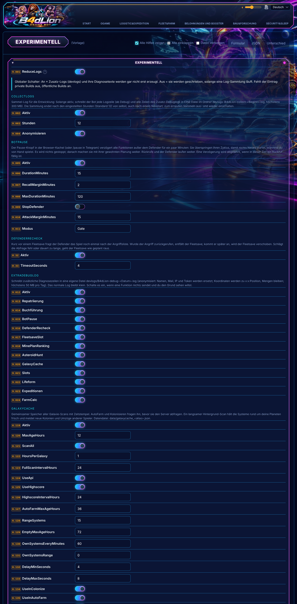

Pages: [Overview](README.md) · [Start](seite-start.md) · [Ogame](seite-ogame.md) · [Logistic & Expedition](seite-logistik.md) · [Fleet & Farm](seite-farm.md) · [Rewards and boosters](seite-belohnungen.md) · [Build & Research](seite-bauforschung.md) · [Security & Sleep](seite-sicherheit.md) · [Logging](seite-logging.md) · [Auctions](seite-auktionen.md) · **Experimental** · [Bar and controls](seite-bedienung.md)

Fields: [General](felder-allgemein.md) · [Logistic & Expedition](felder-logistik.md) · [Fleet & Farm](felder-farm.md) · [Rewards and boosters](felder-belohnungen.md) · [Build & Research (Brain)](felder-bauforschung.md) · [Security & Sleep](felder-sicherheit.md) · [Auctions](felder-auktionen.md) · [Experimental](felder-experimental.md)

---

# Slots (Experimental)

_Menu item: Slots (page of the group Experimental, no separate entry in the main bar)_

Shows the measured use of the fleet slots: once a minute the bot records who holds how many slots, and counts how often a function could not send because no slot was free. The page controls nothing; according to its text it is the basis for adjusting the slot limits later. The page belongs to the Experimental group and, according to the code, exists only in private builds (compiler switch SLOTS); the config start page links to it when the switch is set.

_Interface with template values, no real data._

## Slots

The only tab of the Experimental group. At the top are the period (1, 3, 7 or 14 days, default 7 days), the tick Without sleep and pause (on by default), Reset calculation and Hide data. The cards: Overview (slots total, in use on average and peak, free on average and minimum, time with no free slot at all and with at most one free), Who holds the slots (per function average, 95 %, peak, time at 0), Limits (limit, used, how often the limit was full), Proven demand (cycles with demand, too few slots, shortfall, rejected sends), Checks at the limit and the daily profile (average per hour, server time) as a bar chart. The view reloads every 2 minutes.

1. Choose the period and set or remove the tick Without sleep and pause as needed.
2. With several instances choose the instance and click Open.
3. Click Reset calculation and confirm the question to start from zero; the previous measurements stay as a backup file (slots_<alias>.jsonl.bak).
4. Hide data hides names in the instance list.

Fields: [General](felder-allgemein.md), [Build & Research (Brain)](felder-bauforschung.md), [Fleet & Farm](felder-farm.md)

## Notes

- Right after the start there are no measurements yet; the bot writes one line every minute, data appears after a few minutes.
- If all measurements of the period fall into sleep or pause, a matching note appears instead of the cards.
- The assignment to a function follows the cycle that sent the fleet; fleets of unknown origin (before a restart, manual) are sorted by mission.
- According to the reference you set the slot limits in the General block (SlotsToLeaveFree, SlotShift, SlotPriorityLevel) and with the workers' MaxSlots values; this page only shows the measurement.

