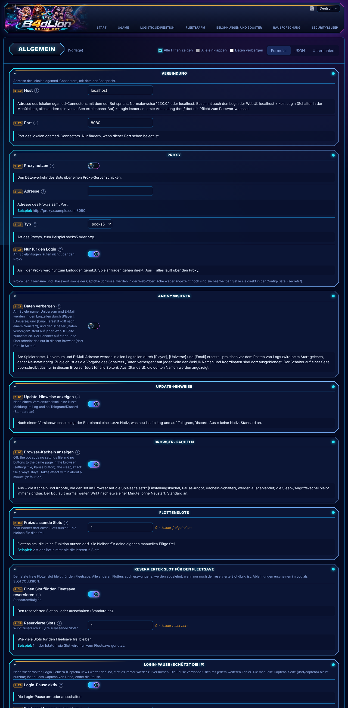

Seiten: [Übersicht](README.md) · [Start](seite-start.md) · [Ogame](seite-ogame.md) · [Logistic & Expedition](seite-logistik.md) · [Fleet & Farm](seite-farm.md) · [Rewards and boosters](seite-belohnungen.md) · [Build & Research](seite-bauforschung.md) · [Security & Sleep](seite-sicherheit.md) · [Logging](seite-logging.md) · [Auktionen](seite-auktionen.md) · [Leiste und Bedienung](seite-bedienung.md)

Felder: **Allgemein** · [Logistic & Expedition](felder-logistik.md) · [Fleet & Farm](felder-farm.md) · [Rewards and boosters](felder-belohnungen.md) · [Build & Research (Brain)](felder-bauforschung.md) · [Security & Sleep](felder-sicherheit.md) · [Auktionen](felder-auktionen.md)

---

# Felder: Allgemein

Einstellungen, die allgemein gelten: Verbindung, Proxy, Anonymisierer, Slot-Verteilung und Benachrichtigungen (Discord, Telegram).

23 Felder, so wie die B4dLion-Oberfläche sie zeigt (Nummer = Feldnummer vor dem Feldnamen).

_Oberfläche mit Vorlagen-Werten, ohne echte Daten._

## Verbindung

#### 1.019 Host

`General.Host` · Standard: **„localhost“** · Text

Adresse des lokalen ogamed-Connectors, mit dem der Bot spricht. Normalerweise 127.0.0.1 oder localhost. Bestimmt auch den Login der WebUI: localhost = kein Login (Schalter in der Menüleiste), alles andere (ein von außen erreichbarer Bot) = Login immer an, erste Anmeldung tbot / tbot mit Pflicht zum Passwortwechsel.

#### 1.020 Port

`General.Port` · Standard: **„8080“** · Text

Port des lokalen ogamed-Connectors. Nur ändern, wenn dieser Port schon belegt ist.

## Proxy

#### 1.021 Proxy nutzen

`General.Proxy.Enabled` · Standard: **nein** · Schalter

Den Datenverkehr des Bots über einen Proxy-Server schicken.

#### 1.022 Adresse

`General.Proxy.Address` · Standard: **(leer)** · Text

Adresse des Proxys samt Port.

**Beispiel:** http://proxy.example.com:8080

#### 1.023 Typ

`General.Proxy.Type` · Standard: **„socks5“** · Text

Art des Proxys, zum Beispiel socks5 oder http.

#### 1.026 Nur für den Login

`General.Proxy.LoginOnly` · Standard: **ja** · Schalter · An: Spielanfragen laufen nicht über den Proxy

An = der Proxy wird nur zum Einloggen genutzt, Spielanfragen gehen direkt. Aus = alles läuft über den Proxy.

## Anonymisierer

#### 1.028 Daten verbergen

`General.AnonymizeLogs` · Standard: **nein** · Schalter · An: Spielername, Universum und E-Mail werden in den Logzeilen durch [Player], [Universe] und [Email] ersetzt (gilt nach einem Neustart), und der Schalter „Daten verbergen“ steht auf jeder WebUI-Seite zunächst an. Der Schalter auf einer Seite überschreibt das nur in diesem Browser (dort für alle Seiten)

An: Spielername, Universum und E-Mail-Adresse werden in allen Logzeilen durch [Player], [Universe] und [Email] ersetzt - praktisch vor dem Posten von Logs (wird beim Start gelesen, daher Neustart nötig). Zugleich ist es die Vorgabe des Schalters „Daten verbergen“ auf jeder Seite der WebUI: Namen und Koordinaten sind dort ausgeblendet. Der Schalter auf einer Seite überschreibt das nur in diesem Browser (dort für alle Seiten). Aus (Standard): die echten Namen werden angezeigt.

## Login-Pause (schützt die IP)

#### 1.029 Login-Pause aktiv

`General.LoginPause.Active` · Standard: **ja** · Schalter

Die Login-Pause an- oder ausschalten.

#### 1.030 Fehlgeschlagene Logins bis zur ersten Pause

`General.LoginPause.FailuresBeforePause` · Standard: **2** · Zahl

Fehlgeschlagene Logins in Folge bis zur ersten Pause.

#### 1.031 Erste Pause

`General.LoginPause.PauseMinutes` · Standard: **30** · Zahl · Verdoppelt sich mit jedem weiteren Fehler

Länge der ersten Pause in Minuten. Verdoppelt sich mit jedem weiteren Fehler.

#### 1.032 Längste Verzögerung

`General.LoginPause.MaxPauseMinutes` · Standard: **120** · Zahl

Längste Pause in Minuten.

## Update-Hinweise

#### 2.001 Update-Hinweise anzeigen

`General.ShowUpdateNotes` · Standard: **ja** · Schalter · Nach einem Versionswechsel: eine kurze Meldung im Log und an Telegram/Discord (Standard an)

Nach einem Versionswechsel zeigt der Bot einmal eine kurze Notiz, was neu ist, im Log und auf Telegram/Discord. Aus = keine Notiz. Standard an.

## Browser-Kacheln

#### 2.002 Browser-Kacheln anzeigen

`General.ShowBrowserTiles` · Standard: **ja** · Schalter · Off: the bot adds no settings tile and no buttons to the game page in the browser (settings tile, Pause button); the sleep/attack tile always stays. Takes effect within about a minute (default on)

Aus = die Kacheln und Knöpfe, die der Bot im Browser auf die Spielseite setzt (Einstellungskachel, Pause-Knopf, Kacheln-Schalter), werden ausgeblendet; die Sleep-/Angriffskachel bleibt immer sichtbar. Der Bot läuft normal weiter. Wirkt nach etwa einer Minute, ohne Neustart. Standard an.

## Flottenslots

#### 2.003 Freizulassende Slots

`General.SlotsToLeaveFree` · Standard: **1** · Zahl · Kein Worker darf diese Slots nutzen – sie bleiben für dich frei

Flottenslots, die keine Funktion nutzen darf. Sie bleiben für deine eigenen manuellen Flüge frei.

**Beispiel:** 2 = der Bot nimmt nie die letzten 2 Slots.

## Slot shift Brain <-> AutoFarm

#### 2.004 Automatische Slot-Verschiebung

`General.SlotShift.Active` · Standard: **ja** · Schalter

Hauptschalter dieser Funktion. Aus = der Bot macht hier nichts.

#### 2.005 Höchstens zusätzliche Slots

`General.SlotShift.MaxExtraSlots` · Standard: **6** · Zahl · How far a limit may be raised above its MaxSlots (the free slots in the game still bound it)

_Noch keine Beschreibung._

#### 2.006 Brain im Leerlauf nach

`General.SlotShift.IdleReleaseMinutes` · Standard: **10** · Zahl · Ein Brain ohne Transporte und ohne Slot-Anfragen gibt nach dieser Zeit seine ungenutzte Reserve an die anderen ab

_Noch keine Beschreibung._

#### 2.007 Erhöhung hält für

`General.SlotShift.PressureMinutes` · Standard: **5** · Zahl · Ohne weiteren Druck fällt ein erhöhtes Limit nach dieser Zeit auf MaxSlots zurück

_Noch keine Beschreibung._

#### 2.008 Brain-Reserve freigeben bis

`General.SlotShift.WakeLeadMinutes` · Standard: **20** · Zahl · The building/research workers sleep until their running builds end. If none of them wakes within this many minutes and no transport is flying, Brain reserves no slots for the others (0 = off)

_Noch keine Beschreibung._

#### 2.009 Einen Slot für einen wartenden Worker freihalten

`General.SlotShift.ClaimMinutes` · Standard: **10** · Zahl · A worker at its transport limit gets the next free game slot: the others (and the farm) do not take the last free one for this long, and the farm limit drops by 1 while no slot is free (0 = off)

_Noch keine Beschreibung._

## Discord

#### 2.054 Discord active

`DiscordWebhook.Active` · Standard: **nein** · Schalter · Einschalten, um die Optionen zu zeigen und zu bearbeiten

Die Telegram-Nachrichten nach Discord kopieren. Das sendet nur; Befehle laufen weiter über Telegram.

#### 2.055 Webhook-URL

`DiscordWebhook.Url` · Standard: **„https://discord.com/api/webhooks/WEBHOOK_ID/WEBHOOK_TOKEN“** · Text · Kanaleinstellungen > Integrationen > Webhooks

Webhook-Adresse deines Discord-Kanals. Behandle sie wie ein Passwort.

#### 2.056 Anzeigename

`DiscordWebhook.Username` · Standard: **„B4dLion“** · Text · Name, der bei den Discord-Beiträgen angezeigt wird

Name, der als Absender der Discord-Nachrichten angezeigt wird.

