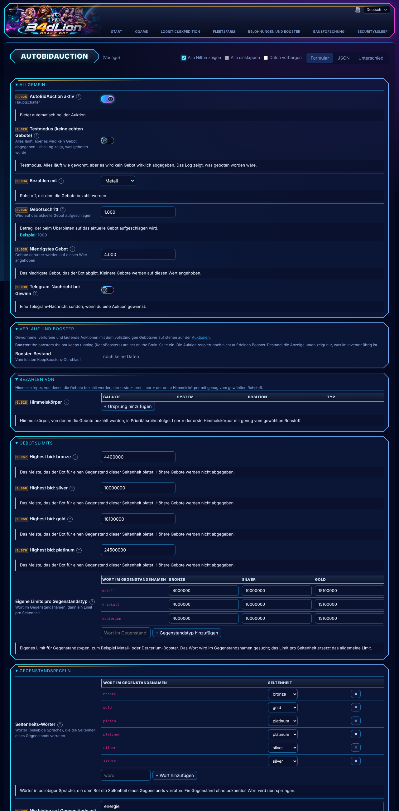

Seiten: [Übersicht](README.md) · [Start](seite-start.md) · [Ogame](seite-ogame.md) · [Logistic & Expedition](seite-logistik.md) · [Fleet & Farm](seite-farm.md) · [Rewards and boosters](seite-belohnungen.md) · [Build & Research](seite-bauforschung.md) · [Security & Sleep](seite-sicherheit.md) · [Logging](seite-logging.md) · [Auktionen](seite-auktionen.md) · [Leiste und Bedienung](seite-bedienung.md)

Felder: [Allgemein](felder-allgemein.md) · [Logistic & Expedition](felder-logistik.md) · [Fleet & Farm](felder-farm.md) · [Rewards and boosters](felder-belohnungen.md) · [Build & Research (Brain)](felder-bauforschung.md) · [Security & Sleep](felder-sicherheit.md) · **Auktionen** · [Experimental](felder-experimental.md)

---

# Felder: Auktionen

Automatisches Bieten im Auktionshaus.

41 Felder, so wie die B4dLion-Oberfläche sie zeigt (Nummer = Feldnummer vor dem Feldnamen).

_Oberfläche mit Vorlagen-Werten, ohne echte Daten._

## Allgemein

#### 9.025 AutoBidAuction aktiv

`AutoBidAuction.Active` · Standard: **nein** · Schalter · Hauptschalter

Bietet automatisch bei der Auktion.

#### 9.029 Testmodus (keine echten Gebote)

`AutoBidAuction.DryRun` · Standard: **nein** · Schalter · Alles läuft, aber es wird kein Gebot abgegeben – das Log zeigt, was geboten würde

Testmodus. Alles läuft wie gewohnt, aber es wird kein Gebot wirklich abgegeben. Das Log zeigt, was geboten worden wäre.

#### 9.034 Bezahlen mit

`AutoBidAuction.BidResource` · Standard: **„Metal“** · Text

Rohstoff, mit dem die Gebote bezahlt werden.

#### 9.035 Niedrigstes Gebot

`AutoBidAuction.MinBidFloor` · Standard: **4000** · Zahl · Gebote darunter werden auf diesen Wert angehoben

Das niedrigste Gebot, das der Bot abgibt. Kleinere Gebote werden auf diesen Wert angehoben.

#### 9.036 Gebotsschritt

`AutoBidAuction.BidIncrement` · Standard: **1000** · Zahl · Wird auf das aktuelle Gebot aufgeschlagen

Betrag, der beim Überbieten auf das aktuelle Gebot aufgeschlagen wird.

**Beispiel:** 1000

#### 9.039 Telegram-Nachricht bei Gewinn

`AutoBidAuction.NotifyTelegramOnWin` · Standard: **nein** · Schalter

Eine Telegram-Nachricht senden, wenn du eine Auktion gewinnst.

## Zeitverhalten

#### 9.026 Longest pause, min (minutes)

`AutoBidAuction.CheckIntervalMin` · Standard: **5** · Zahl · Wartezeiten über dem Maximum werden auf einen Wert in diesem Bereich gekürzt

Kürzeste Pause in Minuten zwischen zwei Durchläufen dieser Funktion.

#### 9.027 Longest pause, max (minutes)

`AutoBidAuction.CheckIntervalMax` · Standard: **10** · Zahl · 0 = keine Grenze

Längste Pause in Minuten zwischen zwei Durchläufen. Der Bot wählt eine zufällige Zeit zwischen Minimum und Maximum, damit er nicht wie eine Uhr arbeitet.

#### 9.030 Human Reaction Delay Min.

`AutoBidAuction.HumanReactionDelayMinMs` · Standard: **0** · Zahl

Kürzeste Verzögerung in Millisekunden, bevor der Bot in der Endphase auf ein Gebot antwortet. Wirkt menschlich.

#### 9.031 Human Reaction Delay Max.

`AutoBidAuction.HumanReactionDelayMaxMs` · Standard: **0** · Zahl

Längste solche Verzögerung in Millisekunden.

#### 9.032 Normal Bid Reaction Delay Min.

`AutoBidAuction.NormalBidReactionDelayMinMs` · Standard: **0** · Zahl

Kürzeste Verzögerung in Millisekunden vor einem normalen Gebot (nicht Endphase).

#### 9.033 Normal Bid Reaction Delay Max.

`AutoBidAuction.NormalBidReactionDelayMaxMs` · Standard: **0** · Zahl

Längste solche Verzögerung in Millisekunden.

## Bezahlen von

#### 9.028 Himmelskörper

`AutoBidAuction.Origin` · Standard: **[]** · Liste

Himmelskörper, von denen die Gebote bezahlt werden, in Prioritätsreihenfolge. Leer = der erste Himmelskörper mit genug vom gewählten Rohstoff.

## More settings (4)

#### 9.037 BidEveryNthAuction

`AutoBidAuction.BidEveryNthAuction` · Standard: **1** · Zahl

Nur bei jeder n-ten Auktion mitbieten (gezählt werden Auktionen, auf die der Bot sonst bieten würde: nicht durch ein verbotenes Wort gesperrt, mit Obergrenze). 1 = auf jede Auktion bieten. Nach einem Neustart beginnt die Zählung neu.

**Beispiel:** 3 = bei der 1., 4., 7. ... Auktion bieten

#### 9.038 MaxBidsPerAuction

`AutoBidAuction.MaxBidsPerAuction` · Standard: **0** · Zahl

Höchstzahl eigener Gebote je Auktion. Ist sie erreicht, bietet der Bot auf diese Auktion nicht weiter (er gewinnt sie trotzdem, wenn ihn keiner überbietet). 0 = keine Grenze. Hält ihn aus Bietergefechten mit 100 oder mehr Geboten heraus.

**Beispiel:** 10

## Whitelist

#### 9.040 Ganze Allianz nie überbieten

`AutoBidAuction.AllianceWhitelist.Active` · Standard: **nein** · Schalter · Die Mitgliederliste wird aus der öffentlichen Spiel-API gelesen

Alle Mitglieder deiner Allianz wie die Whitelist behandeln. Die Mitgliederliste kommt aus der öffentlichen Spiel-API.

#### 9.041 Server-Host

`AutoBidAuction.AllianceWhitelist.ServerHost` · Standard: **„sXXX-xx.ogame.gameforge.com“** · Text · Host deines Universums

Hostname deines Universums.

**Beispiel:** sNNN-xx.ogame.gameforge.com

#### 9.085 Spieler-IDs, die nie überboten werden

`AutoBidAuction.Whitelist` · Standard: **[0]** · Liste · Kommagetrennt

Spieler-IDs, die nie überboten werden. Überbietet dich so ein Spieler absichtlich dreimal, gibt der Bot diesen Gegenstand auf.

## Gebotslimits

#### 9.067 Highest bid: bronze

`AutoBidAuction.HighestBids.bronze` · Standard: **4400000** · Zahl

Das Meiste, das der Bot für einen Gegenstand dieser Seltenheit bietet. Höhere Gebote werden nicht abgegeben.

#### 9.068 Highest bid: silver

`AutoBidAuction.HighestBids.silver` · Standard: **10000000** · Zahl

Das Meiste, das der Bot für einen Gegenstand dieser Seltenheit bietet. Höhere Gebote werden nicht abgegeben.

#### 9.069 Highest bid: gold

`AutoBidAuction.HighestBids.gold` · Standard: **18100000** · Zahl

Das Meiste, das der Bot für einen Gegenstand dieser Seltenheit bietet. Höhere Gebote werden nicht abgegeben.

#### 9.070 Highest bid: platinum

`AutoBidAuction.HighestBids.platinum` · Standard: **24500000** · Zahl

Das Meiste, das der Bot für einen Gegenstand dieser Seltenheit bietet. Höhere Gebote werden nicht abgegeben.

## Gegenstandsregeln

#### 9.083 Nie bieten auf Gegenstände mit

`AutoBidAuction.ForbiddenWords` · Standard: **["energie", "bronze"]** · Liste · Ein Wort pro Zeile

Der Bot bietet nie auf Gegenstände, deren Name eines dieser Wörter enthält.

#### 9.084 Diese Bronze-Gegenstände ignorieren

`AutoBidAuction.IgnoredBronzeItemNames` · Standard: **[]** · Liste · Ein Wort pro Zeile

Bronze-Gegenstände mit einem dieser Wörter im Namen werden übersprungen.

## Bietergefecht-Bremse

#### 9.086 Bietergefecht-Bremse aktiv

`AutoBidAuction.BidWar.Active` · Standard: **ja** · Schalter

Bietergefecht-Bremse. Hört auf zu bieten, wenn jemand absichtlich immer weiter erhöht, damit du nicht viel zu viel zahlst.

#### 9.087 Zusätzliche Logzeilen

`AutoBidAuction.BidWar.Debug` · Standard: **nein** · Schalter

Zusätzliche Zeilen zur Bremse ins Log schreiben.

#### 9.088 Telegram-Nachricht beim Bremsen

`AutoBidAuction.BidWar.NotifyTelegram` · Standard: **nein** · Schalter

Eine Telegram-Nachricht senden, wenn die Bremse ein Gebot stoppt.

#### 9.089 Beobachtungsfenster

`AutoBidAuction.BidWar.WindowSecs` · Standard: **120** · Zahl

Länge des Zeitfensters in Sekunden, in dem Erhöhungen gezählt werden.

#### 9.090 Erhöhungen in Folge, die ein Gefecht auslösen

`AutoBidAuction.BidWar.MinLadderSteps` · Standard: **3** · Zahl

Zahl der Erhöhungen in Folge, die als Gefecht zählen.

#### 9.091 Wachstum, das ein Gefecht auslöst

`AutoBidAuction.BidWar.GrowthPct` · Standard: **150** · Zahl

Das Gebot zählt als Gefecht, wenn es auf diesen Prozentsatz des Startwerts wächst.

#### 9.092 Reaktionszeit

`AutoBidAuction.BidWar.ReactSecs` · Standard: **10** · Zahl

Sekunden, die der Bot wartet, bevor er auf ein vermutetes Gefecht reagiert.

#### 9.093 Derselbe Bieter zählt als Gefecht

`AutoBidAuction.BidWar.SameBidder` · Standard: **ja** · Schalter

Als Gefecht werten, wenn derselbe Spieler immer wieder erhöht.

#### 9.094 Pause nach dem Bremsen

`AutoBidAuction.BidWar.CooldownSecs` · Standard: **180** · Zahl

Sekunden, die der Bot ruhig bleibt, nachdem die Bremse ausgelöst hat.

#### 9.095 Snipe window before the end (no effect, the game shows only whole minutes)

`AutoBidAuction.BidWar.SnipeSecs` · Standard: **20** · Zahl

Letzte Sekunden einer Auktion, in denen die Bremse gelockert ist, damit noch ein Schlussgebot möglich ist. Praktisch ohne Wirkung: das Spiel zeigt das Ende nur in ganzen Minuten (letzte Stufe 5 Minuten), ein Fenster in Sekunden wird nie erreicht. Am besten unverändert lassen.

#### 9.096 Prüfintervall während der Pause

`AutoBidAuction.BidWar.PausePollSecs` · Standard: **10** · Zahl

Sekunden zwischen den Prüfungen, solange die Bremse pausiert.

#### 9.097 Wachstum im Fenster

`AutoBidAuction.BidWar.WindowGrowthPct` · Standard: **300** · Zahl

Wachstum in Prozent innerhalb des Zeitfensters, das als Gefecht zählt.

#### 9.098 Nötige Gebote im Zeitfenster

`AutoBidAuction.BidWar.WindowMinBids` · Standard: **3** · Zahl

Zahl der Gebote, die im Fenster nötig sind, bevor beurteilt wird.

#### 9.099 Sprungfaktor

`AutoBidAuction.BidWar.JumpFactor` · Standard: **3** · Zahl

Eine einzelne Erhöhung, die so oft größer ist als der übliche Schritt, zählt als Sprung.

#### 9.100 Kleinster Sprung, der zählt

`AutoBidAuction.BidWar.JumpMinAbs` · Standard: **1000000** · Zahl

Ein Sprung zählt nur, wenn er absolut mindestens so groß ist.

## Andere Worker am Ende pausieren

#### 9.101 Andere Worker in den letzten 5 Minuten pausieren

`AutoBidAuction.PauseOtherWorkersInFinalPhase.Active` · Standard: **ja** · Schalter

In den letzten 5 Minuten einer Auktion werden andere Worker verzögert, damit sie die schnellen Prüfungen nicht blockieren.

#### 9.102 Zu pausierende Worker

`AutoBidAuction.PauseOtherWorkersInFinalPhase.Features` · Standard: **["BrainAutoMine", "BrainLifeformAutoMine", "BrainLifeformAutoResearch", "Brai…** · Liste · Kommagetrennt, z. B. AutoFarm, Expeditions

Namen der Worker, die verzögert werden, zum Beispiel AutoFarm, Expeditions.

