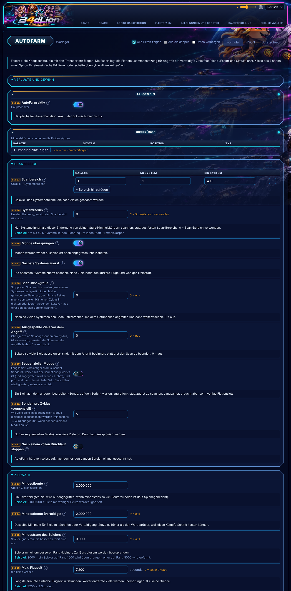

Seiten: [Übersicht](README.md) · [Start](seite-start.md) · [Ogame](seite-ogame.md) · [Logistic & Expedition](seite-logistik.md) · [Fleet & Farm](seite-farm.md) · [Rewards and boosters](seite-belohnungen.md) · [Build & Research](seite-bauforschung.md) · [Security & Sleep](seite-sicherheit.md) · [Logging](seite-logging.md) · [Auktionen](seite-auktionen.md) · [Leiste und Bedienung](seite-bedienung.md)

Felder: [Allgemein](felder-allgemein.md) · [Logistic & Expedition](felder-logistik.md) · **Fleet & Farm** · [Rewards and boosters](felder-belohnungen.md) · [Build & Research (Brain)](felder-bauforschung.md) · [Security & Sleep](felder-sicherheit.md) · [Auktionen](felder-auktionen.md)

---

# Felder: Fleet & Farm

AutoFarm (Spionage und Angriff, Eskorte, Sperrliste) und Trümmerfeld-Ernte.

108 Felder, so wie die B4dLion-Oberfläche sie zeigt (Nummer = Feldnummer vor dem Feldnamen).

_Oberfläche mit Vorlagen-Werten, ohne echte Daten._

## Allgemein

#### 6.001 AutoFarm aktiv

`AutoFarm.Active` · Standard: **nein** · Schalter · Hauptschalter

Hauptschalter dieser Funktion. Aus = der Bot macht hier nichts.

## Scanbereich

#### 6.003 Scanbereich

`AutoFarm.ScanRange` · Standard: **[{"Galaxy": 1, "StartSystem": 1, "EndSystem": 499}]** · Liste · Galaxie- / Systembereiche

Galaxie- und Systembereiche, die nach Zielen gescannt werden.

#### 6.004 Systemradius

`AutoFarm.SystemRange` · Standard: **0** · Zahl · Um den Ursprung; ersetzt den Scanbereich (0 = aus)

Nur Systeme innerhalb dieser Entfernung von deinen Start-Himmelskörpern scannen, statt des festen Scan-Bereichs. 0 = Scan-Bereich verwenden.

**Beispiel:** 5 = bis zu 5 Systeme in jede Richtung um jeden Start-Himmelskörper.

#### 6.006 Monde überspringen

`AutoFarm.ExcludeMoons` · Standard: **ja** · Schalter

Monde werden weder ausspioniert noch angegriffen, nur Planeten.

#### 6.007 Nächste Systeme zuerst

`AutoFarm.DistanceBasedScanOrder` · Standard: **ja** · Schalter

Die nächsten Systeme zuerst scannen. Nahe Ziele bedeuten kürzere Flüge und weniger Treibstoff.

#### 6.008 Scan-Blockgröße

`AutoFarm.ScanBlockSize` · Standard: **0** · Zahl · Stoppt den Scan nach so vielen gescannten Systemen und greift mit den bisher gefundenen Zielen an; der nächste Zyklus macht dort weiter. Hält einen Zyklus in dichten oder leeren Gegenden kurz. 0 = aus (erst den ganzen Bereich scannen).

Nach so vielen Systemen den Scan unterbrechen, mit dem Gefundenen angreifen und dann weitermachen. 0 = aus.

#### 6.009 Ausgespähte Ziele vor dem Angriff

`AutoFarm.TargetsProbedBeforeAttack` · Standard: **0** · Zahl · Obergrenze an Spionagesonden pro Zyklus; ist sie erreicht, pausiert der Scan und die Angriffe laufen. 0 = kein Limit.

Sobald so viele Ziele ausspioniert sind, mit dem Angriff beginnen, statt erst den Scan zu beenden. 0 = aus.

#### 6.010 Sequenzieller Modus

`AutoFarm.SequentialMode` · Standard: **nein** · Schalter · Langsamer, vorsichtiger Modus: sendet Sonde(n), wartet, bis der Bericht ausgewertet ist (und angegriffen wird, wenn es lohnt), und prüft erst dann das nächste Ziel. „Slots füllen“ wird ignoriert, solange er an ist.

Ein Ziel nach dem anderen bearbeiten (Sonde, auf den Bericht warten, angreifen), statt zuerst zu scannen. Langsamer, braucht aber sehr wenige Flottenslots.

#### 6.011 Sonden pro Zyklus (sequenziell)

`AutoFarm.SequentialModeProbesPerCycle` · Standard: **5** · Zahl · Wie viele Ziele im sequenziellen Modus gleichzeitig ausgespäht werden (mindestens 1). Wird nur genutzt, wenn der sequenzielle Modus an ist.

Nur im sequenziellen Modus: wie viele Ziele pro Durchlauf ausspioniert werden.

#### 6.012 Nach einem vollen Durchlauf stoppen

`AutoFarm.StopAfterFullScan` · Standard: **nein** · Schalter

AutoFarm hört von selbst auf, nachdem es den ganzen Bereich einmal gescannt hat.

## Zielwahl

#### 6.013 Mindestbeute

`AutoFarm.MinimumResources` · Standard: **2000000** · Zahl · Um ein Ziel anzugreifen

Ein unverteidigtes Ziel wird nur angegriffen, wenn mindestens so viel Beute zu holen ist (laut Spionagebericht).

**Beispiel:** 2.000.000 = Ziele mit weniger Beute werden ignoriert.

#### 6.014 Mindestbeute (verteidigt)

`AutoFarm.MinimumResourcesDefended` · Standard: **2000000** · Zahl

Dasselbe Minimum für Ziele mit Schiffen oder Verteidigung. Setze es höher als den Wert darüber, weil diese Kämpfe Schiffe kosten können.

#### 6.015 Mindestrang des Spielers

`AutoFarm.MinimumPlayerRank` · Standard: **3000** · Zahl · Spieler ignorieren, die besser platziert sind als

Spieler mit einem besseren Rang (kleinere Zahl) als diesem werden übersprungen.

**Beispiel:** 3000 = ein Spieler auf Rang 1500 wird übersprungen, einer auf Rang 5000 wird gefarmt.

#### 6.016 Max. Flugzeit

`AutoFarm.MaxFlightTime` · Standard: **7200** · Zahl · 0 = keine Grenze

Längste erlaubte einfache Flugzeit in Sekunden. Weiter entfernte Ziele werden übersprungen. 0 = keine Grenze.

**Beispiel:** 7200 = 2 Stunden.

#### 6.017 Min. Verhältnis Beute / Treibstoff

`AutoFarm.MinLootFuelRatio` · Standard: **1.5** · Zahl

Die Beute muss mindestens so viel wert sein wie der Treibstoff, multipliziert mit diesem Faktor. Der Bot wählt die schnellste Geschwindigkeit, die das noch erfüllt.

**Beispiel:** 1,5 = bei 100.000 Deuterium Treibstoff müssen mindestens 150.000 Beute da sein.

#### 6.018 Bevorzugter Rohstoff

`AutoFarm.PreferedResource` · Standard: **(leer)** · Text · Sortiert die Ziele danach

Ziele mit dem meisten dieses Rohstoffs kommen zuerst. Leer = keine Vorliebe.

#### 6.019 Verteidigte Ziele angreifen

`AutoFarm.AttackDefendedTargets` · Standard: **ja** · Schalter · Braucht die Escort-Simulation

Auch Ziele mit Schiffen oder Verteidigung angreifen. Der Bot simuliert den Kampf und schickt eine Eskorte aus Kriegsschiffen mit den Frachtern. Braucht die Eskorte-Einstellungen weiter unten.

**Beispiel:** Kostet mehr Deuterium und kann Schiffe verlieren.

#### 6.020 Max. Verteidigungspunkte

`AutoFarm.MaxDefensePoints` · Standard: **50000000** · Zahl

Ziele, deren Verteidigung mehr wert ist als dieser Wert, werden übersprungen.

#### 6.021 Min. Beute pro Verteidigungspunkt

`AutoFarm.MinLootPerDefensePoint` · Standard: **20** · Zahl

Verteidigte Ziele werden übersprungen, wenn ihre Beute im Verhältnis zur Verteidigung zu klein ist. Höher = wählerischer.

#### 6.022 Bericht gültig für

`AutoFarm.KeepReportFor` · Standard: **1440** · Zahl

Minuten, die ein Spionagebericht gültig bleibt, bevor das Ziel erneut ausspioniert werden muss.

#### 6.023 Ungeeignete Ziele erneut prüfen nach

`AutoFarm.NotSuitableRetryMinutes` · Standard: **720** · Zahl

Minuten, nach denen ein als ungeeignet erkanntes Ziel (Beute zu klein, lohnt nicht) erneut ausspioniert wird. Es zählt der kürzere Wert aus diesem und der Berichtsgültigkeit, damit tägliche Läufe solche Ziele wieder erreichen. 0 = wie die Berichtsgültigkeit.

#### 6.024 Alte Berichte im Spiel löschen

`AutoFarm.DeleteExpiredReports` · Standard: **ja** · Schalter · Abgelaufene und ersetzte Spionageberichte werden gelöscht; gehaltene und wegen Verteidigung gesperrte Ziele behalten ihre

Löscht Spionageberichte im Spiel, die älter als die Berichtsgültigkeit oder durch einen neueren Bericht desselben Ziels ersetzt sind, damit sie sich nicht im Posteingang ansammeln (höchstens 50 pro Durchlauf). Berichte von Zielen mit manueller Prüfung oder Sperrliste wegen Verteidigung/Unrentabilität bleiben stehen.

## Erweiterte Optionen

#### 6.025 Max. Berichtsalter für Angriff

`AutoFarm.MaxReportAgeMinutesForAttack` · Standard: **120** · Zahl · Ältere Berichte werden nicht angegriffen (0 = aus)

Direkt vor einem Angriff wird ein älterer Bericht verworfen und das Ziel erneut ausspioniert, weil sich die Verteidigung geändert haben kann. 0 = aus.

#### 6.026 Alle Berichte verarbeiten

`AutoFarm.ProcessAllReports` · Standard: **ja** · Schalter · Also evaluate reports of targets B4dLion did not probe itself (manual probes)

Berichte zu Zielen, die B4dLion nicht selbst ausspioniert hat (z.B. manuelle Sonden), trotzdem auswerten, wenn das Ziel inaktiv ist. false = solche Berichte ignorieren.

#### 6.027 Verteidigte Ziele pro Durchgang

`AutoFarm.MaxDefendedPerPass` · Standard: **2** · Zahl · Evaluate at most this many defended targets per pass (escort simulation); they also count as attack-ready only up to this number (0 = unlimited)

Höchstzahl verteidigter Ziele, die pro Durchlauf ausgewertet werden (Eskorten-Simulation, Flottentrümmer), die mit der meisten Beute zuerst. Sie zählen auch nur bis zu dieser Zahl als angriffsbereit und sperren so das Scannen für freie Slots nicht mehr. Bereits ausgewertete, nicht angreifbare Ziele ruhen 45 Minuten. 0 = unbegrenzt.

#### 6.028 Verteidigte Ziele: auswählen nach

`AutoFarm.DefendedPick` · Standard: **„Loot“** · Text · Loot = most loot first, Fresh = newest report first

Welche verteidigten Ziele die Plätze von MaxDefendedPerPass bekommen: Loot = meiste Beute zuerst (Standard), Fresh = jüngster Spionagebericht zuerst.

#### 6.029 Verteidigte Ziele: max. Berichtsalter

`AutoFarm.DefendedMaxAgeMinutes` · Standard: **45** · Zahl · Older defended targets are dropped and probed again later (0 = off)

Verteidigte Ziele, deren Spionagebericht älter ist, werden verworfen (zurück auf ProbesPending, später neu ausgespäht), damit alte nicht zu lange in der Warteliste stehen. 0 = aus.

#### 6.032 Vorrangige Nachspionage wertvoller Ziele

`AutoFarm.PriorityReprobe` · Standard: **nein** · Schalter · Probe valuable targets with an outdated report before the scan (one per pass)

Vorrang für wertvolle Ziele: Ziele, deren Spionagebericht zu alt für einen Angriff ist (MaxReportAgeMinutesForAttack), aber viel Beute hatte, werden vor dem Scan mit einer Sonde neu ausspioniert (höchstens eine pro Durchgang, zusätzlich zum Sondenlimit).

#### 6.033 Längste Angriffsverzögerung

`AutoFarm.MaxAttackDelaySec` · Standard: **600** · Zahl · Längste Verschiebung, um den Zeitplan einzuhalten

Längste Zeit in Sekunden, die ein Angriff zurückgehalten werden darf, damit die Recycler direkt dahinter ankommen.

#### 6.034 Trümmergutschrift

`AutoFarm.DebrisCreditPercent` · Standard: **80** · Zahl · Anteil der Trümmer, der als Gewinn zählt

Wie viel des erwarteten Trümmerfelds als Gewinn zählt, wenn der Bot entscheidet, ob sich ein Angriff lohnt (nach dem Treibstoff der Recycler).

**Beispiel:** 80 = 80 % der Trümmer werden angerechnet.

#### 6.035 Min. recyclers to send

`AutoFarm.MinRecyclersToSend` · Standard: **0** · Zahl · Smaller debris fields are skipped (0 = off)

Trümmerfelder, für die weniger Recycler nötig sind als dieser Wert, werden übersprungen (keine Recycler, keine Trigger-Sonde). So belegen kleine Felder keinen Slot. 0 = aus.

#### 6.036 Min. Geschwindigkeit für die Gewinn-Neuprüfung

`AutoFarm.MinSpeedPercentForProfitRetry` · Standard: **50** · Zahl

Lohnt sich ein Angriff bei der gewählten Geschwindigkeit nicht, probiert der Bot langsamere Geschwindigkeiten bis zu diesem Wert, weil langsamere Flüge weniger Treibstoff verbrennen.

#### 6.042 Globaler Abstand

`AutoFarm.GlobalSpacing` · Standard: **nein** · Schalter · Mehrere Bot-Instanzen auf verschiedene Startpunkte verteilen

Nur für mehrere Bot-Instanzen: verteilt sie auf verschiedene Startpunkte im Scan-Bereich. Bei einer Instanz aus lassen.

#### 6.043 Wiederholungsintervall des Logs

`AutoFarm.RepeatedLogIntervalMinutes` · Standard: **360** · Zahl · Gleiche Logzeilen höchstens so oft (0 = immer)

Dieselbe Log-Meldung erscheint höchstens so oft. 0 = jedes Mal.

## More settings (4)

#### 6.030 ReserveSlotMinLoot

`AutoFarm.ReserveSlotMinLoot` · Standard: **5000000** · Zahl

Default `5000000` (`0` = off). An attack-ready target with at least this much loot that waits because the AutoFarm slot budget is used up keeps one free game slot reserved: Expeditions, Brain and other workers cannot take the next freed slot (they may still use any further free slots). The reserve lasts 10 minutes and is renewed every AutoFarm run while the target waits. Defender and fleetsave are not affected.

_Beschreibung noch englisch._

#### 6.031 BigTargetsFirstWhenSlotsScarce

`AutoFarm.BigTargetsFirstWhenSlotsScarce` · Standard: **ja** · Schalter

Default `true`. Normally unprotected targets come before defended ones (most loot first). If there are more attack-ready targets than free AutoFarm slots, all of them are ordered by loot instead, so the scarce slot goes to the biggest one (a defended target with a lot of loot is no longer behind small ones).

_Beschreibung noch englisch._

#### 6.081 CalcSource

`AutoFarm.CalcSource` · Standard: **„ogame“** · Text

Combat calculator: `ogame` (default, existing Go simulator), `shadow` (Go decides, including the lifeform bonuses; Rust compares asynchronously only for confirmed compositions), or `external` (Rust decides).

_Beschreibung noch englisch._

#### 6.082 Url

`AutoFarm.ExternalCalc.Url` · Standard: **„http://127.0.0.1:3000“** · Text

Local Rust API URL. Only loopback hosts (`127.0.0.1`, `localhost`, `::1`) are accepted. Default `http://127.0.0.1:3000`.

_Beschreibung noch englisch._

#### 6.083 AutoStart

`AutoFarm.ExternalCalc.AutoStart` · Standard: **nein** · Schalter

Start and supervise the local Rust process on first use (default `false`). The executable must be present beside B4dLion or at `ExecutablePath`.

_Beschreibung noch englisch._

#### 6.084 ExecutablePath

`AutoFarm.ExternalCalc.ExecutablePath` · Standard: **(leer)** · Text

Optional path for the Rust executable when process management is enabled.

_Beschreibung noch englisch._

#### 6.085 Port

`AutoFarm.ExternalCalc.Port` · Standard: **3000** · Zahl

Rust service port (default `3000`).

_Beschreibung noch englisch._

#### 6.086 TimeoutSeconds

`AutoFarm.ExternalCalc.TimeoutSeconds` · Standard: **60** · Zahl

Maximum wait per Rust request (default `60`).

_Beschreibung noch englisch._

#### 6.087 FallbackToOgame

`AutoFarm.ExternalCalc.FallbackToOgame` · Standard: **ja** · Schalter

Use the Go simulator after external connection, timeout, or server failures (default `true`). Invalid requests (HTTP 4xx) are not silently retried through Go.

_Beschreibung noch englisch._

#### 6.088 DebrisDeuterium

`AutoFarm.ExternalCalc.DebrisDeuterium` · Standard: **„auto“** · Text

Deuterium in debris fields for the combat calculators. `auto` (default) reads the server rule from the galaxy view (`deuteriumInDebris`); until the first galaxy view after a start it counts as off. `true` / `false` force it. Off: the deuterium share is removed from the Go result and Rust calculates without it. On: Go keeps it and Rust includes it.

_Beschreibung noch englisch._

#### 6.089 AuthToken

`AutoFarm.ExternalCalc.AuthToken` · Standard: **(leer)** · Text

Optional bearer token; must match the Rust service's `AUTH_TOKEN` environment variable. Keep it private.

_Beschreibung noch englisch._

#### 6.090 AttackerClassAndLifeform

`AutoFarm.ExternalCalc.AttackerClassAndLifeform` · Standard: **ja** · Schalter

Default `true`: uses your own lifeform ship bonuses (weapon/shield/structure per ship type, from the lifeform bonus page) in the combat calculation. Both the Go simulator and the Rust calculator calculate with them (the Go factor is tech level + bonus, without bonuses the result is unchanged). `false` = calculate without. Missiles (502/503) are never sent to Rust.

_Beschreibung noch englisch._

#### 6.091 DefenderLifeformBonuses

`AutoFarm.ExternalCalc.DefenderLifeformBonuses` · Standard: **ja** · Schalter

Default `true`: uses the defender's lifeform combat bonuses per ship type (weapon/shield/structure in percent) in the combat calculation. They are read from the lifeform bonus table of the espionage report (servers of version 13.x deliver it); without the table nothing is used. Go and Rust calculate with them. `false` = calculate without. Keep `TargetCombatTechBonus` as the safety margin (default +1 level on the target's techs) for bonuses that are not visible in the report.

_Beschreibung noch englisch._

#### 6.092 CompareMode

`AutoFarm.ExternalCalc.CompareMode` · Standard: **nein** · Schalter

Run both engines sequentially and log comparison differences to developer logs; the selected `CalcSource` result is returned. This adds time and is intended for testing only (default `false`). Use `CalcSource: shadow` for non-blocking comparisons of confirmed compositions.

_Beschreibung noch englisch._

#### 6.093 BattleLogRetentionDays

`AutoFarm.ExternalCalc.BattleLogRetentionDays` · Standard: **14** · Zahl

_Noch keine Beschreibung._

#### 6.094 BattleLogArchiveKeep

`AutoFarm.ExternalCalc.BattleLogArchiveKeep` · Standard: **10** · Zahl

_Noch keine Beschreibung._

## Deuterium

#### 6.037 Deuterium sparen

`AutoFarm.ReduceDeuterium` · Standard: **nein** · Schalter · Angriffsflotte und Recycler fliegen so langsam wie sinnvoll (Flugzeitlimit bleibt, Recycler kommt direkt hinter der Flotte an)

Deuterium sparen: Angriffsflotte und Recycler fliegen so langsam, wie es sinnvoll ist, nie unter der unten eingestellten niedrigsten Geschwindigkeit. Flüge dauern länger und Slots bleiben länger belegt.

**Beispiel:** Nützlich, wenn Deuterium knapp ist.

#### 6.038 Niedrigste Geschwindigkeit beim Deuterium-Sparen

`AutoFarm.ReduceDeuteriumMinSpeedPercent` · Standard: **30** · Zahl · Nie unter 30 %

Die langsamste Geschwindigkeit, die „Deuterium sparen“ nutzen darf. Nie unter 30 %.

#### 6.039 Wächter bei wenig Deuterium

`AutoFarm.DeuteriumGuard` · Standard: **ja** · Schalter · Unter dem Minimum auf dem Start-Himmelskörper: keine Angriffe auf verteidigte Ziele

Hat ein Start-Himmelskörper weniger Deuterium als das Minimum darunter, werden Angriffe auf verteidigte Ziele von dort pausiert. Nichts anderes wird abgeschaltet. Die AutoFarm-Seite zeigt dann „Deuterium too low for bigger fleets“.

#### 6.040 Wächter: Mindest-Deuterium

`AutoFarm.DeuteriumGuardMin` · Standard: **10000000** · Zahl

Die Deuterium-Schwelle der Sperre.

**Beispiel:** 10.000.000 = die Sperre greift unter 10 Millionen Deuterium.

#### 6.041 Wächter: manuell überbrücken

`AutoFarm.DeuteriumGuardOverride` · Standard: **nein** · Schalter · An = Schutz ignorieren und mit wenig Deuterium weiterfarmen

Die Sperre von Hand überbrücken und auch bei wenig Deuterium weiterfarmen. Die Seite zeigt weiterhin einen Hinweis.

## Blacklist

#### 6.044 Blacklist aktiv

`AutoFarm.Blacklist.Active` · Standard: **ja** · Schalter

Hauptschalter dieser Funktion. Aus = der Bot macht hier nichts.

#### 6.045 Zurücksetzen nach

`AutoFarm.Blacklist.ResetAfterHours` · Standard: **24** · Zahl

Stunden, bis ein Ziel auf der Sperrliste wieder erlaubt ist. 0 = nie.

#### 6.046 Ungültiges Ziel: zurücksetzen nach

`AutoFarm.Blacklist.InvalidTargetResetAfterHours` · Standard: **12** · Zahl · Ziele, die der Sondenversand ablehnt (leere Position, Neulingsschutz), werden so lange nicht erneut angespäht. 0 = nie

_Noch keine Beschreibung._

#### 6.047 Leerer Mond: zurücksetzen nach

`AutoFarm.Blacklist.EmptyMoonResetAfterHours` · Standard: **168** · Zahl · Moons without any resources are not probed again for this long (default 168 = 7 days). 0 = never

_Noch keine Beschreibung._

#### 6.048 Dauerhaft: zurücksetzen nach

`AutoFarm.Blacklist.PermanentResetAfterHours` · Standard: **0** · Zahl

Stunden, bis ein dauerhaft gesperrtes Ziel freigegeben wird. 0 = nie.

#### 6.049 Unbrauchbarer Bericht: Sperrliste nach

`AutoFarm.Blacklist.ReportQueryLimitForNonActionable` · Standard: **3** · Zahl · Ein Ziel, dessen Bericht so oft hintereinander unbrauchbar war, kommt auf die Sperrliste und der Bericht wird gelöscht

Wie oft derselbe Bericht ein Ziel hintereinander als nicht verwertbar ausweisen darf. Danach kommt das Ziel auf die Blacklist (wie bei zu wenig Rohstoffen) und der Bericht wird im Spiel gelöscht, damit er sich nicht ansammelt. Die Blacklist muss eingeschaltet sein.

## Sonden und Slots

#### 6.050 Sonden pro Spionagemission

`AutoFarm.NumProbes` · Standard: **25** · Zahl

Spionagesonden, die pro Ziel geschickt werden.

#### 6.051 Fehlende Sonden bauen

`AutoFarm.BuildProbes` · Standard: **nein** · Schalter

Sonden automatisch bauen, wenn zu wenige zu Hause sind.

#### 6.052 Alle Slots belegt halten

`AutoFarm.FillSlots` · Standard: **ja** · Schalter

Alle erlaubten Flottenslots mit Sonden und Angriffen belegt halten.

#### 6.053 Max. Wartezeit auf Sondenberichte

`AutoFarm.FillSlotsMaxProbeWaitSec` · Standard: **300** · Zahl

Wie lange (in Sekunden) auf Sondenberichte gewartet wird, bevor freie Slots anders genutzt werden.

#### 6.054 Max. Slots für AutoFarm

`AutoFarm.MaxSlots` · Standard: **4** · Zahl

Die meisten Flottenslots, die AutoFarm gleichzeitig nutzen darf.

## Transporter und Flotte

#### 6.055 Fluggeschwindigkeit

`AutoFarm.FleetSpeed` · Standard: **100** · Zahl · 10-100

Feste Geschwindigkeit für Angriffe, wenn keine bessere berechnet wird. 100 % ist am schnellsten und verbrennt am meisten Deuterium.

#### 6.056 Transportschiff

`AutoFarm.CargoType` · Standard: **„LargeCargo“** · Text · SmallCargo = KT, LargeCargo = GT, Pathfinder = PF

Der Frachtertyp, der die Beute trägt: SmallCargo (KT), LargeCargo (GT) oder Pathfinder (PF). Pathfinder sind schnell, verbrennen aber mehr Deuterium.

#### 6.057 Min. Transporter pro Angriff

`AutoFarm.MinCargosToSend` · Standard: **50** · Zahl

Es wird kein Angriff mit weniger Frachtern als diesem Wert gestartet.

#### 6.058 Transporter, die zu Hause bleiben

`AutoFarm.MinCargosToKeep` · Standard: **0** · Zahl

Frachter, die immer zu Hause bleiben.

#### 6.059 Zusatzfracht

`AutoFarm.CargoSurplusPercentage` · Standard: **10** · Zahl · Zusätzlich zur berechneten Menge

Zusätzlicher Laderaum über die berechnete Menge hinaus, als Sicherheitsreserve.

#### 6.060 Transporter-Reserve

`AutoFarm.CargoReservePercent` · Standard: **5** · Zahl

Anteil der Frachter, der als Reserve zurückgehalten wird.

#### 6.061 Fehlende Transporter bauen

`AutoFarm.BuildCargos` · Standard: **nein** · Schalter

Frachter bauen, wenn nicht genug da sind.

#### 6.062 Höchster akzeptierter Frachtverlust

`AutoFarm.MaxCargoLossPercent` · Standard: **2** · Zahl

Höchster akzeptierter Verlust an Frachtern in der Simulation, als Anteil an ihrem Wert.

#### 6.063 Flottenverlust, der zu Trümmern wird

`AutoFarm.FleetToDebrisPercent` · Standard: **30** · Zahl

Erwarteter Anteil der Flottenverluste, der als Trümmerfeld übrig bleibt. Wird für die Planung der Recycler genutzt.

#### 6.064 Trümmer nach dem Angriff einsammeln

`AutoFarm.AutoHarvestDebrisAfterAttack` · Standard: **ja** · Schalter

Nach einem Angriff auf ein verteidigtes Ziel Recycler zum Trümmerfeld schicken (Angriffe auf unverteidigte Ziele hinterlassen keine Trümmer).

#### 6.065 Recycler-Reserve

`AutoFarm.RecyclerReservePercent` · Standard: **10** · Zahl

Anteil der Recycler, der als Reserve zurückgehalten wird.

## Escort und Simulation (nur verteidigte Ziele)

#### 6.066 Zielwert Kampftechnik-Bonus

`AutoFarm.TargetCombatTechBonus` · Standard: **1** · Zahl · Sicherheitsabstand in Simulationen

Zusätzliche Waffentechnik-Stufen, die für das Ziel in Kampfsimulationen angenommen werden, als Sicherheitsreserve. Höher = vorsichtiger.

#### 6.067 Escort-Schiffe

`AutoFarm.EscortShipTypes` · Standard: **„Cruiser,Battlecruiser“** · Text · Kommagetrennt, nach Vorrang

Kriegsschiffe, die als Eskorte mitfliegen dürfen, in der Reihenfolge der Vorliebe. Mit Komma getrennt.

#### 6.068 Ersatz-Escort-Schiffe

`AutoFarm.EscortFallbackShipTypes` · Standard: **„Bomber,Reaper“** · Text

Wird nur genutzt, wenn die Eskortschiffe darüber nicht ausreichen.

#### 6.071 Escort-Schrittgröße

`AutoFarm.EscortShipsStep` · Standard: **50** · Zahl

Die Eskorte wird in Schritten von so vielen Schiffen gesucht. Kleiner = genauer, aber langsamer.

#### 6.072 Max. Escort-Schiffe

`AutoFarm.MaxEscortShips` · Standard: **100000000** · Zahl

Größte Zahl Schiffe eines Typs in einer Eskorte, wenn unten für diesen Typ keine Obergrenze gesetzt ist.

#### 6.073 Max. Anteil der Flotte

`AutoFarm.MaxEscortFleetPercent` · Standard: **100** · Zahl

Höchstens so viel Prozent der Schiffe eines Typs, die zu Hause stehen, dürfen als Eskorte mitfliegen.

**Beispiel:** 100 = keine Grenze nach Anteil; 20 = höchstens ein Fünftel davon.

#### 6.074 Escort-Reserve

`AutoFarm.EscortReservePercent` · Standard: **5** · Zahl

Sicherheitspuffer: Auf die berechnete Eskorte kommt so viel zusätzlich, wo Schiffe verfügbar sind.

#### 6.075 Suche: max. Iterationen

`AutoFarm.EscortMaxIterations` · Standard: **300** · Zahl

Suchaufwand für die beste Eskortengröße: höchste Zahl an Schritten. Höher = besseres Ergebnis, mehr Rechenzeit.

#### 6.076 Suche: Bisektions-Iterationen

`AutoFarm.EscortBisectionIterations` · Standard: **20** · Zahl

Suchaufwand: wie fein die Eskortengröße eingegrenzt wird. Höher = genauer, langsamer.

#### 6.077 Suche: Feinabstimmungs-Simulationen

`AutoFarm.EscortFineTuneMaxSims` · Standard: **40** · Zahl

Suchaufwand: Simulationen für die letzte Feinabstimmung der Eskorte.

#### 6.078 Max. Escort-Verlust (% des Flottenwerts)

`AutoFarm.MaxEscortLossPercent` · Standard: **10** · Zahl · Höchster simulierter Verlust, als Anteil am Wert der gesamten Angriffsflotte. 0 = Limit AUS (jeder Verlust wird akzeptiert). Warnung: Ein zu kleiner Wert lässt kaum noch Eskorten zu, sodass die übrigen Einstellungen wenig auswählen können.

Höchster simulierter Verlust, als Anteil am Wert der ganzen Angriffsflotte. Eskorten, die mehr verlieren würden, werden abgelehnt. 0 = Grenze aus (jeder Verlust wird akzeptiert). Warnung: Ein zu kleiner Wert lässt kaum noch Eskorten zu, sodass die übrigen Einstellungen wenig auswählen können.

**Beispiel:** 10 = eine Eskorte ablehnen, die mehr als 10 % des Flottenwerts verlieren würde.

#### 6.079 Verlustgewicht gegenüber Treibstoff

`AutoFarm.EscortLossWeight` · Standard: **3** · Zahl · >1 bevorzugt eine größere Eskorte

Wie stark Schiffsverluste im Vergleich zum Treibstoff zählen, wenn der Bot die günstigste Eskorte wählt. Höher = er bevorzugt eine größere Eskorte, die weniger verliert.

**Beispiel:** 3 = ein verlorenes Schiff zählt dreimal so viel wie derselbe Wert in Treibstoff.

#### 6.080 Min. Siegquote

`AutoFarm.MinWinRate` · Standard: **0.9** · Zahl · 0,9 = 90 %

Der simulierte Kampf muss mindestens so oft gewonnen werden.

**Beispiel:** 0,9 = in 90 % der simulierten Kämpfe.

#### 6.095 Kämpfe pro Prüfung

`AutoFarm.SimulationRuns` · Standard: **1000** · Zahl

Wie viele Kämpfe pro Prüfung simuliert werden. Mehr = zuverlässiger, aber langsamer.

## Zeitverhalten

#### 6.096 Laufintervall, min

`AutoFarm.CheckIntervalMin` · Standard: **1** · Zahl

Minuten zwischen zwei AutoFarm-Durchläufen. Der Bot wählt eine zufällige Zeit zwischen Minimum und Maximum.

#### 6.097 Laufintervall, max

`AutoFarm.CheckIntervalMax` · Standard: **3** · Zahl

Minuten zwischen zwei AutoFarm-Durchläufen. Der Bot wählt eine zufällige Zeit zwischen Minimum und Maximum.

#### 6.111 Laufintervall, min

`AutoHarvest.CheckIntervalMin` · Standard: **30** · Zahl

Kürzeste Pause in Minuten zwischen zwei Durchläufen dieser Funktion.

#### 6.112 Laufintervall, max

`AutoHarvest.CheckIntervalMax` · Standard: **60** · Zahl · Es wird eine Zufallszeit zwischen Min. und Max. genutzt

Längste Pause in Minuten zwischen zwei Durchläufen. Der Bot wählt eine zufällige Zeit zwischen Minimum und Maximum, damit er nicht wie eine Uhr arbeitet.

## AutoHarvest

#### 6.098 AutoHarvest aktiv

`AutoHarvest.Active` · Standard: **nein** · Schalter · Hauptschalter

Sammelt Trümmerfelder mit Recyclern ein.

#### 6.110 Max. Slots

`AutoHarvest.MaxSlots` · Standard: **1** · Zahl

Flottenslots, die das Einsammeln gleichzeitig nutzen darf.

## Welche Trümmerfelder

#### 6.099 Eigene Trümmerfelder

`AutoHarvest.HarvestOwnDF` · Standard: **ja** · Schalter

Trümmerfelder deiner eigenen Planeten und Monde einsammeln.

#### 6.100 Deep Space

`AutoHarvest.HarvestDeepSpace` · Standard: **ja** · Schalter

Trümmerfelder im Weltraum (Deep Space) einsammeln.

#### 6.101 Fremde Trümmerfelder

`AutoHarvest.HarvestForeignDF` · Standard: **ja** · Schalter

Trümmerfelder anderer Spieler einsammeln.

#### 6.102 Mindestinhalt (fremd)

`AutoHarvest.MinimumResourcesForeignDF` · Standard: **3000** · Zahl

Ein fremdes Feld lohnt die Reise erst ab diesem Inhalt.

#### 6.103 Mindestinhalt (eigen)

`AutoHarvest.MinimumResourcesOwnDF` · Standard: **3000** · Zahl · Kleinere Felder lohnen die Reise nicht

Ein eigenes Feld lohnt die Reise erst ab diesem Inhalt.

#### 6.104 Mindestinhalt (Deep Space)

`AutoHarvest.MinimumResourcesDeepSpace` · Standard: **50000** · Zahl

Ein Deep-Space-Feld lohnt die Reise erst ab diesem Inhalt.

#### 6.105 Umkreis X Systeme (Expeditions-Trümmer)

`AutoHarvest.DeepSpaceRange` · Standard: **30** · Zahl · Systeme zu jeder Seite jedes eigenen Planeten, die nach Tiefenraum-Feldern abgesucht werden

Systeme links und rechts um jeden eigenen Planeten, die nach Deep-Space-Feldern (Expeditions-Trümmerfeldern) abgesucht werden.

#### 6.106 Umkreis X Systeme (normale Trümmer)

`AutoHarvest.ForeignDFRange` · Standard: **0** · Zahl · Systeme zu jeder Seite jedes eigenen Planeten, die nach fremden Trümmerfeldern abgesucht werden; 0 = nur das System des Planeten

Systeme links und rechts um jeden eigenen Planeten, die nach fremden Trümmerfeldern abgesucht werden (0 = nur das System des Planeten). Je größer, desto mehr Galaxie-Aufrufe pro Durchlauf.

#### 6.107 Galaxy-Cache: max. Alter für "kein Trümmerfeld"

`AutoHarvest.ForeignDFCacheMaxAgeMinutes` · Standard: **3** · Zahl · A system the galaxy cache saw without a debris field this recently is not queried live again (default 3 minutes; 0 = always live). Needs the galaxy cache to be active

A system the galaxy cache saw without a debris field (of at least the minimum content) this many minutes ago is not queried live again. 0 = always live. Fields, old or missing entries are always queried live.

_Beschreibung noch englisch._

#### 6.108 Galaxy-Cache: max. Alter für "kein Expeditions-Trümmerfeld"

`AutoHarvest.DeepSpaceCacheMaxAgeMinutes` · Standard: **15** · Zahl · A system the galaxy cache saw without an expedition debris field this recently is not queried live again in the deep space scan (default 15 minutes; 0 = always live). Fields, also foreign ones, are always checked live. Needs the galaxy cache to be active

A system the galaxy cache saw without an expedition debris field (of at least the minimum content) this many minutes ago is not queried live again in the deep space scan. 0 = always live. Fields (also foreign ones), old or missing entries are always queried live. Saves more the more often the systems are scanned.

_Beschreibung noch englisch._

#### 6.109 Nur Expeditionsstarts verwenden

`AutoHarvest.ScanOnlyExpeditionOrigins` · Standard: **nein** · Schalter · Nur um die Expeditions-Startkörper suchen, nicht um alle Planeten

An: Deep-Space- und Fremdfeld-Suche nur um die Start-Himmelskörper der Expeditionen (Expeditions.Origin) statt um alle eigenen Planeten. Ohne Einträge bei den Expeditionen gelten alle Planeten. Eigene Felder an deinen Planeten werden immer geprüft.

