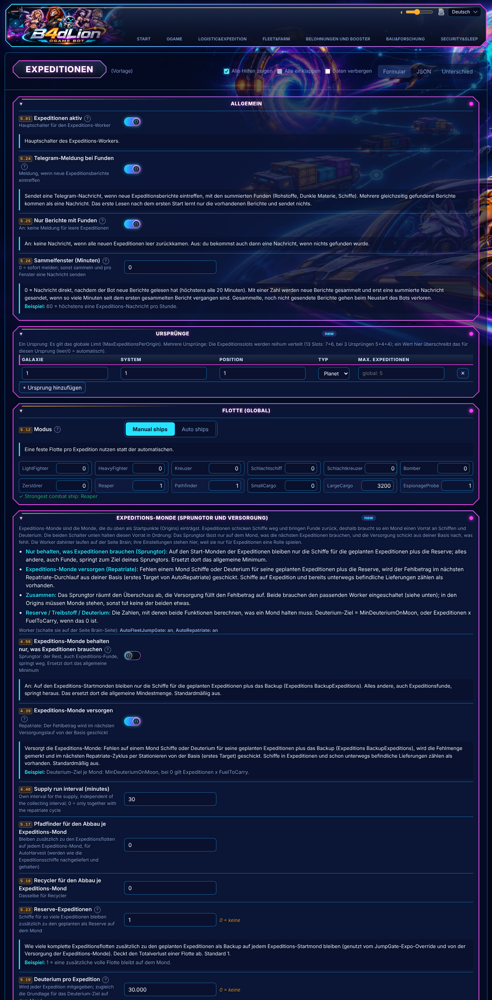

Seiten: [Übersicht](README.md) · [Start](seite-start.md) · [Ogame](seite-ogame.md) · [Logistic & Expedition](seite-logistik.md) · [Fleet & Farm](seite-farm.md) · [Rewards and boosters](seite-belohnungen.md) · [Build & Research](seite-bauforschung.md) · [Security & Sleep](seite-sicherheit.md) · [Logging](seite-logging.md) · [Auktionen](seite-auktionen.md) · [Leiste und Bedienung](seite-bedienung.md)

Felder: [Allgemein](felder-allgemein.md) · **Logistic & Expedition** · [Fleet & Farm](felder-farm.md) · [Rewards and boosters](felder-belohnungen.md) · [Build & Research (Brain)](felder-bauforschung.md) · [Security & Sleep](felder-sicherheit.md) · [Auktionen](felder-auktionen.md) · [Experimental](felder-experimental.md)

---

# Felder: Logistic & Expedition

Expeditionen, Kolonisieren und Discovery.

47 Felder, so wie die B4dLion-Oberfläche sie zeigt (Nummer = Feldnummer vor dem Feldnamen).

_Oberfläche mit Vorlagen-Werten, ohne echte Daten._

## Allgemein

#### 5.001 Expeditionen aktiv

`Expeditions.Active` · Standard: **nein** · Schalter · Hauptschalter für den Expeditions-Worker

Hauptschalter des Expeditions-Workers.

#### 5.024 Telegram-Meldung bei Funden

`Expeditions.TelegramMessenger.Active` · Standard: **nein** · Schalter · Meldung, wenn neue Expeditionsberichte eintreffen

Sendet eine Telegram-Nachricht, wenn neue Expeditionsberichte eintreffen, mit den summierten Funden (Rohstoffe, Dunkle Materie, Schiffe). Mehrere gleichzeitig gefundene Berichte kommen als eine Nachricht. Das erste Lesen nach dem ersten Start lernt nur die vorhandenen Berichte und sendet nichts.

#### 5.025 Nur Berichte mit Funden

`Expeditions.TelegramMessenger.OnlyFinds` · Standard: **ja** · Schalter · An: keine Meldung für leere Expeditionen

An: keine Nachricht, wenn alle neuen Expeditionen leer zurückkamen. Aus: du bekommst auch dann eine Nachricht, wenn nichts gefunden wurde.

#### 5.026 Sammelfenster (Minuten)

`Expeditions.TelegramMessenger.WindowMinutes` · Standard: **0** · Zahl · 0 = sofort melden; sonst sammeln und pro Fenster eine Nachricht senden

0 = Nachricht direkt, nachdem der Bot neue Berichte gelesen hat (höchstens alle 20 Minuten). Mit einer Zahl werden neue Berichte gesammelt und erst eine summierte Nachricht gesendet, wenn so viele Minuten seit dem ersten gesammelten Bericht vergangen sind. Gesammelte, noch nicht gesendete Berichte gehen beim Neustart des Bots verloren.

**Beispiel:** 60 = höchstens eine Expeditions-Nachricht pro Stunde.

## Flotte (global)

#### 5.012 Modus

`Expeditions.ManualShips.Active` · Standard: **ja** · Schalter

Eine feste Flotte pro Expedition nutzen statt der automatischen.

## Expeditions-Monde (Sprungtor und Versorgung)new

#### 5.017 Pfadfinder für den Abbau je Expeditions-Mond

`Expeditions.HarvestShips.Pathfinder` · Standard: **0** · Zahl · Bleiben zusätzlich zu den Expeditionsflotten auf jedem Expeditions-Mond, für AutoHarvest (werden wie die Expeditionsschiffe nachgeliefert und gehalten)

Optional, default `0`. Fixed number of pathfinders / recyclers kept on every expedition start moon for `AutoHarvest` (the expeditions create the debris fields and harvest starts from the expedition moons by default). Added once per moon on top of the expedition fleets and the backup (not multiplied by the number of expeditions); supplied by `AutoRepatriate.ExpoSupply` and held by `AutoFleetJumpGate.ExpoOverride` and the reverse fetch like the expedition ships. Harvest flights from the moon count as present.

_Beschreibung noch englisch._

#### 5.018 Recycler für den Abbau je Expeditions-Mond

`Expeditions.HarvestShips.Recycler` · Standard: **0** · Zahl · Dasselbe für Recycler

Optional, default `0`. Fixed number of pathfinders / recyclers kept on every expedition start moon for `AutoHarvest` (the expeditions create the debris fields and harvest starts from the expedition moons by default). Added once per moon on top of the expedition fleets and the backup (not multiplied by the number of expeditions); supplied by `AutoRepatriate.ExpoSupply` and held by `AutoFleetJumpGate.ExpoOverride` and the reverse fetch like the expedition ships. Harvest flights from the moon count as present.

_Beschreibung noch englisch._

#### 5.019 Deuterium pro Expedition

`Expeditions.FuelToCarry` · Standard: **30000** · Zahl · Wird jeder Expedition mitgegeben; zugleich die Grundlage für das Deuterium-Ziel auf dem Mond

Deuterium, das jede Expedition mitnimmt.

#### 5.020 Mindest-Deuterium auf dem Mond

`Expeditions.MinDeuteriumOnMoon` · Standard: **0** · Zahl · 0 = Expeditionen x Deuterium pro Expedition

Ein Mond braucht mindestens so viel Deuterium, um Expeditionen zu starten (0 = keine Prüfung). Darunter laufen die Expeditionen weiter (die Flotte startet mit dem vorhandenen Deuterium) und du bekommst eine Meldung. Aufgestockt wird über die Mond-Versorgung (ExpoSupply), wenn sie an ist.

#### 5.021 Deuterium buffer on the moon

`Expeditions.DeuteriumBuffer` · Standard: **0** · Zahl · Added on top of the deuterium target; repatriate also leaves it on expedition moons (0 = none)

Zusätzliches Deuterium auf jedem Expeditions-Startmond, auf das Ziel aufgeschlagen (das Größere aus MinDeuteriumOnMoon und dem Bedarf einer Runde). Aufgefüllt wird bis Ziel + Puffer, und Repatriate (auch die Rückholung) lässt ihn auf dem Mond liegen: es bleibt dann max(LeaveDeut, MinDeuteriumOnMoon) + Puffer dort. 0 (Standard) = kein Puffer.

**Beispiel:** MinDeuteriumOnMoon 2.000.000 + Puffer 1.000.000 = 3.000.000 bleiben auf dem Mond.

#### 5.022 Unter dem Deuteriumbedarf stoppen

`Expeditions.StopBelowNeed` · Standard: **nein** · Schalter · An: Keine Expedition startet, solange das Deuterium Flugtreibstoff + Fracht der geplanten Starts nicht deckt

An: von einem Ursprung startet keine Expedition mehr, solange das Deuterium dort nicht für die noch geplanten Starts reicht (Flugsprit + Deuterium je Expedition x Anzahl). Die Repatriate-Runde füllt auf diesen Bedarf auf, danach laufen die Expeditionen von selbst weiter. Aus (Standard): es wird mit dem vorhandenen Deuterium weitergeflogen.

#### 5.023 Reserve-Expeditionen

`Expeditions.BackupExpeditions` · Standard: **1** · Zahl · Schiffe für so viele Expeditionen bleiben zusätzlich zu den geplanten als Reserve auf dem Mond

Wie viele komplette Expeditionsflotten zusätzlich zu den geplanten Expeditionen als Backup auf jedem Expeditions-Startmond bleiben (genutzt vom JumpGate-Expo-Override und von der Versorgung der Expeditions-Monde). Deckt den Totalverlust einer Flotte ab. Standard 1.

**Beispiel:** 1 = eine zusätzliche volle Flotte bleibt auf dem Mond.

## More settings (10)

#### 5.027 MaxExpeditionsPerOrigin

`Expeditions.MaxExpeditionsPerOrigin` · Standard: **5** · Zahl

Höchstzahl an Expeditionen, die gleichzeitig von einem Ursprung fliegen.

#### 5.028 Aktiv

`Expeditions.SplitExpeditionsBetweenSystems.Active` · Standard: **ja** · Schalter

Die Expeditionsziele auf mehrere Systeme verteilen.

#### 5.029 Bereich

`Expeditions.SplitExpeditionsBetweenSystems.Range` · Standard: **3** · Zahl

Systeme um den Ursprung, die als Ziel dienen dürfen.

**Beispiel:** 2 = bis zu 2 Systeme in jede Richtung.

#### 5.030 RandomizeOrder

`Expeditions.RandomizeOrder` · Standard: **ja** · Schalter

Die Ursprünge in zufälliger Reihenfolge bearbeiten.

#### 5.031 IgnoreSleep

`Expeditions.IgnoreSleep` · Standard: **nein** · Schalter

Auch im SleepMode weiter Expeditionen senden.

#### 5.035 WaitForAllExpeditions

`Expeditions.WaitForAllExpeditions` · Standard: **nein** · Schalter

Eine neue Runde erst starten, wenn alle Expeditionen zurück sind.

#### 5.036 WaitForMajorityOfExpeditions

`Expeditions.WaitForMajorityOfExpeditions` · Standard: **nein** · Schalter

Eine neue Runde starten, wenn mehr als die Hälfte der Expeditionen zurück ist.

#### 5.037 MinWaitNextFleet

`Expeditions.MinWaitNextFleet` · Standard: **2** · Zahl

Kürzeste Pause in Sekunden zwischen zwei Flotten einer Runde.

#### 5.038 MaxWaitNextFleet

`Expeditions.MaxWaitNextFleet` · Standard: **6** · Zahl

Längste Pause in Sekunden zwischen zwei Flotten einer Runde.

#### 5.039 MinWaitNextRound

`Expeditions.MinWaitNextRound` · Standard: **10** · Zahl

Kürzeste zusätzliche Pause in Sekunden nach der ersten Rückkehr vor der nächsten Runde.

#### 5.040 MaxWaitNextRound

`Expeditions.MaxWaitNextRound` · Standard: **20** · Zahl

Längste zusätzliche Pause in Sekunden nach der ersten Rückkehr vor der nächsten Runde.

## Schlafwelle

#### 5.032 Aktiv

`Expeditions.SleepWave.Active` · Standard: **nein** · Schalter · Expeditionswelle, die um das Aufwachen zurückkommt

Eine zusätzliche Expeditionswelle kurz bevor der Bot schlafen geht.

#### 5.033 Rückkehr um

`Expeditions.SleepWave.ReturnAt` · Standard: **„WakeUp+15“** · Text · HH:mm, WakeUp oder WakeUp+15 (Minuten); leer = feste Geschwindigkeit

Zeit, zu der die Welle zurück sein soll.

**Beispiel:** WakeUp+15 = 15 Minuten nach dem Aufwachen.

#### 5.034 Geschwindigkeit (Ersatz)

`Expeditions.SleepWave.SpeedPercent` · Standard: **50** · Zahl · Wird genutzt, wenn ReturnAt leer ist

Fluggeschwindigkeit der Welle, wenn keine Rückkehrzeit gesetzt ist (10 bis 100 in 10er-Schritten).

## AutoDiscovery

#### 6.113 AutoDiscovery aktiv

`AutoDiscovery.Active` · Standard: **nein** · Schalter · Hauptschalter

Sendet Entdeckungsmissionen.

#### 6.115 Max. Slots

`AutoDiscovery.MaxSlots` · Standard: **2** · Zahl

Flottenslots, die Entdeckungen gleichzeitig nutzen dürfen.

#### 6.116 Stopp bei Artefakten

`AutoDiscovery.StopAtArtifacts` · Standard: **3600** · Zahl · Keine Entdeckungen mehr ab so vielen gesammelten Artefakten (0 = keine Grenze)

Schickt keine Entdeckungen mehr, sobald so viele Artefakte gesammelt sind (Anzeige „Gesammelte Artefakte: 1840 / 3600“ auf den Lebensform-Seiten). 0 = keine Grenze. Fällt der Bestand wieder darunter, geht es weiter. Lässt sich die Anzeige nicht lesen, laufen die Entdeckungen weiter (Warnung im Log).

## Zeitverhalten

#### 6.117 Laufintervall, min

`AutoDiscovery.CheckIntervalMin` · Standard: **15** · Zahl

Kürzeste Pause in Minuten zwischen zwei Durchläufen dieser Funktion.

#### 6.118 Laufintervall, max

`AutoDiscovery.CheckIntervalMax` · Standard: **25** · Zahl · Es wird eine Zufallszeit zwischen Min. und Max. genutzt

Längste Pause in Minuten zwischen zwei Durchläufen. Der Bot wählt eine zufällige Zeit zwischen Minimum und Maximum, damit er nicht wie eine Uhr arbeitet.

#### 7.017 Laufintervall, min

`AutoColonize.CheckIntervalMin` · Standard: **30** · Zahl

Kürzeste Pause in Minuten zwischen zwei Durchläufen dieser Funktion.

#### 7.018 Laufintervall, max

`AutoColonize.CheckIntervalMax` · Standard: **60** · Zahl · Es wird eine Zufallszeit zwischen Min. und Max. genutzt

Längste Pause in Minuten zwischen zwei Durchläufen. Der Bot wählt eine zufällige Zeit zwischen Minimum und Maximum, damit er nicht wie eine Uhr arbeitet.

## AutoColonize

#### 7.001 AutoColonize aktiv

`AutoColonize.Active` · Standard: **nein** · Schalter · Hauptschalter

Kolonisiert neue Planeten automatisch.

#### 7.016 Zufällige Position in den Zielen

`AutoColonize.RandomPosition` · Standard: **nein** · Schalter

Positionen innerhalb der Zielbereiche zufällig wählen.

## Ursprung

#### 7.002 Galaxie

`AutoColonize.Origin.Galaxy` · Standard: **1** · Zahl

Himmelskörper, von dem die Kolonieschiffe starten.

#### 7.003 System

`AutoColonize.Origin.System` · Standard: **1** · Zahl

Himmelskörper, von dem die Kolonieschiffe starten.

#### 7.004 Position

`AutoColonize.Origin.Position` · Standard: **1** · Zahl

Himmelskörper, von dem die Kolonieschiffe starten.

#### 7.005 Typ

`AutoColonize.Origin.Type` · Standard: **„Planet“** · Text

Himmelskörper, von dem die Kolonieschiffe starten.

## Schlechte Planeten aufgeben

#### 7.006 Schlechte Planeten aufgeben

`AutoColonize.Abandon.Active` · Standard: **ja** · Schalter

Neue Planeten aufgeben, die zu klein sind oder die falsche Temperatur haben. Dein Heimatplanet wird nie aufgegeben.

#### 7.007 Min. Felder

`AutoColonize.Abandon.MinFields` · Standard: **310** · Zahl

Kleinste akzeptable Planetengröße in Feldern.

#### 7.008 Min. Temperatur

`AutoColonize.Abandon.MinTemperatureAcceptable` · Standard: **-130** · Zahl

Niedrigste akzeptable Temperatur.

#### 7.009 Max. Temperatur

`AutoColonize.Abandon.MaxTemperatureAcceptable` · Standard: **260** · Zahl

Höchste akzeptable Temperatur.

## Intensivmodus (Schübe)

#### 7.011 Intensivmodus

`AutoColonize.IntensiveResearch.Active` · Standard: **ja** · Schalter

In Schüben kolonisieren.

#### 7.012 Max. Slots

`AutoColonize.IntensiveResearch.MaxSlots` · Standard: **1** · Zahl

Slots, die während eines Schubs genutzt werden.

#### 7.013 Wartezeit zwischen Flotten, min

`AutoColonize.IntensiveResearch.MinWaitNextFleet` · Standard: **25** · Zahl

Kürzeste Pause in Sekunden zwischen zwei Koloniflotten in einem Schub.

#### 7.014 Wartezeit zwischen Flotten, max

`AutoColonize.IntensiveResearch.MaxWaitNextFleet` · Standard: **35** · Zahl

Längste Pause in Sekunden zwischen zwei Koloniflotten in einem Schub.

