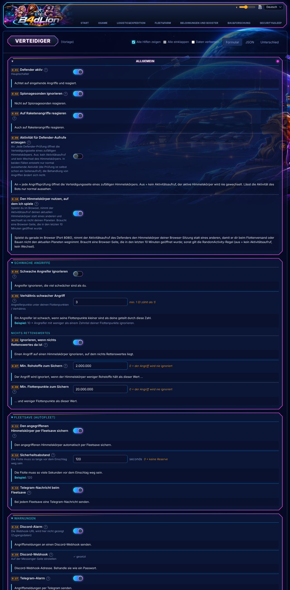

Seiten: [Übersicht](README.md) · [Start](seite-start.md) · [Ogame](seite-ogame.md) · [Logistic & Expedition](seite-logistik.md) · [Fleet & Farm](seite-farm.md) · [Rewards and boosters](seite-belohnungen.md) · [Build & Research](seite-bauforschung.md) · [Security & Sleep](seite-sicherheit.md) · [Logging](seite-logging.md) · [Auktionen](seite-auktionen.md) · [Experimental](seite-experimental.md) · [Leiste und Bedienung](seite-bedienung.md)

Felder: [Allgemein](felder-allgemein.md) · [Logistic & Expedition](felder-logistik.md) · [Fleet & Farm](felder-farm.md) · [Rewards and boosters](felder-belohnungen.md) · [Build & Research (Brain)](felder-bauforschung.md) · **Security & Sleep** · [Auktionen](felder-auktionen.md) · [Experimental](felder-experimental.md)

---

# Felder: Security & Sleep

Defender, Schlafmodus, GhostSleep und Trümmerfeld-Sicherung.

31 Felder, so wie die B4dLion-Oberfläche sie zeigt (Nummer = Feldnummer vor dem Feldnamen).

_Oberfläche mit Vorlagen-Werten, ohne echte Daten._

## Allgemein

#### 8.001 Defender aktiv

`Defender.Active` · Standard: **nein** · Schalter · Hauptschalter

Achtet auf eingehende Angriffe und reagiert.

#### 8.002 Spionagesonden ignorieren

`Defender.IgnoreProbes` · Standard: **ja** · Schalter

Nicht auf Spionagesonden reagieren.

#### 8.003 Auf Raketenangriffe reagieren

`Defender.DefendFromMissiles` · Standard: **ja** · Schalter

Auch auf Raketenangriffe reagieren.

#### 8.009 Aktivität für Defender-Aufrufe erzeugen

`Defender.RandomActivity` · Standard: **nein** · Schalter · An: Jede Defender-Prüfung öffnet die Verteidigungsseite eines zufälligen Himmelskörpers. Aus: kein Aktivitätsaufruf und kein Wechsel des Himmelskörpers. In beiden Fällen entsteht nur normal aussehende Aktivität (die Prüfung ist selbst schon ein Seitenaufruf); die Behandlung von Angriffen ändert sich nicht.

An = jede Angriffsprüfung öffnet die Verteidigungsseite eines zufälligen Himmelskörpers. Aus = kein Aktivitätsaufruf, der aktive Himmelskörper wird nie gewechselt. Lässt die Aktivität des Bots nur normal aussehen.

#### 8.010 Den Himmelskörper nutzen, auf dem ich spiele

`Defender.CurrentlyActiveCelestialActivity` · Standard: **ja** · Schalter · Spielst du im Browser, nimmt der Aktivitätsaufruf deinen aktuellen Himmelskörper statt eines anderen und wechselt so nicht deinen Planeten. Braucht eine Browser-Seite, die in den letzten 10 Minuten geöffnet wurde

Spielst du gerade im Browser (Port 8080), nimmt der Aktivitätsaufruf des Defenders den Himmelskörper deiner Browser-Sitzung statt eines anderen, damit er dir beim Flottenversand oder Bauen nicht den aktuellen Planeten wegnimmt. Braucht eine Browser-Seite, die in den letzten 10 Minuten geöffnet wurde; sonst gilt die RandomActivity-Regel (aus = kein Aktivitätsaufruf, kein Wechsel).

## Schwache Angriffe

#### 8.004 Schwache Angreifer ignorieren

`Defender.IgnoreWeakAttack` · Standard: **nein** · Schalter

Angreifer ignorieren, die viel schwächer sind als du.

#### 8.005 Verhältnis schwacher Angriff

`Defender.WeakAttackRatio` · Standard: **3** · Zahl · Angreiferpunkte unter deinen Flottenpunkten / Verhältnis

Ein Angreifer ist schwach, wenn seine Flottenpunkte kleiner sind als deine geteilt durch diese Zahl.

**Beispiel:** 10 = Angreifer mit weniger als einem Zehntel deiner Flottenpunkte ignorieren.

#### 8.006 Ignorieren, wenn nichts Rettenswertes da ist

`Defender.IgnoreAttackIfIHave.Active` · Standard: **nein** · Schalter

Einen Angriff auf einen Himmelskörper ignorieren, auf dem nichts Rettenswertes liegt.

#### 8.007 Min. Rohstoffe zum Sichern

`Defender.IgnoreAttackIfIHave.MinResourcesToSave` · Standard: **2000000** · Zahl

Der Angriff wird ignoriert, wenn der Himmelskörper weniger Rohstoffe hält als dieser Wert ...

#### 8.008 Min. Flottenpunkte zum Sichern

`Defender.IgnoreAttackIfIHave.MinFleetToSave` · Standard: **20000000** · Zahl

... und weniger Flottenpunkte als dieser Wert.

## Fleetsave (Autofleet)

#### 8.011 Den angegriffenen Himmelskörper per Fleetsave sichern

`Defender.Autofleet.Active` · Standard: **ja** · Schalter

Den angegriffenen Himmelskörper automatisch per Fleetsave sichern.

#### 8.012 Sicherheitsabstand

`Defender.Autofleet.SafetyMarginSeconds` · Standard: **120** · Zahl · Die Flotte muss so lange vor dem Einschlag weg sein

Die Flotte muss so viele Sekunden vor dem Einschlag weg sein.

**Beispiel:** 120

#### 8.013 Telegram-Nachricht beim Fleetsave

`Defender.Autofleet.TelegramMessenger.Active` · Standard: **nein** · Schalter

Bei jedem Fleetsave eine Telegram-Nachricht senden.

## Warnungen

#### 8.014 Discord-Alarm

`Defender.Discord.Active` · Standard: **ja** · Schalter · Die Webhook-URL wird hier nicht gezeigt (Zugangsdaten)

Angriffsmeldungen an einen Discord-Webhook senden.

#### 8.015 Discord-Webhook

`Defender.Discord.WebhookUrl` · Standard: **„https://discord.com/api/webhooks/WEBHOOK_ID/WEBHOOK_TOKEN“** · Text · Auf der Messenger-Seite einstellen

Discord-Webhook-Adresse. Behandle sie wie ein Passwort.

#### 8.027 Telegram-Alarm

`Defender.TelegramMessenger.Active` · Standard: **ja** · Schalter

Angriffsmeldungen per Telegram senden.

#### 8.028 Alarmstufe in der Meldung

`Defender.Alarm.Active` · Standard: **ja** · Schalter

Die Meldung mit hoher Alarmstufe markieren, damit sie auffällt.

#### 8.029 Alarmton (WAV-Datei)

`Defender.Alarm.SoundFile` · Standard: **(leer)** · Text · Vollständiger Pfad zu einer WAV-Datei, die bei einem Angriff abgespielt wird; leer = Piepton

Vollständiger Pfad zu einer WAV-Datei, die bei einem Angriff abgespielt wird (auf dem Rechner mit dem Bot). Leer, nicht vorhanden oder nicht abspielbar: wie bisher der Piepton.

## Whitelist

#### 8.016 Spieler-IDs

`Defender.WhiteList` · Standard: **[0]** · Liste · Kommagetrennt

Spieler-IDs, die nie als Angreifer behandelt werden, zum Beispiel Freunde oder Allianzmitglieder.

## Reaktion auf den Angreifer

#### 8.017 Den Angreifer ausspionieren

`Defender.SpyAttacker.Active` · Standard: **nein** · Schalter

Den Angreifer mit Sonden ausspionieren, wenn ein Angriff eingeht.

#### 8.018 Sonden

`Defender.SpyAttacker.Probes` · Standard: **20** · Zahl

Zahl der Sonden, die den Angreifer ausspionieren.

#### 8.019 Vor möglichem Angriff warnen

`Defender.RaidWarning.Active` · Standard: **nein** · Schalter · Telegram-Warnung, wenn ein Spieler in kurzer Zeit mehrfach spioniert

Warnen (Telegram, Discord, Log), wenn derselbe Spieler dich in kurzer Zeit mehrfach ausspioniert. Das heißt meist, dass ein Angriff geplant wird.

#### 8.020 Mehr als ... Spionageflüge

`Defender.RaidWarning.Missions` · Standard: **2** · Zahl

Warnen, wenn der Spieler mehr als so viele Spionageflüge schickt.

#### 8.021 Innerhalb von

`Defender.RaidWarning.WindowMinutes` · Standard: **30** · Zahl

Zeitfenster in Minuten. Höchstens eine Warnung je Spieler und Zeitfenster.

#### 8.022 Zurückspionieren, wenn man ausspioniert wird

`Defender.BackfireSpy.Active` · Standard: **nein** · Schalter · Schickt eigene Sonden zu dem Spieler, der dich ausspioniert hat

Wird man von einem anderen Spieler ausspioniert, schickt der Bot eigene Sonden zum selben Spieler.

#### 8.023 Sonden

`Defender.BackfireSpy.Probes` · Standard: **5** · Zahl

Zahl der zurückgeschickten Sonden.

#### 8.024 Höchstens alle

`Defender.BackfireSpy.EveryHours` · Standard: **6** · Zahl · Pro Spieler

Höchstens einmal pro Spieler in dieser Zahl von Stunden.

#### 8.025 Dem Angreifer eine Nachricht schicken

`Defender.MessageAttacker.Active` · Standard: **nein** · Schalter · Eine der Nachrichten wird gesendet

Dem Angreifer eine Nachricht schicken.

#### 8.026 Nachrichten

`Defender.MessageAttacker.Messages` · Standard: **["hey", "hello", "i'm online'"]** · Liste · Einer pro Zeile

Mögliche Nachrichten, eine pro Zeile. Der Bot sendet eine davon.

## Zeitverhalten

#### 8.030 Prüfintervall, min

`Defender.CheckIntervalMin` · Standard: **10** · Zahl

Kürzeste Pause in Minuten zwischen zwei Durchläufen dieser Funktion.

#### 8.031 Prüfintervall, max

`Defender.CheckIntervalMax` · Standard: **20** · Zahl

Längste Pause in Minuten zwischen zwei Durchläufen. Der Bot wählt eine zufällige Zeit zwischen Minimum und Maximum, damit er nicht wie eine Uhr arbeitet.

