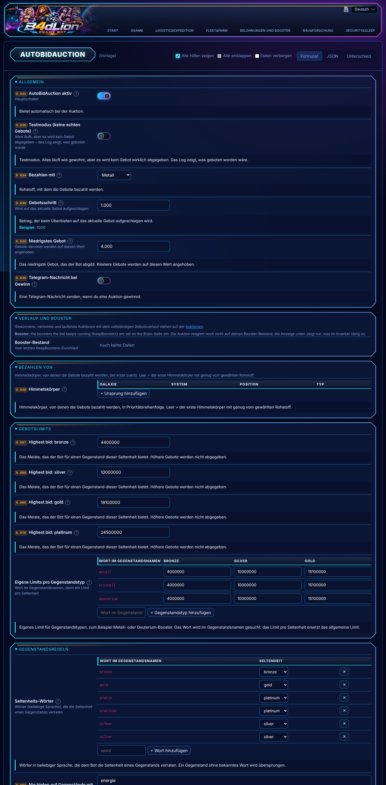

Seiten: [Übersicht](README.md) · [Start](seite-start.md) · [Ogame](seite-ogame.md) · [Logistic & Expedition](seite-logistik.md) · [Fleet & Farm](seite-farm.md) · [Rewards and boosters](seite-belohnungen.md) · [Build & Research](seite-bauforschung.md) · [Security & Sleep](seite-sicherheit.md) · [Logging](seite-logging.md) · **Auktionen** · [Experimental](seite-experimental.md) · [Leiste und Bedienung](seite-bedienung.md)

Felder: [Allgemein](felder-allgemein.md) · [Logistic & Expedition](felder-logistik.md) · [Fleet & Farm](felder-farm.md) · [Rewards and boosters](felder-belohnungen.md) · [Build & Research (Brain)](felder-bauforschung.md) · [Security & Sleep](felder-sicherheit.md) · [Auktionen](felder-auktionen.md) · [Experimental](felder-experimental.md)

---

# Auktionen

_Menüpunkt: Auktionen (Reiter in Belohnungen und Booster; keine eigene Menüleisten-Taste)_

Zeigt das Ergebnis jeder Auktion, die der Bot gesehen hat: gewonnen oder verloren, das Höchstgebot und dein zuletzt abgegebenes Gebot. Darüber stehen die Einstellungen des Auktions-Workers (Block AutoBidAuction). Die Auswertung selbst steuert nichts.

_Oberfläche mit Vorlagen-Werten, ohne echte Daten._

## Einstellungen (AutoBidAuction)

Oben auf der Seite sitzt ein Config-Formular für den Block AutoBidAuction mit eigener Leiste: Alle einklappen, Verwerfen und Speichern. Dort stellst du das Bieten ein (laut Hilfetext zum Beispiel Höchstgebot je Seltenheit mit eigenen Limits für Gegenstandstypen wie Metall- oder Deuterium-Booster).

1. Werte im Formular ändern.
2. Speichern klicken; Verwerfen setzt zurück, Alle einklappen klappt die Gruppen zu.

Felder: [Auktionen](felder-auktionen.md)

## Auswertung

Eine Kopfkarte zählt Gewonnen, Verloren (geboten, aber überboten) und die für gewonnene Auktionen ausgegebenen Punkte. Die Karte Wer gegen dich gewinnt listet bis zu 15 Gegner mit Siegen, wie oft sie dich überboten haben, dem durchschnittlichen Abstand über deinem Gebot, Abstand bis 2.000 und Siege ohne dein Gebot. Die Tabelle darunter zeigt je Auktion Beginn, Gegenstand, Ergebnis (Gewonnen, Verloren, Läuft, Läuft und du führst, Kein Gebot, Unbekannt), Endgebot, Höchstbietender, Mein letztes Gebot, Gebot abgegeben, Gebote und Ende. Die Daten laden sich alle 15 Sekunden neu.

1. Im Feld Anzeigen filtern: Alle, Gewonnen, Verloren oder Nur Auktionen mit meinem Gebot.
2. Daten verbergen blendet Spielernamen und Instanzliste aus.
3. Bei mehreren Instanzen die Instanz wählen und Öffnen klicken.

Felder: [Auktionen](felder-auktionen.md)

## Hinweise

- Beträge sind Gebotspunkte, wie das Spiel sie zählt. Mein letztes Gebot ist die insgesamt in der Auktion gebundene Summe laut Spiel.
- Das Spiel zeigt das Ende einer Auktion nur in ganzen Minuten, die genaue Zeit des Gewinngebots ist nicht bekannt. Viele Siege ohne dein Gebot oder Gebote genau eine Stufe über deinem sprechen laut Seite für einen automatischen Bieter, beweisen es aber nicht.

