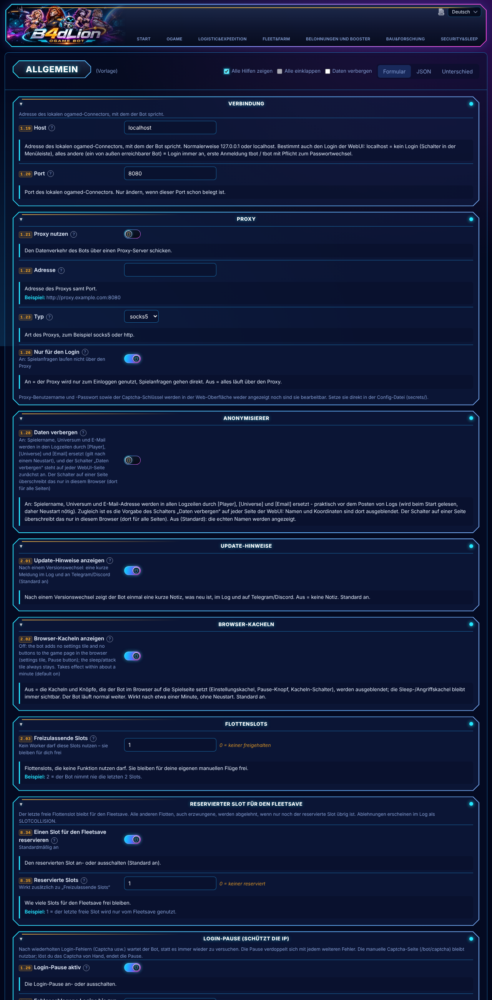

Seiten: [Übersicht](README.md) · [Start](seite-start.md) · [Ogame](seite-ogame.md) · [Logistic & Expedition](seite-logistik.md) · [Fleet & Farm](seite-farm.md) · [Rewards and boosters](seite-belohnungen.md) · [Build & Research](seite-bauforschung.md) · [Security & Sleep](seite-sicherheit.md) · [Logging](seite-logging.md) · **Leiste und Bedienung**

Felder: [Allgemein](felder-allgemein.md) · [Logistic & Expedition](felder-logistik.md) · [Fleet & Farm](felder-farm.md) · [Rewards and boosters](felder-belohnungen.md) · [Build & Research (Brain)](felder-bauforschung.md) · [Security & Sleep](felder-sicherheit.md)

---

# Leiste und Bedienung

_Menüpunkt: Obere Navigationsleiste und Config-Seiten (kein eigener Menüpunkt)_

Die Leiste oben steht auf jeder Seite und führt zu allen Bereichen. Rechts daneben liegen die Bedienelemente für Log, Sprache und Login. Auf den Config-Seiten sammelt eine Leiste ungespeicherte Änderungen, damit du sie gemeinsam speichern kannst. In den eingebetteten Reitern anderer Seiten (Parameter embed=1) wird die Leiste nicht angezeigt.

_Oberfläche mit Vorlagen-Werten, ohne echte Daten._

## Menüpunkte und Logo

Menüpunkte von links: Start, Ogame, Logistic&Expedition, Fleet&Farm, Belohnungen und Booster, Bau&Forschung, Security&Sleep (nach Spracheinstellung übersetzt, z. B. Bau&Forschung). Der aktuelle Punkt ist hervorgehoben. Das Logo führt zum ersten Menüpunkt; Start bleibt immer an erster Stelle. Auf schmalen Bildschirmen klappt die Leiste über das Menü-Symbol auf.

1. Einen Menüpunkt anklicken, um die Seite zu öffnen.
2. Menüpunkte (außer Start) per Ziehen umsortieren; der Browser merkt die Reihenfolge. Der erste Eintrag ist der Einstieg: das Logo führt dorthin.
3. Ebenso lassen sich die Reiterleisten mancher Seiten per Ziehen umsortieren; die Reihenfolge merkt der Browser je Leiste.

## Rechts oben: Log, Build, Sprache, Login

Das Protokoll-Symbol öffnet die Seite Logging. Daneben steht Build mit Commit und Bauzeit der laufenden Version (nur wenn bekannt). Die Sprachwahl wechselt die Oberfläche; danach lädt die Seite neu, bei einem Fehler erscheint eine Meldung. Die Login-Elemente hängen von den WebUI-Einstellungen ab: bei aktivem Login und angemeldetem Benutzer erscheinen Passwort (Passwort ändern) und Abmelden. Ist die WebUI von außen erreichbar und der Login erzwungen, gibt es den Schalter Ohne Passwort, der den Login ganz abschaltet. Nur bei lokalem Zugriff (nicht von außen erreichbar) gibt es den Schalter Login, mit dem du den Passwortschutz ein- und ausschaltest (Benutzername tbot).

1. Sprache in der Auswahl wählen; die Seite lädt neu.
2. Login einschalten: beim ersten Mal öffnet sich die Seite zum Passwort ändern, danach schaltet der Schalter nur um.
3. Ohne Passwort einschalten fragt nach: jeder, der die Adresse kennt, hat dann vollen Zugriff auf Bot und Zugangsdaten. Nur nach Rückfrage bestätigen.

## Deckkraft der Karten

Auf Seiten mit Hintergrundbild (Start, Logistic&Expedition, Fleet&Farm, Bau&Forschung, Belohnungen und Booster, Security&Sleep) liegt in der Leiste ein kleiner Regler mit Halbmond-Symbol (Kartendeckkraft). Er macht die Karten über dem Bild besser lesbar. Der Wert gilt für alle Seiten und wird im Browser gemerkt.

1. Regler ziehen (Bereich -30 bis 45, Schritte von 5).
2. Doppelklick auf den Regler setzt ihn auf 0 zurück.

## Daten verbergen

Schalter auf vielen Seiten (Belohnungen, Bau&Forschung, Logging, Config-Seiten): ersetzt Namen, Koordinaten und andere Daten durch *****, zum Beispiel für Screenshots. Die Vorgabe kommt aus General.AnonymizeLogs (Beschriftung dort: Daten verbergen); der Schalter auf einer Seite überschreibt sie nur in diesem Browser.

1. Haken bei Daten verbergen setzen oder entfernen; der Zustand gilt seitenübergreifend.

Felder: [Allgemein](felder-allgemein.md)

## Config-Seiten: Alle speichern

Änderungen in Config-Formularen bleiben beim Seitenwechsel als Entwurf erhalten (je Instanz im Browser) und werden erst geschrieben, wenn du speicherst. Ist etwas ungespeichert, erscheint oben eine Leiste: Nicht gespeichert, mit Anzahl und Namen der Blöcke. Alle speichern schreibt alle geänderten Blöcke nacheinander (bei einem Fehler wird abgebrochen und eine Meldung gezeigt) und lädt danach die Seite neu. Verwerfen und neu laden löscht alle Entwürfe nach Rückfrage. Blöcke mit Entwurf sind in der Seitenleiste markiert. Beim Speichern wird eine Sicherung (.bak) angelegt.

1. Werte ändern; unten erscheint ungespeicherte Änderungen, geänderte Felder sind markiert.
2. Unten Speichern klicken (nur dieser Block) oder in der Leiste oben Alle speichern (alle Blöcke).
3. Verwerfen setzt den Block zurück; Verwerfen und neu laden in der Leiste oben verwirft alle Entwürfe.

## Config-Seiten: Ansichten und Hilfen

Im Kopf jedes Config-Blocks wählst du die Ansicht Formular, JSON oder Unterschied. JSON ist bearbeitbar (ungültiges JSON wird rot markiert und gemeldet), außer wenn Daten verbergen an ist; dann ist die Ansicht nur lesbar. Unterschied zeigt die Abweichung zum gespeicherten Stand. Alle Hilfen zeigen blendet die Hilfetexte zu allen Optionen auf einmal ein (sonst nur per Fragezeichen neben dem Namen). Alle einklappen klappt alle Blöcke der Seite zu oder auf; der Zustand wird im Browser gemerkt. Vor den Feldnamen steht eine feste Feldnummer (z. B. 3.049); ein Mauszeiger darauf zeigt Nummer und Pfad. Das Verzeichnis aller Nummern liegt laut Projektregeln in config/FELDER.md.

1. Oben rechts zwischen Formular, JSON und Unterschied umschalten.
2. Alle Hilfen zeigen oder Alle einklappen anhaken.
3. Nach dem Ändern im JSON-Text werden Speichern und Alle speichern sofort aktiv.

## Hinweise

- Entwürfe liegen im Browser (Sitzungsspeicher). Schließt du den Tab, ohne zu speichern, sind sie weg.
- Die Seiten der Bau&Forschung und Security&Sleep nutzen eigene Speichern-Knöpfe (Änderungen speichern bzw. Alle speichern in ihrer Leiste); die Sammelleiste oben gehört zu den Config-Seiten.
- Ohne Passwort schaltet den Login auch für externe Adressen ab; vorher sicherstellen, dass das gewollt ist.

