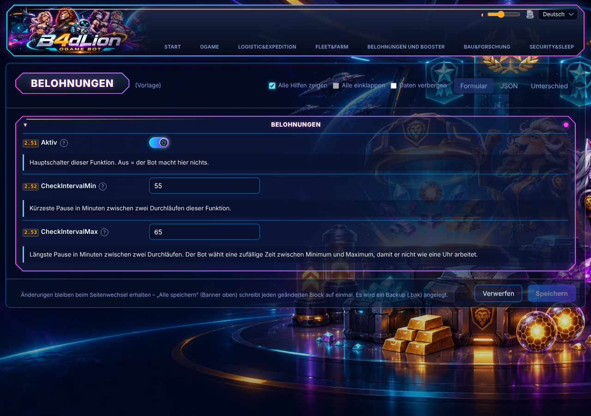

Seiten: [Übersicht](README.md) · [Start](seite-start.md) · [Ogame](seite-ogame.md) · [Logistic & Expedition](seite-logistik.md) · [Fleet & Farm](seite-farm.md) · **Rewards and boosters** · [Build & Research](seite-bauforschung.md) · [Security & Sleep](seite-sicherheit.md) · [Logging](seite-logging.md) · [Auktionen](seite-auktionen.md) · [Experimental](seite-experimental.md) · [Leiste und Bedienung](seite-bedienung.md)

Felder: [Allgemein](felder-allgemein.md) · [Logistic & Expedition](felder-logistik.md) · [Fleet & Farm](felder-farm.md) · [Rewards and boosters](felder-belohnungen.md) · [Build & Research (Brain)](felder-bauforschung.md) · [Security & Sleep](felder-sicherheit.md) · [Auktionen](felder-auktionen.md) · [Experimental](felder-experimental.md)

---

# Belohnungen und Booster

_Menüpunkt: Belohnungen und Booster_

Die Seite bündelt alles rund um Belohnungen: die Aufgaben der Universums-Belohnungen (Tritium) samt Einordnung durch den Bot, Rangbelohnungen, Booster, Auktionen, Direktiven (Tutorial im Spiel) und die Asteroiden-Jagd. Die Reiter Aufgaben und Auktionen zeigen nur Daten; die übrigen Reiter öffnen die zugehörigen Config-Blöcke direkt in der Seite. Oben wählst du bei mehreren Instanzen die Instanz und klickst Öffnen.

_Oberfläche mit Vorlagen-Werten, ohne echte Daten._

## Aufgaben

Zeigt die Aufgaben je Tritium-Stufe mit Fortschritt, Typ, dem, was der Bot tun würde, und Status (offen/erledigt). Darunter stehen die Karten Automatisches Abholen und Rangbelohnungen. Der Bot liest die Seite nur etwa alle 4 Stunden mit; ältere Daten (über 90 Minuten) sind farbig mit Altersangabe markiert. Der Unterreiter Log zeigt nur die Rewards-Zeilen des heutigen Bot-Logs (neueste oben).

1. Jetzt aktualisieren klicken, damit der Bot die Belohnungen-Seite sofort liest (er prüft die Anforderung einmal pro Minute).
2. Bei Automatisches Abholen den Modus wählen: Aus, Testlauf (nur Log) oder An; das Gleiche gilt für Aufgaben automatisch erledigen. Die Auswahl wird sofort gespeichert, der Bot übernimmt sie innerhalb einer Minute.
3. Bei Telegram-Nachrichten (Belohnungs-Nachrichten) An oder Aus wählen.
4. In der Karte Rangbelohnungen pro Rang genau eine Belohnung als Vorabauswahl anklicken (oder keine); es gibt auch Zusatzbelohnungen mit aktivem Kommandostab.
5. Mit Daten verbergen blendest du Namen und Koordinaten aus; der Unterreiter Log zeigt dann nichts an.

Felder: [Rewards and boosters](felder-belohnungen.md), [Build & Research (Brain)](felder-bauforschung.md)

## Booster

Öffnet die Option KeepBoosters aus dem Block Brain: Rohstoff-Booster am Laufen halten. Läuft von einem Typ keiner auf einem Planeten, wird einer aus deinem Inventar aktiviert; mit Dunkler Materie wird nichts gekauft.

1. Typen, erlaubte Stufen, Reserve und Mindest-Minenstufe einstellen.
2. Zuerst Testmodus eingeschaltet lassen und das Log lesen, dann erst scharf schalten.
3. Speichern.

Felder: [Build & Research (Brain)](felder-bauforschung.md)

## Auktionen

Zeigt die Auktionen-Seite eingebettet (siehe Seite Auktionen).

Felder: [Auktionen](felder-auktionen.md)

## Import/Export und Tagesangebot

Öffnet laut Code nur die Option BuyOfferOfTheDay aus dem Block Brain: kauft das tägliche Händlerangebot.

1. BuyOfferOfTheDay einschalten und speichern.

Felder: [Build & Research (Brain)](felder-bauforschung.md)

## Direktiven

Öffnet die Option Directives aus dem Block Brain und arbeitet die Direktiven (Tutorial im Spiel) ab: fertige Belohnungen einsammeln und, wenn eingeschaltet, bauen/erforschen, was offene Aufgaben verlangen (genau bis zur Aufgabenstufe, deine Grenzen werden dafür ignoriert). Allianz-, Freunde-, Umbenennen- und Abriss-Aufgaben bleiben manuell.

1. Aktiv einschalten; Belohnungen einsammeln ist standardmäßig an, Aufgaben erfüllen und Flottenaufgaben sind standardmäßig aus.
2. Zuerst Probelauf einschalten und das Log lesen.
3. Speichern.

Felder: [Build & Research (Brain)](felder-bauforschung.md)

## Asteroiden-Jagd

Öffnet den Block AsteroidHunt (in Testing): einmal pro Spieltag greift ein Schiff den Asteroiden auf Position 17 deines eigenen Systems an. Nach der Ankunft prüft der Bot, ob das Inventar gewachsen ist. Pro Versuch gibt es eine kurze Logzeile, keine Messenger-Nachricht. Standardmäßig aus.

1. Aktiv einschalten, Schiffstyp und Anzahl wählen (Standard Pathfinder, 1).
2. Optional Versuche pro Tag und Suchsysteme einstellen, dann speichern.

## Hinweise

- nach dem Anlegen den Bot neu starten. Der erste Mitschnitt läuft direkt nach dem Start, danach alle 4 Stunden.
- Verteidigung und Schiffe werden immer auf der Heimatwelt gebaut, Gebäude auf dem Planeten mit der günstigsten nächsten Stufe.
- Aufgaben mit Dunkler Materie, Items oder Kauf bleiben immer manuell.
- Rangbelohnungen werden nur abgeholt, wenn Automatisches Abholen an ist, der Rang erreicht ist und du eine Belohnung gewählt hast. Bei einem neuen Event verfällt eine gespeicherte Wahl (neu wählen).
- Aufgaben automatisch erledigen kostet Rohstoffe (Schiffe und Verteidigung auf dem Heimatplaneten, nur die fehlende Menge, derselbe Auftrag nicht innerhalb von 24 Stunden erneut) und ist deshalb standardmäßig aus.

