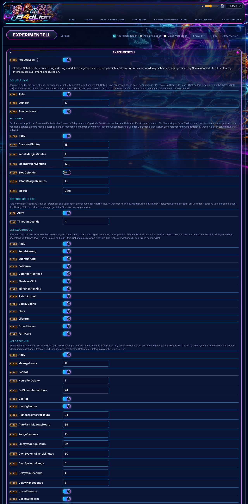

Seiten: [Übersicht](README.md) · [Start](seite-start.md) · [Ogame](seite-ogame.md) · [Logistic & Expedition](seite-logistik.md) · [Fleet & Farm](seite-farm.md) · [Rewards and boosters](seite-belohnungen.md) · [Build & Research](seite-bauforschung.md) · [Security & Sleep](seite-sicherheit.md) · [Logging](seite-logging.md) · [Auktionen](seite-auktionen.md) · **Experimental** · [Leiste und Bedienung](seite-bedienung.md)

Felder: [Allgemein](felder-allgemein.md) · [Logistic & Expedition](felder-logistik.md) · [Fleet & Farm](felder-farm.md) · [Rewards and boosters](felder-belohnungen.md) · [Build & Research (Brain)](felder-bauforschung.md) · [Security & Sleep](felder-sicherheit.md) · [Auktionen](felder-auktionen.md) · [Experimental](felder-experimental.md)

---

# Slots (Experimentell)

_Menüpunkt: Slots (Seite der Gruppe Experimental/Experimentell, kein eigener Eintrag in der Hauptleiste)_

Zeigt die gemessene Belegung der Flottenslots: der Bot erfasst einmal pro Minute, wer wie viele Slots hält, und zählt, wie oft eine Funktion nicht senden konnte, weil kein Slot frei war. Die Seite steuert nichts; sie ist laut Seitentext die Grundlage, um die Slot-Grenzen später anzupassen. Die Seite gehört zur Gruppe Experimentell und gibt es laut Code nur in privaten Builds (Compiler-Schalter SLOTS); die Startseite der Config verlinkt dorthin, wenn der Schalter gesetzt ist.

_Oberfläche mit Vorlagen-Werten, ohne echte Daten._

## Slots

Der einzige Reiter der Gruppe Experimentell. Oben stehen Zeitraum (1, 3, 7 oder 14 Tage, Standard 7 Tage), das Häkchen Ohne Schlaf und Pause (standardmäßig an), Berechnung zurücksetzen und Daten verbergen. Die Karten: Übersicht (Slots gesamt, in Benutzung im Durchschnitt und Spitze, frei im Durchschnitt und Minimum, Zeit ganz ohne freien Slot und mit höchstens einem freien), Wer die Slots hält (je Funktion Durchschnitt, 95 %, Spitze, Zeit bei 0), Grenzen (Limit, genutzt, wie oft das Limit voll war), Nachgewiesener Bedarf (Zyklen mit Bedarf, zu wenig Slots, Fehlmenge, abgelehnte Sendungen), Prüfungen an der Grenze und das Tagesprofil (Durchschnitt je Stunde, Serverzeit) als Balkendiagramm. Die Anzeige lädt alle 2 Minuten neu.

1. Zeitraum wählen und das Häkchen Ohne Schlaf und Pause nach Bedarf setzen oder entfernen.
2. Bei mehreren Instanzen die Instanz wählen und Öffnen klicken.
3. Berechnung zurücksetzen klicken und die Rückfrage bestätigen, um bei null zu beginnen; die bisherigen Messwerte bleiben als Sicherungsdatei (slots_<Alias>.jsonl.bak) erhalten.
4. Daten verbergen blendet Namen in der Instanzliste aus.

Felder: [Allgemein](felder-allgemein.md), [Build & Research (Brain)](felder-bauforschung.md), [Fleet & Farm](felder-farm.md)

## Hinweise

- Direkt nach dem Start gibt es noch keine Messwerte; der Bot schreibt jede Minute eine Zeile, nach einigen Minuten erscheinen Daten.
- Fallen alle Messwerte des Zeitraums in Schlaf oder Pause, erscheint ein entsprechender Hinweis statt der Karten.
- Die Zuordnung zu einer Funktion richtet sich nach dem Zyklus, der die Flotte gesendet hat; Flotten unbekannter Herkunft (vor einem Neustart, manuell) werden nach Mission einsortiert.
- Die Slot-Grenzen stellst du laut Referenz im Block General (SlotsToLeaveFree, SlotShift, SlotPriorityLevel) und mit den MaxSlots-Werten der Worker ein; diese Seite zeigt nur die Messung.

