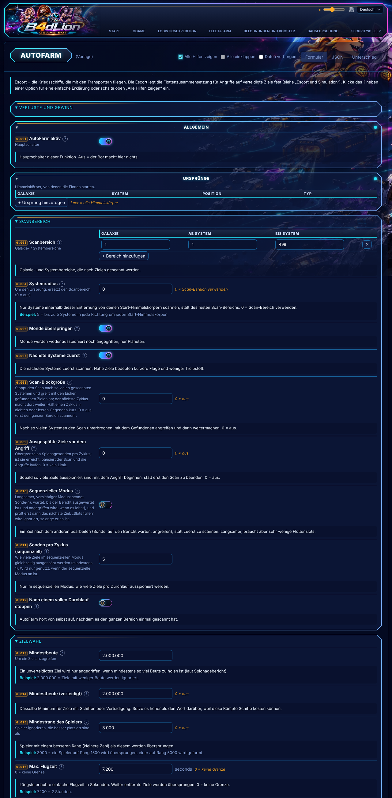

Seiten: [Übersicht](README.md) · [Start](seite-start.md) · [Ogame](seite-ogame.md) · [Logistic & Expedition](seite-logistik.md) · **Fleet & Farm** · [Rewards and boosters](seite-belohnungen.md) · [Build & Research](seite-bauforschung.md) · [Security & Sleep](seite-sicherheit.md) · [Logging](seite-logging.md) · [Auktionen](seite-auktionen.md) · [Leiste und Bedienung](seite-bedienung.md)

Felder: [Allgemein](felder-allgemein.md) · [Logistic & Expedition](felder-logistik.md) · [Fleet & Farm](felder-farm.md) · [Rewards and boosters](felder-belohnungen.md) · [Build & Research (Brain)](felder-bauforschung.md) · [Security & Sleep](felder-sicherheit.md) · [Auktionen](felder-auktionen.md)

---

# Fleet & Farm

_Menüpunkt: Fleet&Farm_

Die Seite bündelt das Farmen (AutoFarm und Trümmerfeld-Ernte AutoHarvest) und zugehörige Werkzeuge in Reitern. Du siehst, was AutoFarm entscheidet, kannst Ziele sperren oder gezielt angreifen und alle Farm-Einstellungen an einer Stelle ändern. Oben gibt es 'Daten verbergen' und die Instanzauswahl (bei mehreren Instanzen).

_Oberfläche mit Vorlagen-Werten, ohne echte Daten._

## Farm

Hat zwei Unterteile: Status und Settings. Status hat die Ansichten Übersicht (Worker-Status, Deuterium der Start-Himmelskörper, Flottenslots, Galaxie-Scan, Scan-Fortschritt, Verluste und Gewinn), Ziele (Ziele und Entscheidungen), Angriffe (aufgezeichnete Angriffe), Systeme (gecachte Systeme), Blacklist & Wartung und Logs & Fehler; die Daten aktualisieren sich alle 5 Sekunden. Settings enthält alle Einstellungen in aufklappbaren Gruppen: Allgemein, Scanbereich und Reihenfolge, Galaxie-Cache, Asteroiden-Suche, Zielauswahl, Spionageberichte, Verteidigte Ziele, Gewinn und Deuterium, Blacklist und Allianzschutz, Sonden und Slots, Fracht und Flotte, Geleitschutz und Simulation, Kampfrechner (erweitert), Zeitplan, AutoHarvest. Felder ohne Wirkung, widersprüchliche oder selten nötige Felder werden markiert; automatisch geändert wird nichts.

1. Status/Settings oben im Reiter wählen, dann die Ansicht (Übersicht, Ziele, ...).
2. Blacklist & Wartung: 'Spieler sperren' (ID oder Name eintragen), 'Freigeben', 'Entfernen', 'Scan + Angriff' für ein einzelnes verteidigtes Ziel, 'Blacklist leeren', 'Systemcache leeren und Scan neu starten'. Jeder Befehl fragt nach und läuft zu Beginn des nächsten AutoFarm-Zyklus.
3. 'Farm zurücksetzen' und 'Gesamte Datenbank zurücksetzen' verlangen zusätzlich die Eingabe von DELETE.
4. Settings: Werte ändern, dann 'Änderungen speichern' oder 'Verwerfen'. Gespeichert werden nur geänderte Felder.

Felder: [Fleet & Farm](felder-farm.md), [Security & Sleep](felder-sicherheit.md)

## HoldForReview

Zeigt alle Ziele, die AutoFarm in den letzten 2 Stunden als verteidigt verworfen hat (Verteidigung vorhanden, zu stark, nicht rentabel), mit Rohstoffen, Verteidigung und Schiffen. Danach verschwinden sie aus der Liste (die Blacklist des Workers bleibt).

1. Sortierung wählen: Rohstoffe, Flotte oder Def-Punkte.
2. 'Scan + Angriff' berechnet Geleitschutz und Gewinn und greift das Ziel allein an; braucht 2 freie Flottenslots. Optional unter 'Min. Geschwindigkeit bei Neuberechnung' eine Mindestgeschwindigkeit wählen (Standard: Wert aus der Config).
3. 'Sperren' sperrt das Ziel dauerhaft.

Felder: [Fleet & Farm](felder-farm.md)

## Combat sim

Vergleicht die Kampfrechner (ogamed/Go, Go mit Lebensform-Boni, Rust) mit gemessenen Verlusten. Zusammenfassung oben, darunter eine Zielliste mit 'Best calc', Gewonnen, Verloren und Offen (Flotte noch nicht zurück). Im Schattenmodus bleibt Go maßgeblich.

1. Filter: Ziel (Name oder G:S:P), 'Actual only', 'Deviations only', 'Rust errors only'; 'Refresh' lädt neu.
2. Zeile anklicken, um die Einzelkämpfe aufzuklappen. 'Export CSV' und 'Export JSON' exportieren mit denselben Filtern.
3. 'Reset' löscht das gesamte Kampflog nach Rückfrage; vorher exportieren.

## Hunter

Beobachtet Spieler anhand der Galaxie-Ansicht: Der Hunter liest in jeder Prüfung alle bekannten Systeme der beobachteten Spieler über den Galaxie-Cache-Scanner. Du siehst je Spieler Highscore, Allianz, Positionen und eine Aktivitätsleiste (keine Aktivität, Timer 15 bis 59 Min., aktiv unter 15 Min.). Zusätzlich 'Espionage on demand' zum gezielten Ausspähen.

1. 'Hunter active' setzen, Prüfintervall (min. 3 Minuten) eintragen und 'Save' klicken.
2. Spielername eintragen und '+ Watch' klicken, um einen Spieler zu beobachten.
3. Spy-Knöpfe: Planeten und Monde, nur Planeten, nur Monde (für alle beobachteten Spieler oder je Zeile); Haken 'Skip home planet'.
4. Angriffslauf je Position (Schwert-Symbol): spioniert und sendet einen Angriff nur, wenn Geleitschutz-, Gewinn- und Flottenprüfung bestehen.
5. Je Spieler lassen sich Benachrichtigungen setzen: Timer, Urlaubsmodus, Sperre.

Felder: [Security & Sleep](felder-sicherheit.md), [Fleet & Farm](felder-farm.md)

## Galaxy

Schreibgeschützte Ansicht des Galaxie-Caches: Es wird keine Anfrage ans Spiel gesendet, die Daten sind so alt wie der letzte Scan des Systems. Ansichten: Sonnensystem, Universumskarte mit Ebenen (z. B. bewohnte Planeten, Inaktive, Urlaubsmodus, Neulingsschutz, Monde, Trümmerfelder, Alter der Daten, eigene Planeten, Allianzen), Trümmerfelder und Spielerdetails.

1. Galaxie und System eintragen oder mit den Pfeilen blättern, 'Go' klicken.
2. Spieler suchen: Name eintragen, 'Search'.
3. 'Debris fields' mit 'Min. total' und 'Load'; 'Universe map' für die Karte; 'Back to the galaxy' führt zurück.
4. Die Watch list (Spieler- und Allianz-IDs) ist einklappbar.
5. Position anklicken, um sie in der Ogame-Seite zu öffnen (laut Code verlinkt).

Felder: [Security & Sleep](felder-sicherheit.md)

## Hinweise

- Befehle an AutoFarm (Sperren, Scan + Angriff, Reset) laufen erst im nächsten Zyklus; der AutoFarm-Worker muss aktiv sein.
- Farm zurücksetzen löscht Blacklist, Ziele, Berichte, Angriffsverlauf, Verlust-/Gewinnliste und Scan-Position; nur gescannte Systeme und der Galaxie-Cache bleiben. Gesamte Datenbank zurücksetzen löscht auch die gescannten Systeme. Beides ist nicht rückgängig zu machen.
- Ein gesperrter Spieler wird von AutoFarm nie ausgespäht oder angegriffen.
- Ohne AutoFarm-Datenbank zeigt der Status-Teil einen Hinweis; er füllt sich nach dem ersten AutoFarm-Lauf.
- Hunter und Galaxy brauchen Experimental.GalaxyCache.Active.
- Die Hunter- und Galaxy-Seiten sind in Fleet&Farm eingebettet (embed); Combat sim ist zusätzlich als eigene Seite mit Reiterleiste erreichbar.

