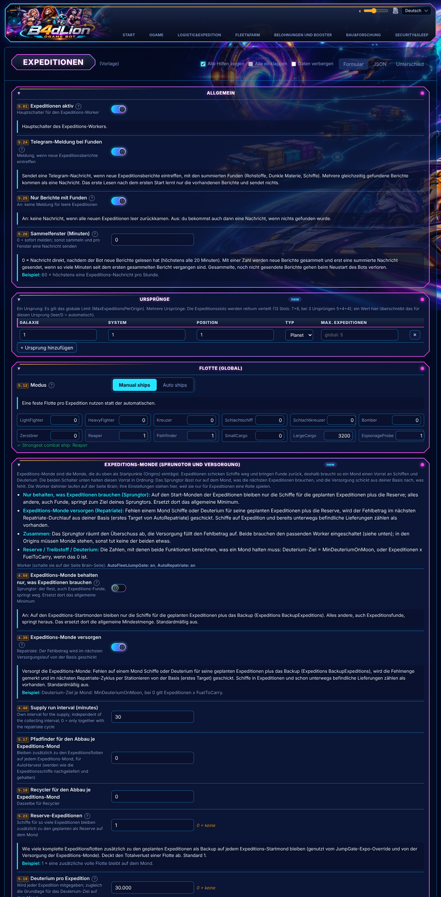

Seiten: [Übersicht](README.md) · [Start](seite-start.md) · [Ogame](seite-ogame.md) · **Logistic & Expedition** · [Fleet & Farm](seite-farm.md) · [Rewards and boosters](seite-belohnungen.md) · [Build & Research](seite-bauforschung.md) · [Security & Sleep](seite-sicherheit.md) · [Logging](seite-logging.md) · [Auktionen](seite-auktionen.md) · [Experimental](seite-experimental.md) · [Leiste und Bedienung](seite-bedienung.md)

Felder: [Allgemein](felder-allgemein.md) · [Logistic & Expedition](felder-logistik.md) · [Fleet & Farm](felder-farm.md) · [Rewards and boosters](felder-belohnungen.md) · [Build & Research (Brain)](felder-bauforschung.md) · [Security & Sleep](felder-sicherheit.md) · [Auktionen](felder-auktionen.md) · [Experimental](felder-experimental.md)

---

# Logistik & Expeditionen

_Menüpunkt: Logistic&Expedition_

Drei Reiter für alles, was Flotten außerhalb des Farmens tut: Expeditionen (Boni, Startorte, Flotte, alle Expeditions-Schalter), Logistik (Discovery, Kolonisieren, Transporte, Sprungtor) und Repatriierung (Rohstoffe von allen Himmelskörpern zusammenführen oder zurückholen). Die Reiterleiste oben wechselt zwischen den drei Seiten.

_Oberfläche mit Vorlagen-Werten, ohne echte Daten._

## Expedition

Vier Kästen. 'Lebensform- und Expeditions-Boni' zeigt gelesene Boni, die maximal möglichen Funde (Metall, Kristall, Deuterium) und die berechnete Zahl Großer Transporter je Expedition; ohne Daten wartet die Seite, bis der Expeditions-Worker sie beim nächsten Lauf schreibt. 'Expedition origins (moons)' listet die Startorte (G, S, P, Planet/Mond, 'max expeditions'). 'Flotte' schaltet zwischen Auto und Manuell. 'Expeditions-Einstellungen (aus allen Reitern gesammelt)' fasst die Expeditions-Schalter in Gruppen zusammen: Expeditions, Support (Expeditionsmonde versorgen), Collecting (Überschuss zurückholen), Other workers.

1. Startorte: Koordinaten und Typ eintragen, '+ Ursprung hinzufügen', dann 'Startorte speichern'; das Kreuz entfernt einen Eintrag. 'max expeditions' leer oder 0 = automatisch.
2. Flotte: Auto berechnet die Flotte je Expedition (nur Anzeige, ausgegraut). Manuell sendet genau die eingetragene Flotte auf jede Expedition. Der Wechsel wird sofort gespeichert; Schiffszahlen danach mit 'Save fleet' speichern.
3. 'Expeditionen auffüllen': Kleine Transporter und Pathfinder jeweils auf 'Auffüllen' oder 'None' stellen; Haken 'Alles auf die Expo-Slots verteilen' für kleine Spieler; dann 'Save' bzw. 'Save fleet'.
4. Einstellungen: Gruppen aufklappen, Werte ändern und unten speichern ('Einstellungen speichern').

Felder: [Logistic & Expedition](felder-logistik.md), [Build & Research (Brain)](felder-bauforschung.md), [Security & Sleep](felder-sicherheit.md), [Experimental](felder-experimental.md)

## Logistic

Einklappbare Kästen mit je drei Spalten (Nummer, Feld, Beschreibung): AutoDiscovery (beim Öffnen aufgeklappt), AutoColonize und Brain (logistics) mit Transports, AutoFleetJumpGate, ResourceLedger und DeutHold. Frachter-Bau steht unter Build&Research > AutoShips, Repatriierung im Reiter Repatriate.

1. Kasten per Klick auf die Titelzeile auf- oder zuklappen; 'Alle einklappen' klappt alle zu.
2. Felder ändern; 'Alle speichern' schreibt alle Änderungen, 'Verwerfen' nimmt sie zurück (beide sind erst nach einer Änderung aktiv).

Felder: [Logistic & Expedition](felder-logistik.md), [Build & Research (Brain)](felder-bauforschung.md)

## Repatriate

Die Einstellungen von Brain.AutoRepatriate (Rückführen aller Rohstoffe zum Ziel, Reverse-Repatriate zum Zurückholen für einen Bau, ExpoSupply, Deuterium am Mond) und RepatriateLedgerHold. Aufbau und Bedienung wie im Reiter Logistic; AutoRepatriate ist beim Öffnen aufgeklappt.

1. Kästen auf- und zuklappen, Felder ändern, dann 'Alle speichern' oder 'Verwerfen'.

Felder: [Build & Research (Brain)](felder-bauforschung.md), [Experimental](felder-experimental.md)

## Hinweise

- Der Expeditionen-Reiter speichert den ganzen Expeditions-Block; nach dem Speichern übernimmt der Bot die Werte bei der nächsten Expeditionsplanung (Neustart nur nötig, wenn Config-Reload aus ist, laut Meldung der Seite).
- Mehrere Startorte im selben System werden orange markiert, weil Expeditionen aus demselben System den Ertrag senken können.
- Im Modus Auto stehen Primärschiff, 'Keep at home' und Minimum im Kasten Einstellungen (Expeditions).
- Mit nur einer Instanz ist die Instanzauswahl ausgeblendet.

