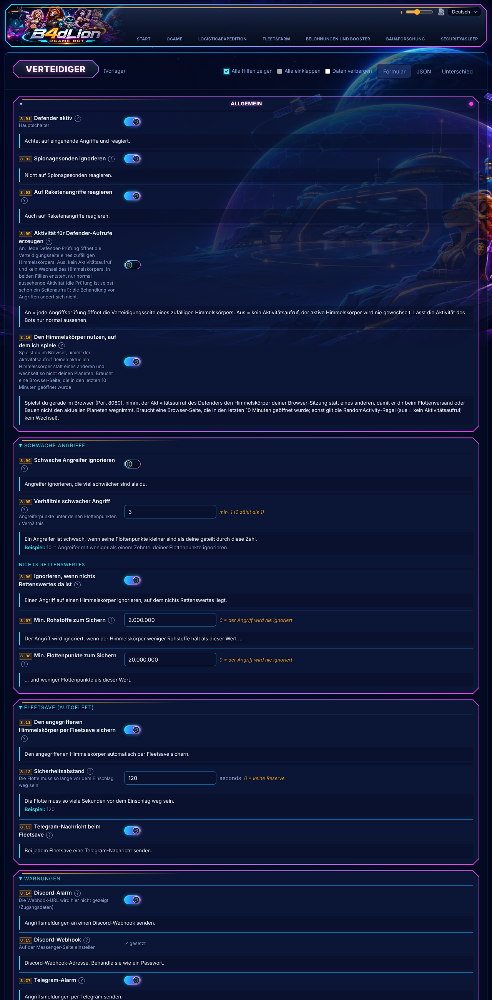

Seiten: [Übersicht](README.md) · [Start](seite-start.md) · [Ogame](seite-ogame.md) · [Logistic & Expedition](seite-logistik.md) · [Fleet & Farm](seite-farm.md) · [Rewards and boosters](seite-belohnungen.md) · [Build & Research](seite-bauforschung.md) · **Security & Sleep** · [Logging](seite-logging.md) · [Leiste und Bedienung](seite-bedienung.md)

Felder: [Allgemein](felder-allgemein.md) · [Logistic & Expedition](felder-logistik.md) · [Fleet & Farm](felder-farm.md) · [Rewards and boosters](felder-belohnungen.md) · [Build & Research (Brain)](felder-bauforschung.md) · [Security & Sleep](felder-sicherheit.md)

---

# Sicherheit & Schlaf

_Menüpunkt: Security&Sleep_

Hier stellst du ein, wann der Bot schläft und was er dabei tut, wie er auf Angriffe und Spionage reagiert und wie Flotten und Trümmerfelder geschützt werden. Die Seite hat drei Reiter (Sleep, Security, General). Jeder Reiter zeigt einklappbare, nummerierte Kästen mit drei Spalten: Nummer, Feld, Beschreibung.

_Oberfläche mit Vorlagen-Werten, ohne echte Daten._

## Sleep

Enthält drei Kästen: SleepMode (festes tägliches Schlaffenster, in dem keine Flotten gesendet werden; geöffnet beim Start), GhostSleep (Schlafvariante mit Geisterflug-Fleetsave, bei der Expeditionen und Defender weiterlaufen) und DiscoverNight (während des Schlafs sendet der Bot in Runden kurz neue Entdeckungsmissionen, braucht SleepMode aktiv). Zeiten sind Serverzeit.

1. Im Kasten SleepMode Aktiv einschalten und Schlafen gehen und Aufwachen als Uhrzeit eintragen (z. B. 23:00 und 07:00).
2. Optional die zufällige Verschiebung in Minuten setzen (0 = exakt); je Nacht wird ein Versatz gewählt, eine neue Nacht beginnt um 15:00.
3. Beim Schlaf-Fleetsave einstellen, ob die Flotten gesichert werden (nur Monde, Deuterium-Rest, Rückruf, Mission, Ziel); ausgeschlossene Himmelskörper pflegst du im Reiter Ausschlüsse unter Schlaf-Fleetsave.
4. Oben Alle speichern klicken; Verwerfen setzt die Änderungen zurück, Alle einklappen klappt die Kästen zu.

Felder: [Security & Sleep](felder-sicherheit.md)

## Security

Enthält die Kästen RaidProtection (Raid-Warnung, Gegenspionage, Watch-Liste, Scans eigener Systeme), Defender (erkennt anfliegende Angriffe und reagiert; geöffnet beim Start), DefenderRecheck, DebrisSave und FleetsaveSlot. Beim Defender kannst du u. a. Sonden ignorieren, schwache Angreifer ignorieren, die Flotte automatisch sichern (Sicherheitsabstand vor dem Einschlag), Benachrichtigungen per Telegram oder Discord, eine Whitelist von Spieler-IDs, Gegenspionage und Alarm einstellen. DefenderRecheck holt kurz vor dem Fleetsave die Angriffsliste nochmals. FleetsaveSlot hält den letzten freien Flottenslot für den Fleetsave frei.

1. Kasten aufklappen, Schalter und Werte ändern.
2. Oben auf Alle speichern klicken.

Felder: [Security & Sleep](felder-sicherheit.md)

## General

Allgemeine Einstellungen des Bots in den Kästen General (geöffnet beim Start), Logs und BotPause. Logs enthält die Log-Schalter (ReduceLogs, CollectLogs, ExtraDebugLog). BotPause steuert die Verzögerung (Delay) über den Pause-Knopf der Browser-Kacheln. Auf diesem Reiter gibt es zusätzlich den Knopf Config neu laden: er liest die aktive Config der Instanz erneut, ohne den Bot neu zu starten.

1. Werte ändern und oben speichern.
2. Config neu laden klicken, wenn du die Config-Datei von Hand geändert hast. Ungespeicherte Änderungen der Seite sind darin nicht enthalten; der Bot übernimmt den Neuladeauftrag innerhalb weniger Sekunden (siehe Log).

Felder: [Allgemein](felder-allgemein.md)

## Hinweise

- Ist die Config nicht lesbar, behält der Bot beim Neuladen die laufenden Werte und schreibt einen Fehler ins Log.
- Der Schlaf-Fleetsave meldet per Telegram, sofern SleepMode.TelegramMessenger aktiv ist; ein Fleetsave durch den Defender oder per Telegram-Befehl meldet unabhängig davon wie bisher.
- Der Defender-Eintrag 0 in der Whitelist ist nur der Platzhalter der Vorlage (0 heißt: Angreifer unbekannt); trage echte Spieler-IDs ein.
- BotPause verweigert eine Verzögerung, solange du schläfst, ein Angriff naht oder ein Rückruf fällig ist (laut Referenz).
- Die Kästen des Blocks Experimental (z. B. Galaxie-Cache und Diagnose-Log) stehen ebenfalls auf dieser Seite; der Block hat kein eigenes Formular.

