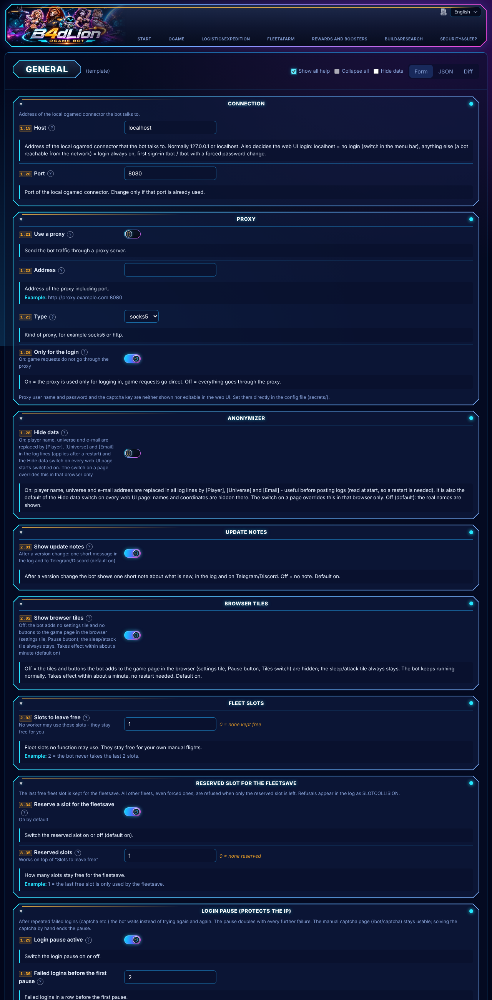

Pages: [Overview](README.md) · [Start](seite-start.md) · [Ogame](seite-ogame.md) · [Logistic & Expedition](seite-logistik.md) · [Fleet & Farm](seite-farm.md) · [Rewards and boosters](seite-belohnungen.md) · [Build & Research](seite-bauforschung.md) · [Security & Sleep](seite-sicherheit.md) · [Logging](seite-logging.md) · [Bar and controls](seite-bedienung.md)

Fields: **General** · [Logistic & Expedition](felder-logistik.md) · [Fleet & Farm](felder-farm.md) · [Rewards and boosters](felder-belohnungen.md) · [Build & Research (Brain)](felder-bauforschung.md) · [Security & Sleep](felder-sicherheit.md)

---

# Fields: General

Settings that apply everywhere: connection, proxy, anonymizer, slot distribution and notifications (Discord, Telegram).

23 fields, as the B4dLion interface shows them (number = field number before the field name).

_Interface with template values, no real data._

## Connection

#### 1.019 Host

`General.Host` · Default: **“localhost”** · Text

Address of the local ogamed connector that the bot talks to. Normally 127.0.0.1 or localhost. Also decides the web UI login: localhost = no login (switch in the menu bar), anything else (a bot reachable from the network) = login always on, first sign-in tbot / tbot with a forced password change.

#### 1.020 Port

`General.Port` · Default: **“8080”** · Text

Port of the local ogamed connector. Change only if that port is already used.

## Proxy

#### 1.021 Use a proxy

`General.Proxy.Enabled` · Default: **no** · Switch

Send the bot traffic through a proxy server.

#### 1.022 Address

`General.Proxy.Address` · Default: **(empty)** · Text

Address of the proxy including port.

**Example:** http://proxy.example.com:8080

#### 1.023 Type

`General.Proxy.Type` · Default: **“socks5”** · Text

Kind of proxy, for example socks5 or http.

#### 1.026 Only for the login

`General.Proxy.LoginOnly` · Default: **yes** · Switch · On: game requests do not go through the proxy

On = the proxy is used only for logging in, game requests go direct. Off = everything goes through the proxy.

## Anonymizer

#### 1.028 Hide data

`General.AnonymizeLogs` · Default: **no** · Switch · On: player name, universe and e-mail are replaced by [Player], [Universe] and [Email] in the log lines (applies after a restart) and the Hide data switch on every web UI page starts switched on. The switch on a page overrides this in that browser only

On: player name, universe and e-mail address are replaced in all log lines by [Player], [Universe] and [Email] - useful before posting logs (read at start, so a restart is needed). It is also the default of the Hide data switch on every web UI page: names and coordinates are hidden there. The switch on a page overrides this in that browser only. Off (default): the real names are shown.

## Login pause (protects the IP)

#### 1.029 Login pause active

`General.LoginPause.Active` · Default: **yes** · Switch

Switch the login pause on or off.

#### 1.030 Failed logins before the first pause

`General.LoginPause.FailuresBeforePause` · Default: **2** · Number

Failed logins in a row before the first pause.

#### 1.031 First pause

`General.LoginPause.PauseMinutes` · Default: **30** · Number · Doubles with every further failure

Length of the first pause in minutes. Doubles with every further failure.

#### 1.032 Longest delay

`General.LoginPause.MaxPauseMinutes` · Default: **120** · Number

Longest pause in minutes.

## Update notes

#### 2.001 Show update notes

`General.ShowUpdateNotes` · Default: **yes** · Switch · After a version change: one short message in the log and to Telegram/Discord (default on)

After a version change the bot shows one short note about what is new, in the log and on Telegram/Discord. Off = no note. Default on.

## Browser tiles

#### 2.002 Show browser tiles

`General.ShowBrowserTiles` · Default: **yes** · Switch · Off: the bot adds no settings tile and no buttons to the game page in the browser (settings tile, Pause button); the sleep/attack tile always stays. Takes effect within about a minute (default on)

Off = the tiles and buttons the bot adds to the game page in the browser (settings tile, Pause button, Tiles switch) are hidden; the sleep/attack tile always stays. The bot keeps running normally. Takes effect within about a minute, no restart needed. Default on.

## Fleet slots

#### 2.003 Slots to leave free

`General.SlotsToLeaveFree` · Default: **1** · Number · No worker may use these slots - they stay free for you

Fleet slots no function may use. They stay free for your own manual flights.

**Example:** 2 = the bot never takes the last 2 slots.

## Slot shift Brain <-> AutoFarm

#### 2.004 Automatic slot shift

`General.SlotShift.Active` · Default: **yes** · Switch

Master switch of this function. Off = the bot does nothing here.

#### 2.005 Extra slots at most

`General.SlotShift.MaxExtraSlots` · Default: **6** · Number · How far a limit may be raised above its MaxSlots (the free slots in the game still bound it)

_No description yet._

#### 2.006 Brain idle after

`General.SlotShift.IdleReleaseMinutes` · Default: **10** · Number · Brain without transports and without slot requests for this long gives its unused reserve to the others

_No description yet._

#### 2.007 Raise holds for

`General.SlotShift.PressureMinutes` · Default: **5** · Number · Without further pressure a raised limit falls back to MaxSlots after this long

_No description yet._

#### 2.008 Release Brain reserve until

`General.SlotShift.WakeLeadMinutes` · Default: **20** · Number · The building/research workers sleep until their running builds end. If none of them wakes within this many minutes and no transport is flying, Brain reserves no slots for the others (0 = off)

_No description yet._

#### 2.009 Hold a slot for a waiting worker

`General.SlotShift.ClaimMinutes` · Default: **10** · Number · A worker at its transport limit gets the next free game slot: the others (and the farm) do not take the last free one for this long, and the farm limit drops by 1 while no slot is free (0 = off)

_No description yet._

## Discord

#### 2.054 Discord active

`DiscordWebhook.Active` · Default: **no** · Switch · Switch it on to show and edit the options

Copy the Telegram messages to Discord. This only sends; commands still go through Telegram.

#### 2.055 Webhook URL

`DiscordWebhook.Url` · Default: **“https://discord.com/api/webhooks/WEBHOOK_ID/WEBHOOK_TOKEN”** · Text · Channel settings > Integrations > Webhooks

Webhook address of your Discord channel. Treat it like a password.

#### 2.056 Display name

`DiscordWebhook.Username` · Default: **“B4dLion”** · Text · Name shown on the Discord posts

Name shown as sender of the Discord messages.

