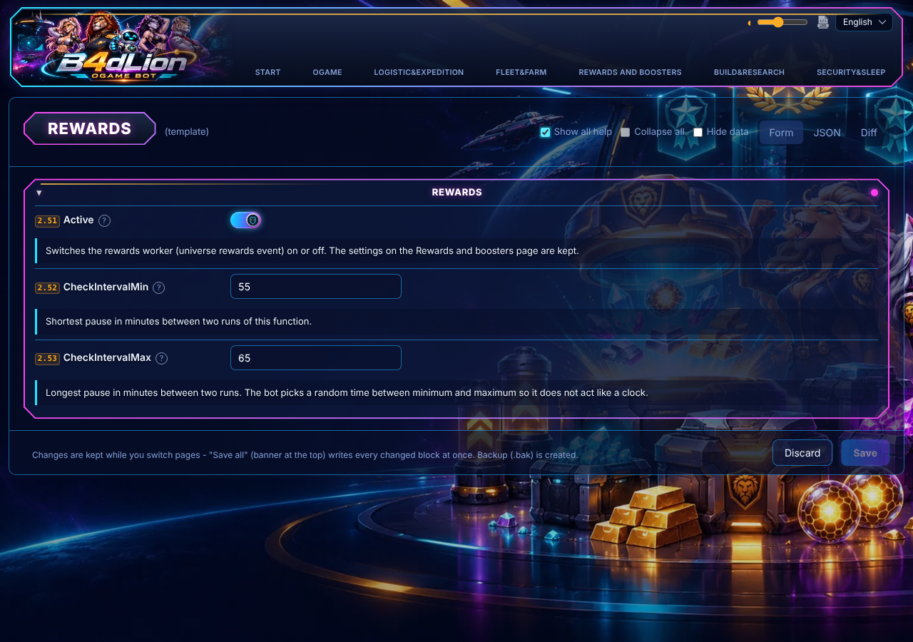

Pages: [Overview](README.md) · [Start](seite-start.md) · [Ogame](seite-ogame.md) · [Logistic & Expedition](seite-logistik.md) · [Fleet & Farm](seite-farm.md) · [Rewards and boosters](seite-belohnungen.md) · [Build & Research](seite-bauforschung.md) · [Security & Sleep](seite-sicherheit.md) · [Logging](seite-logging.md) · [Auctions](seite-auktionen.md) · [Bar and controls](seite-bedienung.md)

Fields: [General](felder-allgemein.md) · [Logistic & Expedition](felder-logistik.md) · [Fleet & Farm](felder-farm.md) · **Rewards and boosters** · [Build & Research (Brain)](felder-bauforschung.md) · [Security & Sleep](felder-sicherheit.md) · [Auctions](felder-auktionen.md) · [Experimental](felder-experimental.md)

---

# Fields: Rewards and boosters

Rewards.

3 fields, as the B4dLion interface shows them (number = field number before the field name).

_Interface with template values, no real data._

## Rewards

#### 2.051 Active

`Rewards.Active` · Default: **yes** · Switch

Switches the rewards worker (universe rewards event) on or off. The settings on the Rewards and boosters page are kept.

#### 2.052 CheckIntervalMin

`Rewards.CheckIntervalMin` · Default: **55** · Number

Shortest pause in minutes between two runs of this function.

#### 2.053 CheckIntervalMax

`Rewards.CheckIntervalMax` · Default: **65** · Number

Longest pause in minutes between two runs. The bot picks a random time between minimum and maximum so it does not act like a clock.

