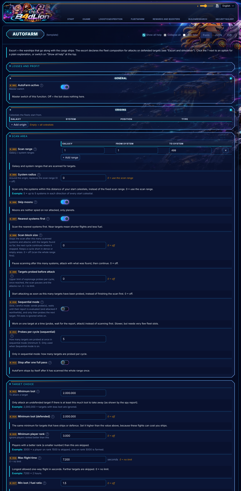

Pages: [Overview](README.md) · [Start](seite-start.md) · [Ogame](seite-ogame.md) · [Logistic & Expedition](seite-logistik.md) · [Fleet & Farm](seite-farm.md) · [Rewards and boosters](seite-belohnungen.md) · [Build & Research](seite-bauforschung.md) · [Security & Sleep](seite-sicherheit.md) · [Logging](seite-logging.md) · [Auctions](seite-auktionen.md) · [Bar and controls](seite-bedienung.md)

Fields: [General](felder-allgemein.md) · [Logistic & Expedition](felder-logistik.md) · **Fleet & Farm** · [Rewards and boosters](felder-belohnungen.md) · [Build & Research (Brain)](felder-bauforschung.md) · [Security & Sleep](felder-sicherheit.md) · [Auctions](felder-auktionen.md)

---

# Fields: Fleet & Farm

AutoFarm (espionage and attack, escort, block list) and debris harvest.

108 fields, as the B4dLion interface shows them (number = field number before the field name).

_Interface with template values, no real data._

## General

#### 6.001 AutoFarm active

`AutoFarm.Active` · Default: **no** · Switch · Master switch

Master switch of this function. Off = the bot does nothing here.

## Scan area

#### 6.003 Scan area

`AutoFarm.ScanRange` · Default: **[{"Galaxy": 1, "StartSystem": 1, "EndSystem": 499}]** · List · Galaxy / system ranges

Galaxy and system ranges that are scanned for targets.

#### 6.004 System radius

`AutoFarm.SystemRange` · Default: **0** · Number · Around the origin; replaces the scan range (0 = off)

Scan only the systems within this distance of your start celestials, instead of the fixed scan range. 0 = use the scan range.

**Example:** 5 = up to 5 systems in each direction of every start celestial.

#### 6.006 Skip moons

`AutoFarm.ExcludeMoons` · Default: **yes** · Switch

Moons are neither spied on nor attacked, only planets.

#### 6.007 Nearest systems first

`AutoFarm.DistanceBasedScanOrder` · Default: **yes** · Switch

Scan the nearest systems first. Near targets mean shorter flights and less fuel.

#### 6.008 Scan block size

`AutoFarm.ScanBlockSize` · Default: **0** · Number · Stops the scan after this many scanned systems and attacks with the targets found so far; the next cycle continues where it stopped. Keeps a cycle short in dense or empty areas. 0 = off (scan the whole range first).

Pause scanning after this many systems, attack with what was found, then continue. 0 = off.

#### 6.009 Targets probed before attack

`AutoFarm.TargetsProbedBeforeAttack` · Default: **0** · Number · Upper limit of espionage probes per cycle; once reached, the scan pauses and the attacks run. 0 = no limit.

Start attacking as soon as this many targets have been probed, instead of finishing the scan first. 0 = off.

#### 6.010 Sequential mode

`AutoFarm.SequentialMode` · Default: **no** · Switch · Slow, careful mode: sends probe(s), waits until their report is evaluated (and attacked if worthwhile), and only then probes the next target. Fill slots is ignored while on.

Work on one target at a time (probe, wait for the report, attack) instead of scanning first. Slower, but needs very few fleet slots.

#### 6.011 Probes per cycle (sequential)

`AutoFarm.SequentialModeProbesPerCycle` · Default: **5** · Number · How many targets are probed at once in sequential mode (minimum 1). Only used when Sequential mode is on.

Only in sequential mode: how many targets are probed per cycle.

#### 6.012 Stop after one full pass

`AutoFarm.StopAfterFullScan` · Default: **no** · Switch

AutoFarm stops by itself after it has scanned the whole range once.

## Target choice

#### 6.013 Minimum loot

`AutoFarm.MinimumResources` · Default: **2000000** · Number · To attack a target

Only attack an undefended target if there is at least this much loot to take away (as shown by the spy report).

**Example:** 2,000,000 = targets with less loot are ignored.

#### 6.014 Minimum loot (defended)

`AutoFarm.MinimumResourcesDefended` · Default: **2000000** · Number

The same minimum for targets that have ships or defence. Set it higher than the value above, because these fights can cost you ships.

#### 6.015 Minimum player rank

`AutoFarm.MinimumPlayerRank` · Default: **3000** · Number · Ignore players ranked better than this

Players with a better rank (a smaller number) than this are skipped.

**Example:** 3000 = a player on rank 1500 is skipped, one on rank 5000 is farmed.

#### 6.016 Max flight time

`AutoFarm.MaxFlightTime` · Default: **7200** · Number · 0 = no limit

Longest allowed one-way flight in seconds. Farther targets are skipped. 0 = no limit.

**Example:** 7200 = 2 hours.

#### 6.017 Min loot / fuel ratio

`AutoFarm.MinLootFuelRatio` · Default: **1.5** · Number

The loot must be worth at least this many times the fuel cost. The bot picks the fastest speed that still meets it.

**Example:** 1.5 = for 100,000 deuterium of fuel there must be at least 150,000 of loot.

#### 6.018 Preferred resource

`AutoFarm.PreferedResource` · Default: **(empty)** · Text · Sorts targets by it

Targets with the most of this resource come first. Empty = no preference.

#### 6.019 Attack defended targets

`AutoFarm.AttackDefendedTargets` · Default: **yes** · Switch · Needs the escort simulation

Also attack targets that have ships or defence. The bot simulates the fight and sends an escort of warships along with the cargo ships. Needs the escort settings below.

**Example:** Costs more deuterium and can lose ships.

#### 6.020 Max defence points

`AutoFarm.MaxDefensePoints` · Default: **50000000** · Number

Targets whose defence is worth more than this are skipped.

#### 6.021 Min loot per defence point

`AutoFarm.MinLootPerDefensePoint` · Default: **20** · Number

Defended targets are skipped when their loot is too small compared to their defence. Higher = pickier.

#### 6.022 Report valid for

`AutoFarm.KeepReportFor` · Default: **1440** · Number

Minutes an espionage report counts as valid before the target has to be probed again.

#### 6.023 Retry unsuitable targets after

`AutoFarm.NotSuitableRetryMinutes` · Default: **720** · Number

Minutes after which a target that was found unsuitable (loot too small, not worth it) is probed again. The shorter of this value and the report validity counts, so daily runs reach such targets again. 0 = same as the report validity.

#### 6.024 Delete old reports in the game

`AutoFarm.DeleteExpiredReports` · Default: **yes** · Switch · Expired and replaced espionage reports are deleted; held and defence-blacklisted targets keep theirs

Deletes espionage reports in the game that are older than the report validity or replaced by a newer report of the same target, so they do not pile up in your inbox (at most 50 per run). Reports of targets held for manual review or blacklisted for defence/unprofitable are kept.

## Advanced options

#### 6.025 Max report age for attack

`AutoFarm.MaxReportAgeMinutesForAttack` · Default: **120** · Number · Older reports are not attacked (0 = off)

Right before an attack, a report older than this is discarded and the target is probed again, because the defence may have changed. 0 = off.

#### 6.026 Process all reports

`AutoFarm.ProcessAllReports` · Default: **yes** · Switch · Also evaluate reports of targets TBot did not probe itself (manual probes)

Also evaluate reports of targets TBot did not probe itself (e.g. manual probes) when the target is inactive. false = ignore such reports.

#### 6.027 Defended targets per pass

`AutoFarm.MaxDefendedPerPass` · Default: **2** · Number · Evaluate at most this many defended targets per pass (escort simulation); they also count as attack-ready only up to this number (0 = unlimited)

Maximum number of defended targets evaluated per pass (escort simulation, fleet debris), most loot first. They also count as attack-ready only up to this number, so they no longer block scanning for free slots. Already evaluated, not attackable targets rest for 45 minutes. 0 = unlimited.

#### 6.028 Defended targets: pick by

`AutoFarm.DefendedPick` · Default: **“Loot”** · Text · Loot = most loot first, Fresh = newest report first

Which defended targets fill the places of MaxDefendedPerPass: Loot = most loot first (default), Fresh = newest espionage report first.

#### 6.029 Defended targets: max report age

`AutoFarm.DefendedMaxAgeMinutes` · Default: **45** · Number · Older defended targets are dropped and probed again later (0 = off)

Defended targets whose espionage report is older than this are dropped (back to ProbesPending, probed again later), so old ones do not stay in the waiting list. 0 = off.

#### 6.032 Priority re-probe of valuable targets

`AutoFarm.PriorityReprobe` · Default: **no** · Switch · Probe valuable targets with an outdated report before the scan (one per pass)

Priority for valuable targets: targets whose espionage report is too old for an attack (MaxReportAgeMinutesForAttack) but had a lot of loot are probed again before the scan (at most one per pass, in addition to the probe limit).

#### 6.033 Max attack delay

`AutoFarm.MaxAttackDelaySec` · Default: **600** · Number · Longest postponement to fit the timing

Longest time in seconds an attack may be held back so that the recyclers arrive right behind it.

#### 6.034 Debris credit

`AutoFarm.DebrisCreditPercent` · Default: **80** · Number · Share of debris counted as profit

How much of the expected debris field counts as profit when the bot decides whether an attack pays off (after recycler fuel).

**Example:** 80 = 80 % of the debris are counted.

#### 6.035 Min. recyclers to send

`AutoFarm.MinRecyclersToSend` · Default: **0** · Number · Smaller debris fields are skipped (0 = off)

Debris fields that need fewer recyclers than this are skipped (no recyclers, no trigger probe), so small fields do not use a slot. 0 = off.

#### 6.036 Min speed for profit re-check

`AutoFarm.MinSpeedPercentForProfitRetry` · Default: **50** · Number

If an attack does not pay off at the chosen speed, the bot tries slower speeds down to this value, because slower flights burn less fuel.

#### 6.042 Global spacing

`AutoFarm.GlobalSpacing` · Default: **no** · Switch · Spread several bot instances over different start points

Only for several bot instances: spreads them over different start points of the scan range. Leave it off with one instance.

#### 6.043 Repeat log interval

`AutoFarm.RepeatedLogIntervalMinutes` · Default: **360** · Number · Identical log lines at most this often (0 = always)

The same log message appears at most this often. 0 = every time.

## More settings (4)

#### 6.030 ReserveSlotMinLoot

`AutoFarm.ReserveSlotMinLoot` · Default: **5000000** · Number

Default `5000000` (`0` = off). An attack-ready target with at least this much loot that waits because the AutoFarm slot budget is used up keeps one free game slot reserved: Expeditions, Brain and other workers cannot take the next freed slot (they may still use any further free slots). The reserve lasts 10 minutes and is renewed every AutoFarm run while the target waits. Defender and fleetsave are not affected.

#### 6.031 BigTargetsFirstWhenSlotsScarce

`AutoFarm.BigTargetsFirstWhenSlotsScarce` · Default: **yes** · Switch

Default `true`. Normally unprotected targets come before defended ones (most loot first). If there are more attack-ready targets than free AutoFarm slots, all of them are ordered by loot instead, so the scarce slot goes to the biggest one (a defended target with a lot of loot is no longer behind small ones).

#### 6.081 CalcSource

`AutoFarm.CalcSource` · Default: **“ogame”** · Text

Combat calculator: `ogame` (default, existing Go simulator), `shadow` (Go decides, including the lifeform bonuses; Rust compares asynchronously only for confirmed compositions), or `external` (Rust decides).

#### 6.082 Url

`AutoFarm.ExternalCalc.Url` · Default: **“http://127.0.0.1:3000”** · Text

Local Rust API URL. Only loopback hosts (`127.0.0.1`, `localhost`, `::1`) are accepted. Default `http://127.0.0.1:3000`.

#### 6.083 AutoStart

`AutoFarm.ExternalCalc.AutoStart` · Default: **no** · Switch

Start and supervise the local Rust process on first use (default `false`). The executable must be present beside TBot or at `ExecutablePath`.

#### 6.084 ExecutablePath

`AutoFarm.ExternalCalc.ExecutablePath` · Default: **(empty)** · Text

Optional path for the Rust executable when process management is enabled.

#### 6.085 Port

`AutoFarm.ExternalCalc.Port` · Default: **3000** · Number

Rust service port (default `3000`).

#### 6.086 TimeoutSeconds

`AutoFarm.ExternalCalc.TimeoutSeconds` · Default: **60** · Number

Maximum wait per Rust request (default `60`).

#### 6.087 FallbackToOgame

`AutoFarm.ExternalCalc.FallbackToOgame` · Default: **yes** · Switch

Use the Go simulator after external connection, timeout, or server failures (default `true`). Invalid requests (HTTP 4xx) are not silently retried through Go.

#### 6.088 DebrisDeuterium

`AutoFarm.ExternalCalc.DebrisDeuterium` · Default: **“auto”** · Text

Deuterium in debris fields for the combat calculators. `auto` (default) reads the server rule from the galaxy view (`deuteriumInDebris`); until the first galaxy view after a start it counts as off. `true` / `false` force it. Off: the deuterium share is removed from the Go result and Rust calculates without it. On: Go keeps it and Rust includes it.

#### 6.089 AuthToken

`AutoFarm.ExternalCalc.AuthToken` · Default: **(empty)** · Text

Optional bearer token; must match the Rust service's `AUTH_TOKEN` environment variable. Keep it private.

#### 6.090 AttackerClassAndLifeform

`AutoFarm.ExternalCalc.AttackerClassAndLifeform` · Default: **yes** · Switch

Default `true`: uses your own lifeform ship bonuses (weapon/shield/structure per ship type, from the lifeform bonus page) in the combat calculation. Both the Go simulator and the Rust calculator calculate with them (the Go factor is tech level + bonus, without bonuses the result is unchanged). `false` = calculate without. Missiles (502/503) are never sent to Rust.

#### 6.091 DefenderLifeformBonuses

`AutoFarm.ExternalCalc.DefenderLifeformBonuses` · Default: **yes** · Switch

Default `true`: uses the defender's lifeform combat bonuses per ship type (weapon/shield/structure in percent) in the combat calculation. They are read from the lifeform bonus table of the espionage report (servers of version 13.x deliver it); without the table nothing is used. Go and Rust calculate with them. `false` = calculate without. Keep `TargetCombatTechBonus` as the safety margin (default +1 level on the target's techs) for bonuses that are not visible in the report.

#### 6.092 CompareMode

`AutoFarm.ExternalCalc.CompareMode` · Default: **no** · Switch

Run both engines sequentially and log comparison differences to developer logs; the selected `CalcSource` result is returned. This adds time and is intended for testing only (default `false`). Use `CalcSource: shadow` for non-blocking comparisons of confirmed compositions.

#### 6.093 BattleLogRetentionDays

`AutoFarm.ExternalCalc.BattleLogRetentionDays` · Default: **14** · Number

_No description yet._

#### 6.094 BattleLogArchiveKeep

`AutoFarm.ExternalCalc.BattleLogArchiveKeep` · Default: **10** · Number

_No description yet._

## Deuterium

#### 6.037 Save deuterium

`AutoFarm.ReduceDeuterium` · Default: **no** · Switch · Attack fleet and recyclers fly as slowly as sensible (flight time limit kept, recycler arrives right behind the fleet)

Save deuterium: the attack fleet and the recyclers fly as slowly as makes sense, never below the lowest speed set below. Flights take longer and slots stay busy longer.

**Example:** Useful when deuterium is short.

#### 6.038 Lowest speed when saving deuterium

`AutoFarm.ReduceDeuteriumMinSpeedPercent` · Default: **30** · Number · Never below 30 %

The slowest speed that 'Save deuterium' may use. Never below 30 %.

#### 6.039 Low-deuterium guard

`AutoFarm.DeuteriumGuard` · Default: **yes** · Switch · Below the minimum on the start celestial: no attacks on defended targets

If a start celestial has less deuterium than the minimum below, attacks on defended targets from it are paused. Nothing else is switched off. The AutoFarm page then shows 'Deuterium too low for bigger fleets'.

#### 6.040 Guard: minimum deuterium

`AutoFarm.DeuteriumGuardMin` · Default: **10000000** · Number

The deuterium threshold of the guard.

**Example:** 10,000,000 = the guard acts below 10 million deuterium.

#### 6.041 Guard: bridge manually

`AutoFarm.DeuteriumGuardOverride` · Default: **no** · Switch · On = ignore the guard and keep farming with low deuterium

Bridge the guard by hand and keep farming even with low deuterium. The page still shows a hint.

## Blacklist

#### 6.044 Blacklist active

`AutoFarm.Blacklist.Active` · Default: **yes** · Switch

Master switch of this function. Off = the bot does nothing here.

#### 6.045 Reset after

`AutoFarm.Blacklist.ResetAfterHours` · Default: **24** · Number

Hours until a target on the blacklist is allowed again. 0 = never.

#### 6.046 Invalid target: reset after

`AutoFarm.Blacklist.InvalidTargetResetAfterHours` · Default: **12** · Number · Targets the probe send rejects (empty position, newbie protection) are not probed again for this long. 0 = never

_No description yet._

#### 6.047 Empty moon: reset after

`AutoFarm.Blacklist.EmptyMoonResetAfterHours` · Default: **168** · Number · Moons without any resources are not probed again for this long (default 168 = 7 days). 0 = never

_No description yet._

#### 6.048 Permanent: reset after

`AutoFarm.Blacklist.PermanentResetAfterHours` · Default: **0** · Number

Hours until a permanently blacklisted target is released. 0 = never.

#### 6.049 Unusable report: blacklist after

`AutoFarm.Blacklist.ReportQueryLimitForNonActionable` · Default: **3** · Number · A target whose report was not usable this many times in a row is blacklisted and the report deleted

How many times in a row the same report may mark a target as not usable. After that the target is blacklisted (like low resources) and the report is deleted in the game, so it does not pile up. Needs the blacklist switched on.

## Probes and slots

#### 6.050 Probes per spy mission

`AutoFarm.NumProbes` · Default: **25** · Number

Espionage probes sent per target.

#### 6.051 Build missing probes

`AutoFarm.BuildProbes` · Default: **no** · Switch

Build probes automatically when too few are at home.

#### 6.052 Keep all slots busy

`AutoFarm.FillSlots` · Default: **yes** · Switch

Keep all allowed fleet slots busy with probes and attacks.

#### 6.053 Max wait for probe reports

`AutoFarm.FillSlotsMaxProbeWaitSec` · Default: **300** · Number

How long to wait for probe reports (seconds) before free slots are used otherwise.

#### 6.054 Max slots for AutoFarm

`AutoFarm.MaxSlots` · Default: **4** · Number

Most fleet slots AutoFarm may use at the same time.

## Cargo and fleet

#### 6.055 Fleet speed

`AutoFarm.FleetSpeed` · Default: **100** · Number · 10-100

Fixed speed for attacks when no better speed is calculated. 100 % is fastest and burns the most deuterium.

#### 6.056 Cargo ship

`AutoFarm.CargoType` · Default: **“LargeCargo”** · Text · SmallCargo = KT, LargeCargo = GT, Pathfinder = PF

The cargo ship type that carries the loot: SmallCargo (KT), LargeCargo (GT) or Pathfinder (PF). Pathfinders are fast, but burn more deuterium.

#### 6.057 Min cargo ships per attack

`AutoFarm.MinCargosToSend` · Default: **50** · Number

No attack is started with fewer cargo ships than this.

#### 6.058 Cargo ships kept at home

`AutoFarm.MinCargosToKeep` · Default: **0** · Number

Cargo ships that always stay at home.

#### 6.059 Extra cargo

`AutoFarm.CargoSurplusPercentage` · Default: **10** · Number · On top of the calculated amount

Extra cargo space on top of the calculated amount, as a safety margin.

#### 6.060 Cargo reserve

`AutoFarm.CargoReservePercent` · Default: **5** · Number

Share of the cargo ships that is held back as a reserve.

#### 6.061 Build missing cargo ships

`AutoFarm.BuildCargos` · Default: **no** · Switch

Build cargo ships when there are not enough.

#### 6.062 Max accepted cargo loss

`AutoFarm.MaxCargoLossPercent` · Default: **2** · Number

Highest accepted loss of cargo ships, as a share of their value, in the simulation.

#### 6.063 Fleet loss that becomes debris

`AutoFarm.FleetToDebrisPercent` · Default: **30** · Number

Expected share of fleet losses that ends up as a debris field. Used to plan the recyclers.

#### 6.064 Harvest debris after attack

`AutoFarm.AutoHarvestDebrisAfterAttack` · Default: **yes** · Switch

Send recyclers to the debris field after an attack on a defended target (attacks on undefended targets leave no debris).

#### 6.065 Recycler reserve

`AutoFarm.RecyclerReservePercent` · Default: **10** · Number

Share of the recyclers that is held back as a reserve.

## Escort and simulation (defended targets only)

#### 6.066 Target combat tech bonus

`AutoFarm.TargetCombatTechBonus` · Default: **1** · Number · Safety margin in simulations

Extra combat tech levels assumed for the target in fight simulations, as a safety margin. Higher = more careful.

#### 6.067 Escort ships

`AutoFarm.EscortShipTypes` · Default: **“Cruiser,Battlecruiser”** · Text · Comma separated, in order of preference

Warships that may go along as escort, in order of preference. Comma separated.

#### 6.068 Fallback escort ships

`AutoFarm.EscortFallbackShipTypes` · Default: **“Bomber,Reaper”** · Text

Used only when the escort ships above are not enough.

#### 6.071 Escort step size

`AutoFarm.EscortShipsStep` · Default: **50** · Number

The escort is searched in steps of this many ships. Smaller = more exact but slower.

#### 6.072 Max escort ships

`AutoFarm.MaxEscortShips` · Default: **100000000** · Number

Largest number of ships of one type in an escort, when no cap is set for that type below.

#### 6.073 Max share of the fleet

`AutoFarm.MaxEscortFleetPercent` · Default: **100** · Number

At most this share of the ships of one type at home may go along as escort.

**Example:** 100 = no limit by share; 20 = at most a fifth of them.

#### 6.074 Escort reserve

`AutoFarm.EscortReservePercent` · Default: **5** · Number

Safety buffer: this much extra is added to the calculated escort where ships are available.

#### 6.075 Search: max iterations

`AutoFarm.EscortMaxIterations` · Default: **300** · Number

Search effort for the best escort size: maximum number of steps. Higher = better result, more computing time.

#### 6.076 Search: bisection iterations

`AutoFarm.EscortBisectionIterations` · Default: **20** · Number

Search effort: how finely the escort size is narrowed down. Higher = more exact, slower.

#### 6.077 Search: fine-tune simulations

`AutoFarm.EscortFineTuneMaxSims` · Default: **40** · Number

Search effort: simulations used for the final fine-tuning of the escort.

#### 6.078 Max escort loss (% of fleet value)

`AutoFarm.MaxEscortLossPercent` · Default: **10** · Number · Highest simulated loss, as a share of the value of the whole attack fleet. 0 = limit OFF (any loss is accepted). Warning: too small a value leaves hardly any escort that qualifies, so the other settings have little to choose from.

Highest simulated loss, as a share of the value of the whole attack fleet. Escorts that would lose more are rejected. 0 = limit off (any loss is accepted). Warning: too small a value leaves hardly any escort that qualifies, so the other settings have little to choose from.

**Example:** 10 = reject an escort that would lose more than 10 % of the fleet value.

#### 6.079 Loss weight vs. fuel

`AutoFarm.EscortLossWeight` · Default: **3** · Number · >1 prefers a larger escort

How much ship losses count compared to fuel when the bot picks the cheapest escort. Higher = it prefers a bigger escort that loses less.

**Example:** 3 = a lost ship counts three times as much as the same value in fuel.

#### 6.080 Min win rate

`AutoFarm.MinWinRate` · Default: **0.9** · Number · 0.9 = 90 %

The simulated fight must be won at least this often.

**Example:** 0.9 = in 90 % of the simulated fights.

#### 6.095 Battles per check

`AutoFarm.SimulationRuns` · Default: **1000** · Number

How many fights are simulated per check. More = more reliable, slower.

## Timing

#### 6.096 Run interval, min

`AutoFarm.CheckIntervalMin` · Default: **1** · Number

Minutes between two AutoFarm runs. The bot picks a random time between minimum and maximum.

#### 6.097 Run interval, max

`AutoFarm.CheckIntervalMax` · Default: **3** · Number

Minutes between two AutoFarm runs. The bot picks a random time between minimum and maximum.

#### 6.111 Run interval, min

`AutoHarvest.CheckIntervalMin` · Default: **30** · Number

Shortest pause in minutes between two runs of this function.

#### 6.112 Run interval, max

`AutoHarvest.CheckIntervalMax` · Default: **60** · Number · Es wird eine Zufallszeit zwischen Min. und Max. genutzt

Longest pause in minutes between two runs. The bot picks a random time between minimum and maximum so it does not act like a clock.

## AutoHarvest

#### 6.098 AutoHarvest active

`AutoHarvest.Active` · Default: **no** · Switch · Master switch

Collects debris fields with recyclers.

#### 6.110 Max slots

`AutoHarvest.MaxSlots` · Default: **1** · Number

Fleet slots harvesting may use at the same time.

## Which debris fields

#### 6.099 Own debris fields

`AutoHarvest.HarvestOwnDF` · Default: **yes** · Switch

Collect debris fields of your own planets and moons.

#### 6.100 Deep space

`AutoHarvest.HarvestDeepSpace` · Default: **yes** · Switch

Collect deep space debris fields.

#### 6.101 Foreign debris fields

`AutoHarvest.HarvestForeignDF` · Default: **yes** · Switch

Collect debris fields of other players.

#### 6.102 Minimum content (foreign)

`AutoHarvest.MinimumResourcesForeignDF` · Default: **3000** · Number

A foreign field is only worth a trip with at least this much content.

#### 6.103 Minimum content (own)

`AutoHarvest.MinimumResourcesOwnDF` · Default: **3000** · Number · Smaller fields are not worth a trip

A field of your own is only worth a trip with at least this much content.

#### 6.104 Minimum content (deep space)

`AutoHarvest.MinimumResourcesDeepSpace` · Default: **50000** · Number

A deep space field is only worth a trip with at least this much content.

#### 6.105 Look around X systems (expedition debris)

`AutoHarvest.DeepSpaceRange` · Default: **30** · Number · Systems to each side of every own planet that are searched for deep space fields

Systems to the left and right of each of your planets that are searched for deep space (expedition) fields.

#### 6.106 Look around X systems (normal debris)

`AutoHarvest.ForeignDFRange` · Default: **0** · Number · Systems to each side of every own planet searched for foreign debris fields; 0 = only the planet's own system

Systems to the left and right of each of your planets that are searched for foreign debris fields (0 = only the planet's own system). The larger, the more galaxy calls per cycle.

#### 6.107 Galaxy cache: max. age for "no debris"

`AutoHarvest.ForeignDFCacheMaxAgeMinutes` · Default: **3** · Number · A system the galaxy cache saw without a debris field this recently is not queried live again (default 3 minutes; 0 = always live). Needs the galaxy cache to be active

A system the galaxy cache saw without a debris field (of at least the minimum content) this many minutes ago is not queried live again. 0 = always live. Fields, old or missing entries are always queried live.

#### 6.108 Galaxy cache: max. age for "no expedition debris"

`AutoHarvest.DeepSpaceCacheMaxAgeMinutes` · Default: **15** · Number · A system the galaxy cache saw without an expedition debris field this recently is not queried live again in the deep space scan (default 15 minutes; 0 = always live). Fields, also foreign ones, are always checked live. Needs the galaxy cache to be active

A system the galaxy cache saw without an expedition debris field (of at least the minimum content) this many minutes ago is not queried live again in the deep space scan. 0 = always live. Fields (also foreign ones), old or missing entries are always queried live. Saves more the more often the systems are scanned.

#### 6.109 Use only expedition starts

`AutoHarvest.ScanOnlyExpeditionOrigins` · Default: **no** · Switch · Search around the expedition start celestials only, not around all planets

On: the deep space and foreign field search runs only around the expedition start celestials (Expeditions.Origin) instead of all your planets. Without expedition origins all planets are used. Own fields at your planets are always checked.

