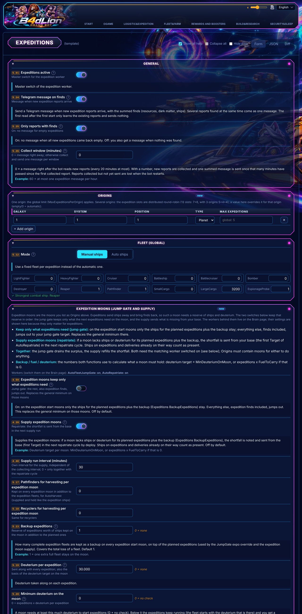

Pages: [Overview](README.md) · [Start](seite-start.md) · [Ogame](seite-ogame.md) · [Logistic & Expedition](seite-logistik.md) · [Fleet & Farm](seite-farm.md) · [Rewards and boosters](seite-belohnungen.md) · [Build & Research](seite-bauforschung.md) · [Security & Sleep](seite-sicherheit.md) · [Logging](seite-logging.md) · [Auctions](seite-auktionen.md) · [Bar and controls](seite-bedienung.md)

Fields: [General](felder-allgemein.md) · **Logistic & Expedition** · [Fleet & Farm](felder-farm.md) · [Rewards and boosters](felder-belohnungen.md) · [Build & Research (Brain)](felder-bauforschung.md) · [Security & Sleep](felder-sicherheit.md) · [Auctions](felder-auktionen.md) · [Experimental](felder-experimental.md)

---

# Fields: Logistic & Expedition

Expeditions, colonizing and discovery.

47 fields, as the B4dLion interface shows them (number = field number before the field name).

_Interface with template values, no real data._

## General

#### 5.001 Expeditions active

`Expeditions.Active` · Default: **no** · Switch · Master switch for the expedition worker

Master switch of the expedition worker.

#### 5.024 Telegram message on finds

`Expeditions.TelegramMessenger.Active` · Default: **no** · Switch · Message when new expedition reports arrive

Send a Telegram message when new expedition reports arrive, with the summed finds (resources, dark matter, ships). Several reports found at the same time come as one message. The first read after the first start only learns the existing reports and sends nothing.

#### 5.025 Only reports with finds

`Expeditions.TelegramMessenger.OnlyFinds` · Default: **yes** · Switch · On: no message for empty expeditions

On: no message when all new expeditions came back empty. Off: you also get a message when nothing was found.

#### 5.026 Collect window (minutes)

`Expeditions.TelegramMessenger.WindowMinutes` · Default: **0** · Number · 0 = message right away; otherwise collect and send one message per window

0 = a message right after the bot reads new reports (every 20 minutes at most). With a number, new reports are collected and one summed message is sent once that many minutes have passed since the first collected report. Reports collected but not yet sent are lost when the bot restarts.

**Example:** 60 = at most one expedition message per hour.

## Fleet (global)

#### 5.012 Mode

`Expeditions.ManualShips.Active` · Default: **yes** · Switch

Use a fixed fleet per expedition instead of the automatic one.

## Expedition moons (jump gate and supply)

#### 5.017 Pathfinders for harvesting per expedition moon

`Expeditions.HarvestShips.Pathfinder` · Default: **0** · Number · Kept on every expedition moon in addition to the expedition fleets, for AutoHarvest (supplied and held like the expedition ships)

Optional, default `0`. Fixed number of pathfinders / recyclers kept on every expedition start moon for `AutoHarvest` (the expeditions create the debris fields and harvest starts from the expedition moons by default). Added once per moon on top of the expedition fleets and the backup (not multiplied by the number of expeditions); supplied by `AutoRepatriate.ExpoSupply` and held by `AutoFleetJumpGate.ExpoOverride` and the reverse fetch like the expedition ships. Harvest flights from the moon count as present.

#### 5.018 Recyclers for harvesting per expedition moon

`Expeditions.HarvestShips.Recycler` · Default: **0** · Number · Same for recyclers

Optional, default `0`. Fixed number of pathfinders / recyclers kept on every expedition start moon for `AutoHarvest` (the expeditions create the debris fields and harvest starts from the expedition moons by default). Added once per moon on top of the expedition fleets and the backup (not multiplied by the number of expeditions); supplied by `AutoRepatriate.ExpoSupply` and held by `AutoFleetJumpGate.ExpoOverride` and the reverse fetch like the expedition ships. Harvest flights from the moon count as present.

#### 5.019 Deuterium per expedition

`Expeditions.FuelToCarry` · Default: **30000** · Number · Sent along with every expedition; also the basis of the deuterium target on the moon

Deuterium taken along on each expedition.

#### 5.020 Minimum deuterium on the moon

`Expeditions.MinDeuteriumOnMoon` · Default: **0** · Number · 0 = expeditions x deuterium per expedition

A moon needs at least this much deuterium to start expeditions (0 = no check). Below it the expeditions keep running (the fleet starts with the deuterium that is there) and you get a message. The moon is topped up from the base by the expedition moon supply (ExpoSupply) when it is on.

#### 5.021 Deuterium buffer on the moon

`Expeditions.DeuteriumBuffer` · Default: **0** · Number · Added on top of the deuterium target; repatriate also leaves it on expedition moons (0 = none)

Extra deuterium on every expedition start moon, added on top of the target (the larger of MinDeuteriumOnMoon and one round's need). The top-up fills up to target + buffer, and repatriate (also the reverse fetch) leaves it on the moon: it then leaves max(LeaveDeut, MinDeuteriumOnMoon) + buffer there. 0 (default) = no buffer.

**Example:** MinDeuteriumOnMoon 2,000,000 + buffer 1,000,000 = 3,000,000 stay on the moon.

#### 5.022 Stop below the deuterium need

`Expeditions.StopBelowNeed` · Default: **no** · Switch · On: no expedition starts while the deuterium does not cover flight fuel + cargo for the planned starts

On: no expedition starts from an origin while its deuterium does not cover the planned starts (flight fuel + deuterium per expedition x number of expeditions). The repatriate round tops the origin up to that need, then the expeditions resume by themselves. Off (default): the expeditions keep flying with the deuterium that is there.

#### 5.023 Backup expeditions

`Expeditions.BackupExpeditions` · Default: **1** · Number · Reserve of expeditions worth of ships kept on the moon in addition to the planned ones

How many complete expedition fleets are kept as a backup on every expedition start moon, on top of the planned expeditions (used by the JumpGate expo override and the expedition moon supply). Covers the total loss of a fleet. Default 1.

**Example:** 1 = one extra full fleet stays on the moon.

## More settings (10)

#### 5.027 MaxExpeditionsPerOrigin

`Expeditions.MaxExpeditionsPerOrigin` · Default: **5** · Number

Most expeditions that fly from one origin at the same time.

#### 5.028 Active

`Expeditions.SplitExpeditionsBetweenSystems.Active` · Default: **yes** · Switch

Spread the expedition targets over several systems.

#### 5.029 Range

`Expeditions.SplitExpeditionsBetweenSystems.Range` · Default: **3** · Number

Systems around the origin that may be used as targets.

**Example:** 2 = up to 2 systems in each direction.

#### 5.030 RandomizeOrder

`Expeditions.RandomizeOrder` · Default: **yes** · Switch

Handle the origins in random order.

#### 5.031 IgnoreSleep

`Expeditions.IgnoreSleep` · Default: **no** · Switch

Keep sending expeditions during SleepMode.

#### 5.035 WaitForAllExpeditions

`Expeditions.WaitForAllExpeditions` · Default: **no** · Switch

Start a new round only after all expeditions are back.

#### 5.036 WaitForMajorityOfExpeditions

`Expeditions.WaitForMajorityOfExpeditions` · Default: **no** · Switch

Start a new round when more than half of the expeditions are back.

#### 5.037 MinWaitNextFleet

`Expeditions.MinWaitNextFleet` · Default: **2** · Number

Shortest pause in seconds between two fleets of one round.

#### 5.038 MaxWaitNextFleet

`Expeditions.MaxWaitNextFleet` · Default: **6** · Number

Longest pause in seconds between two fleets of one round.

#### 5.039 MinWaitNextRound

`Expeditions.MinWaitNextRound` · Default: **10** · Number

Shortest extra pause in seconds after the first return before the next round.

#### 5.040 MaxWaitNextRound

`Expeditions.MaxWaitNextRound` · Default: **20** · Number

Longest extra pause in seconds after the first return before the next round.

## Sleep wave

#### 5.032 Active

`Expeditions.SleepWave.Active` · Default: **no** · Switch · Wave of expeditions that returns around wake-up

One extra expedition wave right before the bot goes to sleep.

#### 5.033 Return at

`Expeditions.SleepWave.ReturnAt` · Default: **“WakeUp+15”** · Text · HH:mm, WakeUp or WakeUp+15 (minutes); empty = fixed speed

Time when the wave should be back.

**Example:** WakeUp+15 = 15 minutes after waking up.

#### 5.034 Speed (fallback)

`Expeditions.SleepWave.SpeedPercent` · Default: **50** · Number · Used when ReturnAt is empty

Flight speed of the wave when no return time is set (10 to 100 in steps of 10).

## AutoDiscovery

#### 6.113 AutoDiscovery active

`AutoDiscovery.Active` · Default: **no** · Switch · Master switch

Sends discovery missions.

#### 6.115 Max slots

`AutoDiscovery.MaxSlots` · Default: **2** · Number

Fleet slots discovery may use at the same time.

#### 6.116 Stop at artifacts

`AutoDiscovery.StopAtArtifacts` · Default: **3600** · Number · No more discoveries from this many collected artifacts (0 = no limit)

Stops sending discoveries once this many artifacts are collected (the "Collected artifacts: 1840 / 3600" counter on the lifeform pages). 0 = no limit. Discoveries resume when the count drops below again. If the counter cannot be read, discoveries keep running (warning in the log).

## Timing

#### 6.117 Run interval, min

`AutoDiscovery.CheckIntervalMin` · Default: **15** · Number

Shortest pause in minutes between two runs of this function.

#### 6.118 Run interval, max

`AutoDiscovery.CheckIntervalMax` · Default: **25** · Number · Es wird eine Zufallszeit zwischen Min. und Max. genutzt

Longest pause in minutes between two runs. The bot picks a random time between minimum and maximum so it does not act like a clock.

#### 7.017 Run interval, min

`AutoColonize.CheckIntervalMin` · Default: **30** · Number

Shortest pause in minutes between two runs of this function.

#### 7.018 Run interval, max

`AutoColonize.CheckIntervalMax` · Default: **60** · Number · Es wird eine Zufallszeit zwischen Min. und Max. genutzt

Longest pause in minutes between two runs. The bot picks a random time between minimum and maximum so it does not act like a clock.

## AutoColonize

#### 7.001 AutoColonize active

`AutoColonize.Active` · Default: **no** · Switch · Master switch

Colonises new planets automatically.

#### 7.016 Random position in the targets

`AutoColonize.RandomPosition` · Default: **no** · Switch

Pick positions at random inside the target ranges.

## Origin

#### 7.002 Galaxy

`AutoColonize.Origin.Galaxy` · Default: **1** · Number

Celestial where the colony ships start.

#### 7.003 System

`AutoColonize.Origin.System` · Default: **1** · Number

Celestial where the colony ships start.

#### 7.004 Position

`AutoColonize.Origin.Position` · Default: **1** · Number

Celestial where the colony ships start.

#### 7.005 Type

`AutoColonize.Origin.Type` · Default: **“Planet”** · Text

Celestial where the colony ships start.

## Abandon bad planets

#### 7.006 Abandon bad planets

`AutoColonize.Abandon.Active` · Default: **yes** · Switch

Give up new planets that are too small or have the wrong temperature. Your home planet is never abandoned.

#### 7.007 Min fields

`AutoColonize.Abandon.MinFields` · Default: **310** · Number

Smallest acceptable planet size in fields.

#### 7.008 Min temperature

`AutoColonize.Abandon.MinTemperatureAcceptable` · Default: **-130** · Number

Lowest acceptable temperature.

#### 7.009 Max temperature

`AutoColonize.Abandon.MaxTemperatureAcceptable` · Default: **260** · Number

Highest acceptable temperature.

## Intensive mode (bursts)

#### 7.011 Intensive mode

`AutoColonize.IntensiveResearch.Active` · Default: **yes** · Switch

Colonise in bursts.

#### 7.012 Max slots

`AutoColonize.IntensiveResearch.MaxSlots` · Default: **1** · Number

Slots used during a burst.

#### 7.013 Wait between fleets, min

`AutoColonize.IntensiveResearch.MinWaitNextFleet` · Default: **25** · Number

Shortest pause in seconds between two colony fleets in a burst.

#### 7.014 Wait between fleets, max

`AutoColonize.IntensiveResearch.MaxWaitNextFleet` · Default: **35** · Number

Longest pause in seconds between two colony fleets in a burst.

