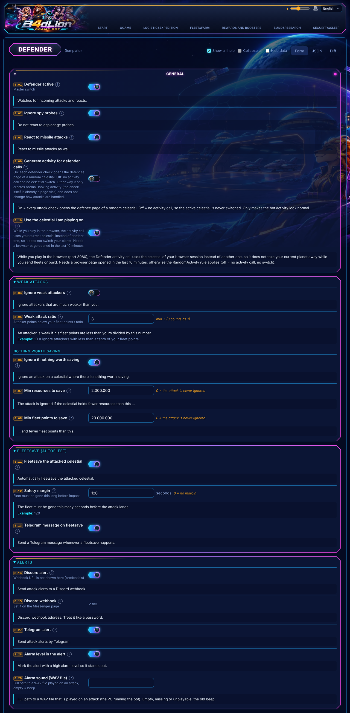

Pages: [Overview](README.md) · [Start](seite-start.md) · [Ogame](seite-ogame.md) · [Logistic & Expedition](seite-logistik.md) · [Fleet & Farm](seite-farm.md) · [Rewards and boosters](seite-belohnungen.md) · [Build & Research](seite-bauforschung.md) · [Security & Sleep](seite-sicherheit.md) · [Logging](seite-logging.md) · [Auctions](seite-auktionen.md) · [Bar and controls](seite-bedienung.md)

Fields: [General](felder-allgemein.md) · [Logistic & Expedition](felder-logistik.md) · [Fleet & Farm](felder-farm.md) · [Rewards and boosters](felder-belohnungen.md) · [Build & Research (Brain)](felder-bauforschung.md) · **Security & Sleep** · [Auctions](felder-auktionen.md)

---

# Fields: Security & Sleep

Defender, sleep mode, GhostSleep, debris protection and the boxes of the Experimental block (galaxy cache, diagnostic log and more).

108 fields, as the B4dLion interface shows them (number = field number before the field name).

_Interface with template values, no real data._

## Experimental

#### 3.218 Mode

`Experimental.MinePlanRanking.Mode` · Default: **“Payback”** · Text

Payback = shortest payback first (like AutoMine). Cheapest = lowest cost first. Npv = highest net gain over the horizon (gain per day times horizon days minus cost); steps that do not pay back within the horizon are left out.

#### 3.219 HorizonDays

`Experimental.MinePlanRanking.HorizonDays` · Default: **90** · Number

Horizon for the net gain ranking, in days.

**Example:** 90 = a step counts as good if it earns more than it costs within 90 days.

#### 3.220 MaxPaybackDays

`Experimental.MinePlanRanking.MaxPaybackDays` · Default: **1000** · Number

Longest payback that still counts as sensible (used with Only sensible).

#### 3.221 OnlySensible

`Experimental.MinePlanRanking.OnlySensible` · Default: **no** · Switch

Hide steps whose payback is longer than the limit.

#### 3.222 IncludeResearch

`Experimental.MinePlanRanking.IncludeResearch` · Default: **yes** · Switch

Rank plasma technology next to the mine steps (it raises the output of all mines on all planets).

#### 3.223 AstrophysicsGain

`Experimental.MinePlanRanking.AstrophysicsGain` · Default: **yes** · Switch

Rate Astrophysics in the plan (default on, display only): cost = the levels up to the next new planet plus the average build-out of an existing planet, yield = the average daily output of a planet. Expedition slots are not counted.

#### 3.224 DailyBudgetDeut

`Experimental.MinePlanRanking.DailyBudgetDeut` · Default: **0** · Number

Daily budget for the build plan in MSU, metal standard units: metal + 1.5 x crystal + 3 x deuterium (e.g. expedition income). 0 = enter it on the page.

#### 3.225 UsePlanForAutoMine

`Experimental.MinePlanRanking.UsePlanForAutoMine` · Default: **no** · Switch

AutoMine only builds a mine when its planet is among the first steps of the build plan (best payback first across all planets). Other planets wait. Off = every planet builds on its own.

#### 3.226 PlanLookahead

`Experimental.MinePlanRanking.PlanLookahead` · Default: **12** · Number

How many steps of the build plan count as due. Larger = more planets build at the same time.

#### 6.138 Player

`Experimental.GalaxyCache.Track.Players` · Default: **[]** · List · Array/complex - edit in the JSON tab

Watch list: player IDs, comma separated. Their systems are scanned first and every event of these players (new colony, planet gone, new moon, status change, move) is reported by Telegram. Easier to edit on the Galaxy page (Watch list).

#### 6.139 Alliances

`Experimental.GalaxyCache.Track.Alliances` · Default: **[]** · List · Array/complex - edit in the JSON tab

Watch list: alliance IDs, comma separated. All known members are watched like the players above.

#### 6.142 Active

`Experimental.GalaxyCache.Hunter.Active` · Default: **no** · Switch

Master switch of this function. Off = the bot does nothing here.

#### 6.143 MinMinutes

`Experimental.GalaxyCache.Hunter.MinMinutes` · Default: **4** · Number

Default `4` and `5` (minimum 3). Each watched player is checked at a random interval in this range: all systems where the cache knows the player (otherwise the home system from the highscore) are read through the GalaxyCache scanner queue, right after the rush scans and before all other scans. With more than 10 players the page shows a hint with the estimated requests per hour; nothing is blocked.

#### 6.144 MaxMinutes

`Experimental.GalaxyCache.Hunter.MaxMinutes` · Default: **5** · Number

Default `4` and `5` (minimum 3). Each watched player is checked at a random interval in this range: all systems where the cache knows the player (otherwise the home system from the highscore) are read through the GalaxyCache scanner queue, right after the rush scans and before all other scans. With more than 10 players the page shows a hint with the estimated requests per hour; nothing is blocked.

#### 6.145 KeepDays

`Experimental.GalaxyCache.Hunter.KeepDays` · Default: **14** · Number

Default `14`. Days of history kept in the hunter file.

#### 6.146 Player

`Experimental.GalaxyCache.Hunter.Players` · Default: **[]** · List · Array/complex - edit in the JSON tab

Own list, separate from `GalaxyCache.Track.Players`. Entries `{Id, Name, Paused, NotifyTimer, NotifyVacation, NotifyBan}`; edited on the Hunter page. Alerts per player (Telegram/Discord, text starts with `[Hunter]`): `NotifyTimer` = the player went from active (under 15 min) to a timer or to no activity (at most every 10 minutes per player, only when the previous scan is not older than 30 minutes), `NotifyVacation` = vacation mode on/off, `NotifyBan` = banned/unbanned (vacation and ban count only after the first reading).

#### 6.147 Origin

`Experimental.GalaxyCache.Hunter.Spy.Origin` · Default: **(empty)** · Text

"Espionage on demand" on the Hunter page (spy buttons per player and for all watched players: planets and moons / planets / moons, option "Skip home planet"). `Origin` = starting planet or moon as `G:S:P:P` (planet) or `G:S:P:M` (moon); empty (default) = celestial with the most probes (also used when the starting point has no probes left). `WaitMinMs`/`WaitMaxMs` = random wait between two spy flights, default `300`/`400` (minimum 100). Probe count per flight comes from `AutoFarm.NumProbes`. With no free slot the bot waits 15 s and retries up to 8 times. Orders are dropped while the bot sleeps or is paused.

#### 6.148 WaitMinMs

`Experimental.GalaxyCache.Hunter.Spy.WaitMinMs` · Default: **300** · Number

_No description yet._

#### 6.149 WaitMaxMs

`Experimental.GalaxyCache.Hunter.Spy.WaitMaxMs` · Default: **400** · Number

_No description yet._

#### 6.151 Active

`Experimental.AsteroidHunt.Active` · Default: **no** · Switch

Switch the hunter on or off (default off).

#### 6.152 ShipType

`Experimental.AsteroidHunt.ShipType` · Default: **“Pathfinder”** · Text

Ship that is sent, typed as in the game (English name). Any ship works, e.g. Pathfinder, Cruiser, Reaper, Destroyer; a probe cannot find items. The planet with the most of this ship is used. An unknown name falls back to Pathfinder.

**Example:** Pathfinder

#### 6.153 ShipCount

`Experimental.AsteroidHunt.ShipCount` · Default: **1** · Number

How many ships are sent (default 1).

#### 6.154 MaxAttemptsPerDay

`Experimental.AsteroidHunt.MaxAttemptsPerDay` · Default: **0** · Number

Attempts per game day (0 = unlimited, at most 60). According to the forums the number of attempts is not limited, but only one item per day can be found - the hunter stops after the first find.

#### 6.155 SearchSystems

`Experimental.AsteroidHunt.SearchSystems` · Default: **10** · Number

The asteroid is not in your home system: this many systems are tried in turn (own system, +1, -1, +2, -2 ...). A target the server refuses costs no attempt.

**Example:** 10 = systems 0, +1, -1 ... up to 5 away.

#### 6.156 SaveJson

`Experimental.AsteroidHunt.SaveJson` · Default: **yes** · Switch

Write every attempt and find to data/asteroiden_funde_<alias>.json.

#### 9.001 ReduceLogs

`Experimental.ReduceLogs` · Default: **yes** · Switch

Global switch: on = the extra logs (devlogs) and their diagnosis texts are not even generated. Off = they are written while a log collection runs. If the entry is missing: private builds off, public builds on.

#### 9.002 Active

`Experimental.CollectLogs.Active` · Default: **no** · Switch

Collection on or off (default off).

#### 9.003 hours

`Experimental.CollectLogs.Hours` · Default: **12** · Number

How long to collect, in hours (default 12).

#### 9.004 Anonymize

`Experimental.CollectLogs.Anonymize` · Default: **yes** · Switch

Replace name, universe, mail, celestials, coordinates (x:x:position), IP and tokens (default on). Off = raw data, do not share.

#### 9.012 Active

`Experimental.ExtraDebugLog.Active` · Default: **yes** · Switch

Switch the extra log on or off (default on).

#### 9.013 Repatriate

`Experimental.ExtraDebugLog.Repatriate` · Default: **yes** · Switch

Repatriate / reverse repatriate: candidates, payload after ledger, send attempts and results.

#### 9.014 Ledger

`Experimental.ExtraDebugLog.Ledger` · Default: **yes** · Switch

Resource ledger: which claims hold how much of a celestial and which of them count for repatriate and collect.

#### 9.015 BotPause

`Experimental.ExtraDebugLog.BotPause` · Default: **yes** · Switch

Pause start/end, rejections and blocked missions.

#### 9.016 DefenderRecheck

`Experimental.ExtraDebugLog.DefenderRecheck` · Default: **yes** · Switch

Attack list before the fleetsave: times, decision.

#### 9.017 FleetsaveSlot

`Experimental.ExtraDebugLog.FleetsaveSlot` · Default: **yes** · Switch

Every slot decision of SendFleet with the numbers.

#### 9.018 MinePlanRanking

`Experimental.ExtraDebugLog.MinePlanRanking` · Default: **yes** · Switch

Ranking mode and the top steps.

#### 9.019 AsteroidHunt

`Experimental.ExtraDebugLog.AsteroidHunt` · Default: **yes** · Switch

All asteroid hunt messages.

#### 9.020 GalaxyCache

`Experimental.ExtraDebugLog.GalaxyCache` · Default: **yes** · Switch

Cache hits, background scans and detected events of the galaxy cache.

#### 9.021 Slots

`Experimental.ExtraDebugLog.Slots` · Default: **yes** · Switch

_No description yet._

#### 9.022 Lifeform

`Experimental.ExtraDebugLog.Lifeform` · Default: **yes** · Switch

_No description yet._

#### 9.023 Expeditions

`Experimental.ExtraDebugLog.Expeditions` · Default: **yes** · Switch

_No description yet._

#### 9.024 FarmCalc

`Experimental.ExtraDebugLog.FarmCalc` · Default: **yes** · Switch

_No description yet._

## Repatriate and the resource ledger

#### 4.056 Ignore the ledger completely

`Experimental.RepatriateLedgerHold.Ignore` · Default: **no** · Switch · On: repatriate, reverse repatriate and /collect move all stock, whatever the build claims hold. Off (default): claims protect their stock as set below

On: repatriate, reverse repatriate and /collect ignore the resource ledger completely and move all stock, even what build claims hold. The workers (AutoMine and others) may then find their saved stock gone. Default off.

#### 4.057 Protect from this coverage

`Experimental.RepatriateLedgerHold.MinPercent` · Default: **30** · Number · 0 % = every held amount is protected (old behavior), 100 % = only fully covered claims

A waiting claim only protects its held stock from repatriate and collect if it already holds at least this percent of its total need (metal+crystal+deuterium). Claims with flights or fully covered always protect. 0 = every held amount is protected (old behavior).

**Example:** 30 = a metal mine claim that holds 1% of 995 M no longer blocks the celestial.

## Galaxy cache (shared galaxy scans)

#### 6.119 Use the galaxy cache

`Experimental.GalaxyCache.Active` · Default: **yes** · Switch · On by default

Switch the cache on or off (default on). Off: every worker queries live again.

#### 6.120 Entry valid for (hours)

`Experimental.GalaxyCache.MaxAgeHours` · Default: **12** · Number · Older entries are queried live again

How old an entry may be so that workers use it instead of a live query (default 12).

**Example:** 12

#### 6.121 Background scan: whole universe (on) or only around my planets (off)

`Experimental.GalaxyCache.ScanAll` · Default: **yes** · Switch · ON = every galaxy and system, slowly, your own surroundings first. The setting "Systems around each planet" is ignored then. OFF = only the systems around your own planets, as many as set there

The background scan walks all galaxies and systems slowly, starting with the surroundings of your own systems, so the cache gives a complete picture (default on). Off = only the systems around your planets (see Systems around each planet).

#### 6.122 Whole-universe scan: hours per galaxy (only when ON)

`Experimental.GalaxyCache.HoursPerGalaxy` · Default: **1** · Number · The pause between systems follows from this (1 = about 7 seconds). 0 = use the pauses below

Full scan: time budget per galaxy. The pause between two systems is calculated from it (1 hour = about 7 seconds per system, 9 galaxies = about 9 hours). 0 = use the pauses DelayMinSeconds / DelayMaxSeconds. Default 1.

#### 6.123 Whole-universe scan: repeat after (hours) (only when ON)

`Experimental.GalaxyCache.FullScanIntervalHours` · Default: **24** · Number · Every system is scanned at most this often (24 = once a day)

Full scan: every system is scanned again after this many hours. 24 = one full scan per day, starting at your home world and moving outwards. Default 24.

#### 6.124 Read the player list from the OGame API

`Experimental.GalaxyCache.UseApi` · Default: **yes** · Switch · players.xml and highscore.xml: one request each, no load in the game. Off: read the highscore pages instead

Reads the player list (status, alliance, rank) from the public OGame API: players.xml and highscore.xml, one request each, no load in the game. The host is derived from the universe number and language. The API status can lag behind (a returned player may stay marked inactive for a while), so the galaxy scans decide the status; the API only supplies the player list and the rank. Off = read the highscore pages instead. Default on.

#### 6.125 Player database from the highscore

`Experimental.GalaxyCache.UseHighscore` · Default: **yes** · Switch · Reads the highscore once a day (status i / I / banned / vacation, rank, home world). Systems of inactive players are kept fresh first

Reads the highscore once a day into a player database: status (inactive i, long inactive I, banned, vacation), rank, alliance and home world. Systems with inactive players are scanned first and kept fresh. The rank and status also correct old cache entries. Default on.

#### 6.126 Read the highscore every (hours)

`Experimental.GalaxyCache.HighscoreIntervalHours` · Default: **24** · Number

How often the highscore is read (default 24 hours). A failed read is retried after an hour.

#### 6.127 AutoFarm uses entries up to (hours)

`Experimental.GalaxyCache.AutoFarmMaxAgeHours` · Default: **36** · Number · Older entries are queried live

AutoFarm takes its scan from the cache while the entry is no older than this (default 36 hours). The target is still re-checked live before an attack.

#### 6.128 Systems around each planet (used only when the switch above is OFF)

`Experimental.GalaxyCache.RangeSystems` · Default: **15** · Number · 15 = 15 systems left and right = 31 around each planet. No effect while the whole-universe scan is on

Used only when the whole-universe scan (ScanAll) is OFF: the background scan walks this many systems left and right of every own system (default 15, i.e. 31 systems around each planet). No effect while ScanAll is on.

**Example:** 15 = 31 systems around each planet.

#### 6.129 Empty systems valid for (hours)

`Experimental.GalaxyCache.EmptyMaxAgeHours` · Default: **72** · Number · Systems without any planet are not scanned again before this time

Systems without any planet are scanned again only after this many hours (default 72).

#### 6.130 Own systems: scan at least every (minutes)

`Experimental.GalaxyCache.OwnSystemsEveryMinutes` · Default: **60** · Number · Systems with your own planets or moons are rescanned this often, before all other scans (0 = off)

Systems with your own planets and moons are rescanned at least this often, before all other background scans (default 60 minutes, 0 = off). A raid colony next to you shows up within the hour instead of the 24 h full scan.

#### 6.131 Own systems: also this many systems left and right

`Experimental.GalaxyCache.OwnSystemsRange` · Default: **0** · Number · 0 = only the systems with your own planets and moons

Also scan this many systems left and right of each own system (default 0 = only the system itself). 1 = the two neighbours as well.

#### 6.132 Pause between background queries, from (seconds)

`Experimental.GalaxyCache.DelayMinSeconds` · Default: **4** · Number

Shortest pause between two background queries (default 4 seconds).

#### 6.133 Pause between background queries, to (seconds)

`Experimental.GalaxyCache.DelayMaxSeconds` · Default: **8** · Number

Longest pause between two background queries (default 8 seconds).

#### 6.134 Colonize reads the cache

`Experimental.GalaxyCache.UseInColonize` · Default: **yes** · Switch · Occupied positions are skipped without a live query; free ones are still checked live

Colonize skips positions that the fresh cache shows as occupied. Positions shown as free are always checked live (default on).

#### 6.135 AutoFarm reads the cache

`Experimental.GalaxyCache.UseInAutoFarm` · Default: **yes** · Switch · The scan for inactive targets uses fresh cache entries instead of live queries; the target is still re-checked live before an attack

AutoFarm takes its scan for inactive targets from the cache while the entry is fresh (default on). Before an attack the target is still re-checked live.

#### 6.136 Write detected events to the log

`Experimental.GalaxyCache.Events` · Default: **yes** · Switch · New colony, planet gone, new moon, status change, move

Write detected changes to the log: new colony, planet gone, new moon, status change, move (default on).

#### 6.137 Warn by Telegram / Discord

`Experimental.GalaxyCache.Telegram` · Default: **yes** · Switch · For new colonies and moves of other players

Send new colonies and moves of other players by Telegram / Discord (default on). Other events only appear in the log.

#### 6.140 Watched systems: scan at least every (hours)

`Experimental.GalaxyCache.Track.EveryHours` · Default: **3** · Number · Systems of watched players are refreshed this often

Systems of watched players are rescanned at least this often (default 3 hours).

#### 6.141 Watched player: rush scan of neighbour systems

`Experimental.GalaxyCache.Track.RescanOnLoss` · Default: **yes** · Switch · Planet gone: my systems +-1. New colony or move into system X: X-1 and X+1. Before all other scans

Rush scans for watched players (default on): when a planet disappears, the systems of your own planets are rescanned; when a new colony or move appears in system X, systems X-1 and X+1 are rescanned. A newly found player is watched for 24 hours.

## Reading game reports

#### 6.150 Read expedition reports

`Experimental.ReportReading.Expeditions` · Default: **yes** · Switch · On (default): finds and daily averages are collected. Off: no report requests; the statistics stay empty and the mine plan runs without expedition averages

Default on (a missing block counts as on). Off: the expedition worker no longer fetches your expedition reports (normally about every 20 minutes). The stored statistics (finds, daily averages) and the Telegram find messages then stay empty, and the mine plan runs without expedition averages.

## General

#### 8.001 Defender active

`Defender.Active` · Default: **no** · Switch · Master switch

Watches for incoming attacks and reacts.

#### 8.002 Ignore spy probes

`Defender.IgnoreProbes` · Default: **yes** · Switch

Do not react to espionage probes.

#### 8.003 React to missile attacks

`Defender.DefendFromMissiles` · Default: **yes** · Switch

React to missile attacks as well.

#### 8.009 Generate activity for defender calls

`Defender.RandomActivity` · Default: **no** · Switch · On: each defender check opens the defences page of a random celestial. Off: no activity call and no celestial switch. Either way it only creates normal-looking activity (the check itself is already a page visit) and does not change how attacks are handled.

On = every attack check opens the defence page of a random celestial. Off = no activity call, so the active celestial is never switched. Only makes the bot activity look normal.

#### 8.010 Use the celestial I am playing on

`Defender.CurrentlyActiveCelestialActivity` · Default: **yes** · Switch · While you play in the browser, the activity call uses your current celestial instead of another one, so it does not switch your planet. Needs a browser page opened in the last 10 minutes

While you play in the browser (port 8080), the Defender activity call uses the celestial of your browser session instead of another one, so it does not take your current planet away while you send fleets or build. Needs a browser page opened in the last 10 minutes; otherwise the RandomActivity rule applies (off = no activity call, no switch).

## Weak attacks

#### 8.004 Ignore weak attackers

`Defender.IgnoreWeakAttack` · Default: **no** · Switch

Ignore attackers that are much weaker than you.

#### 8.005 Weak attack ratio

`Defender.WeakAttackRatio` · Default: **3** · Number · Attacker points below your fleet points / ratio

An attacker is weak if his fleet points are less than yours divided by this number.

**Example:** 10 = ignore attackers with less than a tenth of your fleet points.

#### 8.006 Ignore if nothing worth saving

`Defender.IgnoreAttackIfIHave.Active` · Default: **no** · Switch

Ignore an attack on a celestial where there is nothing worth saving.

#### 8.007 Min resources to save

`Defender.IgnoreAttackIfIHave.MinResourcesToSave` · Default: **2000000** · Number

The attack is ignored if the celestial holds fewer resources than this ...

#### 8.008 Min fleet points to save

`Defender.IgnoreAttackIfIHave.MinFleetToSave` · Default: **20000000** · Number

... and fewer fleet points than this.

## Fleetsave (Autofleet)

#### 8.011 Fleetsave the attacked celestial

`Defender.Autofleet.Active` · Default: **yes** · Switch

Automatically fleetsave the attacked celestial.

#### 8.012 Safety margin

`Defender.Autofleet.SafetyMarginSeconds` · Default: **120** · Number · Fleet must be gone this long before impact

The fleet must be gone this many seconds before the attack lands.

**Example:** 120

#### 8.013 Telegram message on fleetsave

`Defender.Autofleet.TelegramMessenger.Active` · Default: **no** · Switch

Send a Telegram message whenever a fleetsave happens.

## Alerts

#### 8.014 Discord alert

`Defender.Discord.Active` · Default: **yes** · Switch · Webhook URL is not shown here (credentials)

Send attack alerts to a Discord webhook.

#### 8.015 Discord webhook

`Defender.Discord.WebhookUrl` · Default: **“https://discord.com/api/webhooks/WEBHOOK_ID/WEBHOOK_TOKEN”** · Text · Set it on the Messenger page

Discord webhook address. Treat it like a password.

#### 8.027 Telegram alert

`Defender.TelegramMessenger.Active` · Default: **yes** · Switch

Send attack alerts by Telegram.

#### 8.028 Alarm level in the alert

`Defender.Alarm.Active` · Default: **yes** · Switch

Mark the alert with a high alarm level so it stands out.

#### 8.029 Alarm sound (WAV file)

`Defender.Alarm.SoundFile` · Default: **(empty)** · Text · Full path to a WAV file played on an attack; empty = beep

Full path to a WAV file that is played on an attack (the PC running the bot). Empty, missing or unplayable: the old beep.

## Whitelist

#### 8.016 Player IDs

`Defender.WhiteList` · Default: **[0]** · List · Comma separated

Player IDs that are never treated as attackers, for example friends or alliance mates.

## Reaction to the attacker

#### 8.017 Spy the attacker

`Defender.SpyAttacker.Active` · Default: **no** · Switch

Spy the attacker with probes when an attack comes in.

#### 8.018 Probes

`Defender.SpyAttacker.Probes` · Default: **20** · Number

Number of probes sent to spy the attacker.

#### 8.019 Warn about a possible raid

`Defender.RaidWarning.Active` · Default: **no** · Switch · Telegram warning when one player spies several times in a short time

Warn (Telegram, Discord, log) when the same player spies on you several times in a short time. That usually means an attack is being planned.

#### 8.020 More than ... spy missions

`Defender.RaidWarning.Missions` · Default: **2** · Number

Warn when the player sends more than this many spy missions.

#### 8.021 Within

`Defender.RaidWarning.WindowMinutes` · Default: **30** · Number

Time window in minutes. At most one warning per player and window.

#### 8.022 Spy back when spied on

`Defender.BackfireSpy.Active` · Default: **no** · Switch · Sends your own probes to the player who spied on you

When another player spies on you, send your own probes to the same player.

#### 8.023 Probes

`Defender.BackfireSpy.Probes` · Default: **5** · Number

Number of probes sent back.

#### 8.024 At most every

`Defender.BackfireSpy.EveryHours` · Default: **6** · Number · Per player

At most once per player in this many hours.

#### 8.025 Message the attacker

`Defender.MessageAttacker.Active` · Default: **no** · Switch · One of the messages is sent

Send the attacker a message.

#### 8.026 Messages

`Defender.MessageAttacker.Messages` · Default: **["hey", "hello", "i'm online'"]** · List · One per line

Possible messages, one per line. The bot sends one of them.

## Timing

#### 8.030 Check interval, min

`Defender.CheckIntervalMin` · Default: **10** · Number

Shortest pause in minutes between two runs of this function.

#### 8.031 Check interval, max

`Defender.CheckIntervalMax` · Default: **20** · Number

Longest pause in minutes between two runs. The bot picks a random time between minimum and maximum so it does not act like a clock.

## Defender: check again before the fleetsave

#### 8.032 Check again before the fleetsave

`Experimental.DefenderRecheck.Active` · Default: **no** · Switch · Off by default

Switch the second check on or off (default off).

#### 8.033 Wait for the answer

`Experimental.DefenderRecheck.TimeoutSeconds` · Default: **4** · Number · After this the fleetsave is sent as planned

How long the Defender waits for the answer. After that the fleetsave is sent as planned.

**Example:** 4 = after 4 seconds without an answer the fleetsave goes out.

## Reserved slot for the fleetsave

#### 8.034 Reserve a slot for the fleetsave

`Experimental.FleetsaveSlot.Active` · Default: **yes** · Switch · On by default

Switch the reserved slot on or off (default on).

#### 8.035 Reserved slots

`Experimental.FleetsaveSlot.Slots` · Default: **1** · Number · Works on top of "Slots to leave free"

How many slots stay free for the fleetsave.

**Example:** 1 = the last free slot is only used by the fleetsave.

## Bot delay (Pause button and /pause)

#### 9.005 Delay function active

`Experimental.BotPause.Active` · Default: **yes** · Switch · Off: the Pause button and /pause are refused

Switch the delay function on or off. Off: the Pause button and /pause are refused.

#### 9.006 Delay length

`Experimental.BotPause.DurationMinutes` · Default: **15** · Number · Used when you press the button or send /pause without a time

How long a delay lasts if you do not give a time.

**Example:** 15 = the bot continues 15 minutes after you pressed Delay.

#### 9.007 Margin before a recall

`Experimental.BotPause.RecallMarginMinutes` · Default: **2** · Number · A recall due within the delay time plus this margin blocks the delay

Safety distance to a planned recall. The delay is refused if a recall is due within the delay time plus this margin.

**Example:** 2 = with a 15 minute delay, a recall due in 17 minutes or less blocks the delay.

#### 9.008 Longest delay

`Experimental.BotPause.MaxDurationMinutes` · Default: **120** · Number · Upper limit for /pause with a time

Longest delay you can ask for with /pause.

#### 9.009 Delay the Defender too

`Experimental.BotPause.StopDefender` · Default: **no** · Switch · Off (default): the Defender keeps watching. On: nothing runs; a known attack within the limit below plus the delay length blocks the delay

Delay the Defender as well (default off; the setting keeps its name StopDefender). Then nothing watches for attacks, so a delay is refused if a known attack arrives within the limit below plus the delay length.

#### 9.010 No delay before an attack

`Experimental.BotPause.AttackMarginMinutes` · Default: **15** · Number · An attack that arrives within this time blocks the delay

A delay is refused if an attack arrives within this many minutes (default 15). Spy, attack and expedition missions are also blocked while the bot is delayed.

#### 9.011 Delay mode

`Experimental.BotPause.Mode` · Default: **“Gate”** · Text · Gate (default): the workers keep running, skip their cycle during the delay and go on staggered afterwards. Stop: the old hard pause, all workers are stopped and restarted

Gate (default): during the delay the workers keep running but skip their cycle, and go on with their usual plan shortly after, spread over about a minute. Stop: the old hard pause, every worker is stopped and started again afterwards.

