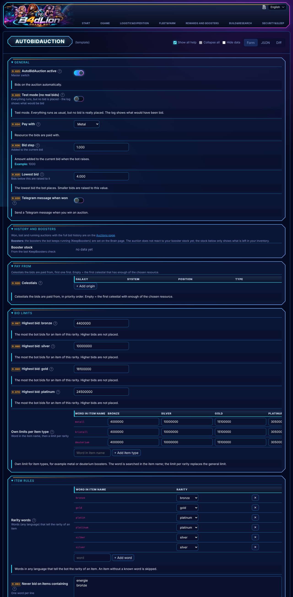

Pages: [Overview](README.md) · [Start](seite-start.md) · [Ogame](seite-ogame.md) · [Logistic & Expedition](seite-logistik.md) · [Fleet & Farm](seite-farm.md) · [Rewards and boosters](seite-belohnungen.md) · [Build & Research](seite-bauforschung.md) · [Security & Sleep](seite-sicherheit.md) · [Logging](seite-logging.md) · **Auctions** · [Bar and controls](seite-bedienung.md)

Fields: [General](felder-allgemein.md) · [Logistic & Expedition](felder-logistik.md) · [Fleet & Farm](felder-farm.md) · [Rewards and boosters](felder-belohnungen.md) · [Build & Research (Brain)](felder-bauforschung.md) · [Security & Sleep](felder-sicherheit.md) · [Auctions](felder-auktionen.md) · [Experimental](felder-experimental.md)

---

# Auctions

_Menu item: Auctions (tab in Rewards and boosters; no separate menu bar key)_

Shows the result of every auction the bot has seen: won or lost, the highest bid and your last bid. Above it are the settings of the auction worker (block AutoBidAuction). The evaluation itself controls nothing.

_Interface with template values, no real data._

## Settings (AutoBidAuction)

At the top of the page there is a config form for the block AutoBidAuction with its own bar: Collapse all, Discard and Save. Here you set up bidding (according to the help text, for example a maximum bid per rarity with separate limits for item types such as metal or deuterium boosters).

1. Change values in the form.
2. Click Save; Discard resets, Collapse all closes the groups.

Fields: [Auctions](felder-auktionen.md)

## Evaluation

A header card counts Won, Lost (bid but outbid) and the points spent on won auctions. The card Who wins against you lists up to 15 opponents with wins, how often they outbid you, the average margin above your bid, margin up to 2,000 and wins without your bid. The table below shows per auction start, item, result (Won, Lost, Running, Running and you lead, No bid, Unknown), final bid, highest bidder, My last bid, Bid placed, Bids and End. The data reloads every 15 seconds.

1. Filter in the field Show: All, Won, Lost or Only auctions with my bid.
2. Hide data hides player names and the instance list.
3. With several instances choose the instance and click Open.

Fields: [Auctions](felder-auktionen.md)

## Notes

- The auction bidder (AutoAuction) is only released on request. Without the release the function is not available.
- Amounts are bid points as the game counts them. My last bid is the total sum committed in the auction according to the game.
- The game shows the end of an auction only in whole minutes, the exact time of the winning bid is not known. Many wins without your bid or bids exactly one step above yours point to an automatic bidder according to the page, but do not prove it.

