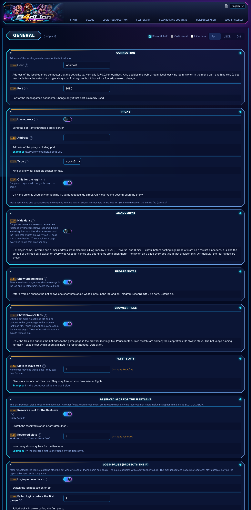

Pages: [Overview](README.md) · [Start](seite-start.md) · [Ogame](seite-ogame.md) · [Logistic & Expedition](seite-logistik.md) · [Fleet & Farm](seite-farm.md) · [Rewards and boosters](seite-belohnungen.md) · [Build & Research](seite-bauforschung.md) · [Security & Sleep](seite-sicherheit.md) · [Logging](seite-logging.md) · **Bar and controls**

Fields: [General](felder-allgemein.md) · [Logistic & Expedition](felder-logistik.md) · [Fleet & Farm](felder-farm.md) · [Rewards and boosters](felder-belohnungen.md) · [Build & Research (Brain)](felder-bauforschung.md) · [Security & Sleep](felder-sicherheit.md)

---

# Bar and controls

_Menu item: Top navigation bar and config pages (no menu item of its own)_

The bar at the top is on every page and leads to all areas. To its right are the controls for log, language and login. On the config pages a bar collects unsaved changes so you can save them together. In the embedded tabs of other pages (parameter embed=1) the bar is not shown.

_Interface with template values, no real data._

## Menu items and logo

Menu items from the left: Start, Ogame, Logistic&Expedition, Fleet&Farm, Rewards and boosters, Build&Research, Security&Sleep (translated according to the language setting). The current item is highlighted. The logo leads to the first menu item; Start always stays first. On narrow screens the bar opens with the menu icon.

1. Click a menu item to open the page.
2. Reorder menu items (except Start) by dragging; the browser remembers the order. The first entry is the entry point: the logo leads there.
3. The tab bars of some pages can likewise be reordered by dragging; the browser remembers the order per bar.

## Top right: Log, Build, Language, Login

The log icon opens the Logging page. Next to it, Build shows the commit and build time of the running version (only if known). The language selection switches the interface; the page then reloads, and an error shows a message. The login elements depend on the WebUI settings: with login active and a signed-in user, Password (change password) and Log out appear. If the WebUI is reachable from outside and login is enforced, there is the switch No password, which turns login off completely. Only with local access (not reachable from outside) there is the switch Login, with which you turn password protection on and off (user name tbot).

1. Choose the language in the selection; the page reloads.
2. Switch login on: the first time the change-password page opens, afterwards the switch only toggles.
3. Switching on No password asks for confirmation: anyone who knows the address then has full access to the bot and credentials. Only confirm after careful consideration.

## Card opacity

On pages with a background picture (Start, Logistic&Expedition, Fleet&Farm, Build&Research, Rewards and boosters, Security&Sleep) the bar holds a small slider with a half-moon icon (card opacity). It makes the cards over the picture easier to read. The value applies to all pages and is remembered in the browser.

1. Drag the slider (range -30 to 45, steps of 5).
2. Double-click the slider to reset it to 0.

## Hide data

A switch on many pages (Rewards, Build&Research, Logging, config pages): replaces names, coordinates and other data with *****, for example for screenshots. The default comes from General.AnonymizeLogs (label there: Hide data); the switch on a page overrides it only in this browser.

1. Set or remove the tick at Hide data; the state applies across pages.

Fields: [General](felder-allgemein.md)

## Config pages: Save all

Changes in config forms stay as a draft when you change pages (per instance in the browser) and are only written when you save. If something is unsaved, a bar appears at the top: Not saved, with the number and names of the blocks. Save all writes all changed blocks one after another (on an error it aborts and shows a message) and then reloads the page. Discard and reload deletes all drafts after confirmation. Blocks with a draft are marked in the side bar. When saving, a backup (.bak) is created.

1. Change values; unsaved changes appears at the bottom, changed fields are marked.
2. Click Save at the bottom (only this block) or Save all in the bar at the top (all blocks).
3. Discard resets the block; Discard and reload in the bar at the top discards all drafts.

## Config pages: views and help

In the header of each config block you choose the view Form, JSON or Difference. JSON is editable (invalid JSON is marked red and reported), except when Hide data is on; then the view is read-only. Difference shows the deviation from the saved state. Show all help shows the help texts of all options at once (otherwise only via the question mark next to the name). Collapse all closes or opens all blocks of the page; the state is remembered in the browser. A fixed field number (e.g. 3.049) stands before the field names; hovering over it shows number and path. According to the project rules the directory of all numbers is in config/FELDER.md.

1. Switch between Form, JSON and Difference at the top right.
2. Tick Show all help or Collapse all.
3. After changing the JSON text, Save and Save all become active immediately.

## Notes

- Drafts live in the browser (session storage). If you close the tab without saving, they are gone.
- The pages Build&Research and Security&Sleep use their own Save buttons (Save changes or Save all in their bar); the collective bar at the top belongs to the config pages.
- No password also turns login off for external addresses; make sure beforehand that this is what you want.

