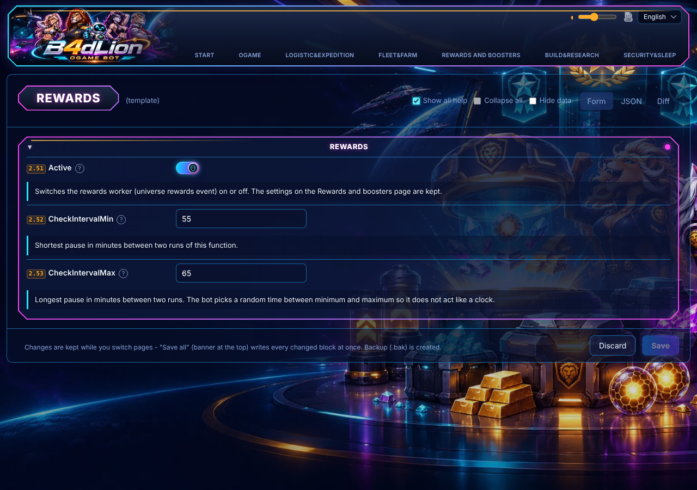

Pages: [Overview](README.md) · [Start](seite-start.md) · [Ogame](seite-ogame.md) · [Logistic & Expedition](seite-logistik.md) · [Fleet & Farm](seite-farm.md) · **Rewards and boosters** · [Build & Research](seite-bauforschung.md) · [Security & Sleep](seite-sicherheit.md) · [Logging](seite-logging.md) · [Auctions](seite-auktionen.md) · [Bar and controls](seite-bedienung.md)

Fields: [General](felder-allgemein.md) · [Logistic & Expedition](felder-logistik.md) · [Fleet & Farm](felder-farm.md) · [Rewards and boosters](felder-belohnungen.md) · [Build & Research (Brain)](felder-bauforschung.md) · [Security & Sleep](felder-sicherheit.md) · [Auctions](felder-auktionen.md) · [Experimental](felder-experimental.md)

---

# Rewards and boosters

_Menu item: Rewards and boosters_

The page bundles everything about rewards: the tasks of the universe rewards (Tritium) with the bot's assessment, rank rewards, boosters, auctions, directives (in-game tutorial) and the asteroid hunt. The Tasks and Auctions tabs only show data; the other tabs open the matching config blocks right in the page. With several instances you choose the instance at the top and click Open.

_Interface with template values, no real data._

## Tasks

Shows the tasks per Tritium tier with progress, type, what the bot would do and status (open/done). Below are the cards Automatic collection and Rank rewards. The bot only reads the page about every 4 hours; older data (over 90 minutes) is marked in colour with its age. The Log sub-tab shows only the Rewards lines of today's bot log (newest on top).

1. Click Refresh now so the bot reads the rewards page immediately (it checks the request once a minute).
2. At Automatic collection choose the mode: Off, Dry run (log only) or On; the same applies to Complete tasks automatically. The choice is saved immediately and the bot takes it within a minute.
3. At Telegram messages (reward messages) choose On or Off.
4. In the Rank rewards card click exactly one reward per rank as a preselection (or none); there are also extra rewards with an active Commanding Staff.
5. Hide data hides names and coordinates; the Log sub-tab then shows nothing.

Fields: [Rewards and boosters](felder-belohnungen.md), [Build & Research (Brain)](felder-bauforschung.md)

## Boosters

Opens the KeepBoosters option of the Brain block: keep resource boosters running. If none of a type is running on a planet, one from your inventory is activated; nothing is bought with Dark Matter.

1. Set types, allowed tiers, reserve and minimum mine level.
2. Leave test mode on first and read the log, only then switch it live.
3. Save.

Fields: [Build & Research (Brain)](felder-bauforschung.md)

## Auctions

Shows the Auctions page embedded (see the Auctions page).

Fields: [Auctions](felder-auktionen.md)

## Import/Export and daily offer

According to the code this only opens the BuyOfferOfTheDay option of the Brain block: buys the daily trader offer.

1. Switch BuyOfferOfTheDay on and save.

Fields: [Build & Research (Brain)](felder-bauforschung.md)

## Directives

Opens the Directives option of the Brain block and works through the directives (in-game tutorial): collect finished rewards and, if switched on, build/research what open tasks require (exactly up to the task level, your limits are ignored for this). Alliance, friends, rename and demolish tasks stay manual.

1. Switch Active on; collecting rewards is on by default, completing tasks and fleet tasks are off by default.
2. Switch on the dry run first and read the log.
3. Save.

Fields: [Build & Research (Brain)](felder-bauforschung.md)

## Asteroid hunt

Opens the AsteroidHunt block (in Testing): once per game day a ship attacks the asteroid at position 17 of your own system. After arrival the bot checks whether the inventory has grown. Each attempt gets a short log line, no messenger message. Off by default.

1. Switch Active on, choose ship type and number (default Pathfinder, 1).
2. Optionally set attempts per day and search systems, then save.

## Notes

- after creating it, restart the bot. The first capture runs right after the start, then every 4 hours.
- Defence and ships are always built on the home world, buildings on the planet with the cheapest next level.
- Tasks with Dark Matter, items or purchases always stay manual.
- Rank rewards are only collected if Automatic collection is on, the rank is reached and you have chosen a reward. With a new event a saved choice expires (choose again).
- Completing tasks automatically costs resources (ships and defence on the home planet, only the missing amount, the same order not again within 24 hours) and is therefore off by default.

