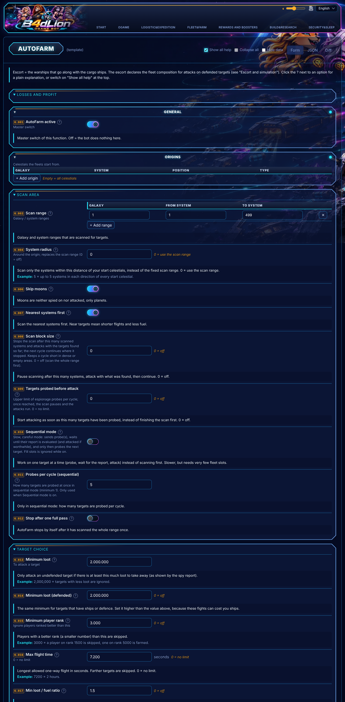

Pages: [Overview](README.md) · [Start](seite-start.md) · [Ogame](seite-ogame.md) · [Logistic & Expedition](seite-logistik.md) · **Fleet & Farm** · [Rewards and boosters](seite-belohnungen.md) · [Build & Research](seite-bauforschung.md) · [Security & Sleep](seite-sicherheit.md) · [Logging](seite-logging.md) · [Auctions](seite-auktionen.md) · [Bar and controls](seite-bedienung.md)

Fields: [General](felder-allgemein.md) · [Logistic & Expedition](felder-logistik.md) · [Fleet & Farm](felder-farm.md) · [Rewards and boosters](felder-belohnungen.md) · [Build & Research (Brain)](felder-bauforschung.md) · [Security & Sleep](felder-sicherheit.md) · [Auctions](felder-auktionen.md) · [Experimental](felder-experimental.md)

---

# Fleet & Farm

_Menu item: Fleet&Farm_

The page bundles farming (AutoFarm and the debris harvest AutoHarvest) and related tools in tabs. You see what AutoFarm decides, can block targets or attack them on purpose and change all farm settings in one place. At the top there are 'Hide data' and the instance selection (with several instances).

_Interface with template values, no real data._

## Farm

Has two parts: Status and Settings. Status has the views Overview (worker status, deuterium of the start bodies, fleet slots, galaxy scan, scan progress, losses and profit), Targets (targets and decisions), Attacks (recorded attacks), Systems (cached systems), Blacklist & maintenance and Logs & errors; the data refreshes every 5 seconds. Settings contains all settings in collapsible groups: General, Scan range and order, Galaxy cache, Asteroid search, Target selection, Espionage reports, Defended targets, Profit and deuterium, Blacklist and alliance protection, Probes and slots, Cargo and fleet, Escort and simulation, Combat calculator (advanced), Schedule, AutoHarvest. Fields without effect, contradictory or rarely needed fields are marked; nothing is changed automatically.

1. Choose Status or Settings at the top of the tab, then the view (Overview, Targets, ...).
2. Blacklist & maintenance: 'Block player' (enter ID or name), 'Release', 'Remove', 'Scan + attack' for a single defended target, 'Clear blacklist', 'Clear system cache and restart scan'. Every command asks for confirmation and runs at the start of the next AutoFarm cycle.
3. 'Reset farm' and 'Reset entire database' additionally require you to type DELETE.
4. Settings: change values, then 'Save changes' or 'Discard'. Only changed fields are saved.

Fields: [Fleet & Farm](felder-farm.md), [Experimental](felder-experimental.md)

## HoldForReview

Shows all targets AutoFarm discarded as defended in the last 2 hours (defence present, too strong, not profitable), with resources, defence and ships. After that they disappear from the list (the worker's blacklist stays).

1. Choose the sorting: Resources, Fleet or Def points.
2. 'Scan + attack' calculates escort and profit and attacks the target alone; it needs 2 free fleet slots. Optionally choose a minimum speed under 'Min. speed when recalculating' (default: value from the config).
3. 'Block' blocks the target permanently.

Fields: [Fleet & Farm](felder-farm.md)

## Combat sim

Compares the combat calculators (ogamed/Go, Go with lifeform bonuses, Rust) with measured losses. Summary at the top, below it a target list with 'Best calc', Won, Lost and Open (fleet not yet back). In shadow mode Go stays authoritative.

1. Filters: target (name or G:S:P), 'Actual only', 'Deviations only', 'Rust errors only'; 'Refresh' reloads.
2. Click a row to open the single battles. 'Export CSV' and 'Export JSON' export with the same filters.
3. 'Reset' deletes the whole combat log after confirmation; export it first.

## Notes

- Commands to AutoFarm (block, scan + attack, reset) only run in the next cycle; the AutoFarm worker must be active.
- Reset farm deletes the blacklist, targets, reports, attack history, loss/profit list and scan position; only scanned systems and the galaxy cache stay. Reset entire database also deletes the scanned systems. Neither can be undone.
- A blocked player is never spied on or attacked by AutoFarm.
- Without an AutoFarm database the status part shows a note; it fills after the first AutoFarm run.

