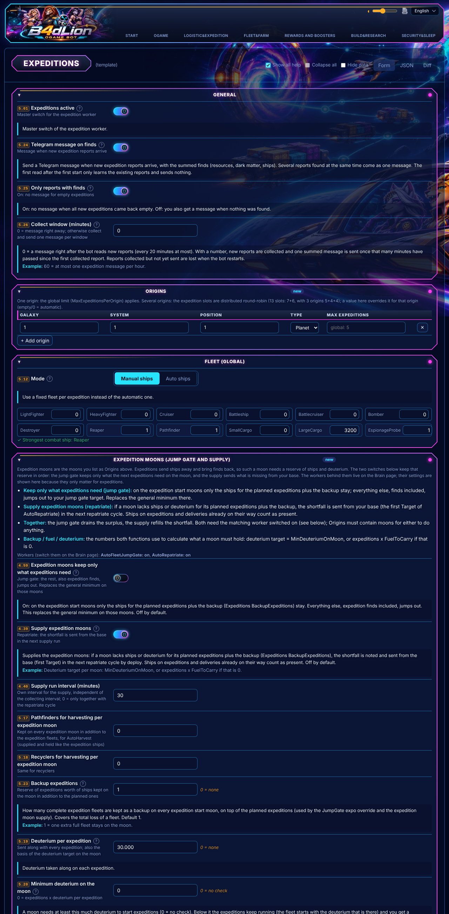

Pages: [Overview](README.md) · [Start](seite-start.md) · [Ogame](seite-ogame.md) · **Logistic & Expedition** · [Fleet & Farm](seite-farm.md) · [Rewards and boosters](seite-belohnungen.md) · [Build & Research](seite-bauforschung.md) · [Security & Sleep](seite-sicherheit.md) · [Logging](seite-logging.md) · [Auctions](seite-auktionen.md) · [Bar and controls](seite-bedienung.md)

Fields: [General](felder-allgemein.md) · [Logistic & Expedition](felder-logistik.md) · [Fleet & Farm](felder-farm.md) · [Rewards and boosters](felder-belohnungen.md) · [Build & Research (Brain)](felder-bauforschung.md) · [Security & Sleep](felder-sicherheit.md) · [Auctions](felder-auktionen.md) · [Experimental](felder-experimental.md)

---

# Logistic & Expedition

_Menu item: Logistic&Expedition_

Three tabs for everything fleets do apart from farming: Expeditions (bonuses, origins, fleet, all expedition switches), Logistic (Discovery, Colonize, transports, jump gate) and Repatriate (gather resources from all celestial bodies or pull them back). The tab bar at the top switches between the three pages.

_Interface with template values, no real data._

## Expedition

Four boxes. 'Lifeform and expedition bonuses' shows bonuses that were read, the maximum possible finds (metal, crystal, deuterium) and the calculated number of Large Cargos per expedition; without data the page waits until the expedition worker writes them on its next run. 'Expedition origins (moons)' lists the origins (G, S, P, planet/moon, 'max expeditions'). 'Fleet' switches between Auto and Manual. 'Expedition settings (collected from all tabs)' groups the expedition switches: Expeditions, Support (supply expedition moons), Collecting (bring surplus back), Other workers.

1. Origins: enter coordinates and type, '+ Add origin', then 'Save origins'; the cross removes an entry. 'max expeditions' empty or 0 = automatic.
2. Fleet: Auto calculates the fleet per expedition (display only, greyed out). Manual sends exactly the entered fleet on every expedition. The switch is saved immediately; save the ship counts afterwards with 'Save fleet'.
3. 'Refill expeditions': set Small Cargos and Pathfinders each to 'Refill' or 'None'; tick 'Spread everything over the expo slots' for small players; then 'Save' or 'Save fleet'.
4. Settings: open the groups, change values and save at the bottom ('Save settings').

Fields: [Logistic & Expedition](felder-logistik.md), [Build & Research (Brain)](felder-bauforschung.md), [Security & Sleep](felder-sicherheit.md), [Experimental](felder-experimental.md)

## Logistic

Collapsible boxes with three columns each (number, field, description): AutoDiscovery (open when the page loads), AutoColonize and Brain (logistics) with Transports, AutoFleetJumpGate, ResourceLedger and DeutHold. Freighter building is under Build&Research > AutoShips, repatriation in the Repatriate tab.

1. Open or close a box by clicking its title bar; 'Collapse all' closes all of them.
2. Change fields; 'Save all' writes all changes, 'Discard' undoes them (both are only active after a change).

Fields: [Logistic & Expedition](felder-logistik.md), [Build & Research (Brain)](felder-bauforschung.md)

## Repatriate

The settings of Brain.AutoRepatriate (bring all resources to the target, Reverse-Repatriate to pull them back for a build, ExpoSupply, deuterium at the moon) and RepatriateLedgerHold. Layout and use as in the Logistic tab; AutoRepatriate is open when the page loads.

1. Open and close boxes, change fields, then 'Save all' or 'Discard'.

Fields: [Build & Research (Brain)](felder-bauforschung.md), [Experimental](felder-experimental.md)

## Notes

- The Expeditions tab saves the whole Expeditions block; after saving the bot takes the values at its next expedition planning (a restart is only needed if config reload is off, according to the page's message).
- Several origins in the same system are marked orange, because expeditions from the same system can lower the yield.
- In Auto mode the primary ship, 'Keep at home' and minimum are in the Settings box (Expeditions).
- With only one instance the instance selection is hidden.

