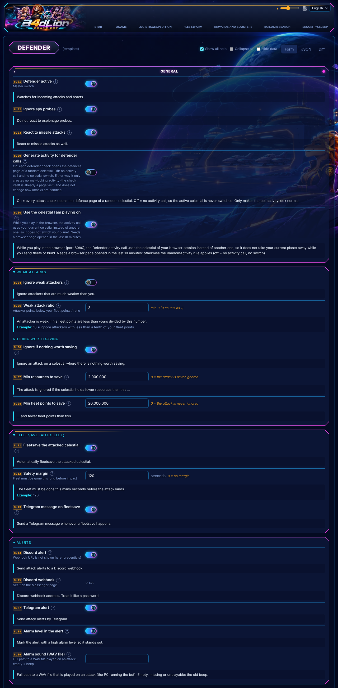

Pages: [Overview](README.md) · [Start](seite-start.md) · [Ogame](seite-ogame.md) · [Logistic & Expedition](seite-logistik.md) · [Fleet & Farm](seite-farm.md) · [Rewards and boosters](seite-belohnungen.md) · [Build & Research](seite-bauforschung.md) · **Security & Sleep** · [Logging](seite-logging.md) · [Bar and controls](seite-bedienung.md)

Fields: [General](felder-allgemein.md) · [Logistic & Expedition](felder-logistik.md) · [Fleet & Farm](felder-farm.md) · [Rewards and boosters](felder-belohnungen.md) · [Build & Research (Brain)](felder-bauforschung.md) · [Security & Sleep](felder-sicherheit.md)

---

# Security & Sleep

_Menu item: Security&Sleep_

Here you set when the bot sleeps and what it does meanwhile, how it reacts to attacks and espionage and how fleets and debris fields are protected. The page has three tabs (Sleep, Security, General). Each tab shows collapsible, numbered boxes with three columns: number, field, description.

_Interface with template values, no real data._

## Sleep

Contains three boxes: SleepMode (a fixed daily sleep window in which no fleets are sent; open at start), GhostSleep (a sleep variant with ghost-flight fleetsave in which expeditions and the Defender keep running) and DiscoverNight (during sleep the bot briefly sends new discovery missions in rounds, needs SleepMode active). Times are server time.

1. In the SleepMode box switch Active on and enter Go to sleep and Wake up as times (e.g. 23:00 and 07:00).
2. Optionally set the random shift in minutes (0 = exact); an offset is chosen per night, a new night begins at 15:00.
3. For the sleep fleetsave set whether the fleets are saved (moons only, deuterium remainder, recall, mission, target); you maintain excluded celestial bodies in the Exclusions tab under Sleep fleetsave.
4. Click Save all at the top; Discard undoes the changes, Collapse all closes the boxes.

Fields: [Security & Sleep](felder-sicherheit.md)

## Security

Contains the boxes RaidProtection (raid warning, counter-espionage, watch list, scans of your own systems), Defender (detects incoming attacks and reacts; open at start), DefenderRecheck, DebrisSave and FleetsaveSlot. With the Defender you can, among other things, ignore probes, ignore weak attackers, save the fleet automatically (safety margin before impact), set notifications by Telegram or Discord, a whitelist of player IDs, counter-espionage and alarm. DefenderRecheck fetches the attack list again shortly before the fleetsave. FleetsaveSlot keeps the last free fleet slot free for the fleetsave.

1. Open a box, change switches and values.
2. Click Save all at the top.

Fields: [Security & Sleep](felder-sicherheit.md)

## General

General settings of the bot in the boxes General (open at start), Logs and BotPause. Logs contains the log switches (ReduceLogs, CollectLogs, ExtraDebugLog). BotPause controls the delay via the Pause button of the browser tiles. This tab also has the button Reload config: it re-reads the instance's active config without restarting the bot.

1. Change values and save at the top.
2. Click Reload config if you changed the config file by hand. Unsaved changes on the page are not included; the bot takes the reload order within a few seconds (see the log).

Fields: [General](felder-allgemein.md)

## Notes

- If the config cannot be read, the bot keeps the running values on reload and writes an error to the log.
- The sleep fleetsave reports by Telegram if SleepMode.TelegramMessenger is active; a fleetsave by the Defender or by Telegram command reports independently, as before.
- The Defender whitelist entry 0 is only the placeholder of the template (0 means: attacker unknown); enter real player IDs.
- BotPause refuses a delay while you are asleep, an attack is approaching or a recall is due (according to the reference).
- The boxes of the Experimental block (e.g. galaxy cache and diagnostic log) are also on this page; the block has no form of its own.

